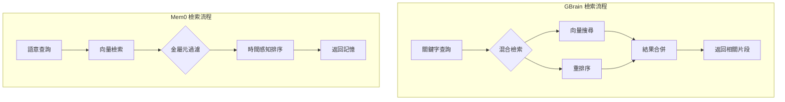

# GBrain vs Mem0：AI 記憶系統深度比較

> **本報告日期：** 2026-11-19  
> **作者：** AI 技術分析

---

## 📊 快速比較總覽

| 特性 | **GBrain** | **Mem0** |
|------|------------|----------|
| **核心定位** | 個人/團隊知識庫 (RAG) | 動態 AI 記憶層 (Memory Layer) |
| **主要用途** | 語義搜索、文件問答、知識庫檢索 | 用戶偏好追蹤、對話上下文記憶、動態實體更新 |
| **記憶層級** | 全局知識 (Global Knowledge) | 分層記憶：用戶 (User)、會話 (Session)、Agent 級別 |
| **動態更新** | 較弱，需手動重新嵌入 | 極強，自動覆蓋/更新舊記憶 |
| **記憶遺忘** | 無，所有文件權重平等 | 支援，自動降低/遺忘過時資訊 |
| **資料來源** | 人類可读 Markdown 文件 | 對話轉錄自動提取 |
| **檢索策略** | 混合檢索 (關鍵字 + 語意 + 重排序) | 單策略語意檢索 + 金屬元過濾 |
| **自托管** | 完善 (Postgres/PGLite) | 存在但較不成熟 |
| **雲端服務** | 無 | 完善 (Managed API) |
| **SDK 支援** | 主要 CLI + MCP | 多語言 SDK (Python, Node, Go) |
| **開放原始碼** | MIT | 開放原始碼 + 商業平台 |

---

## 🔍 核心差異分析

### 1. 設計理念

```
GBrain
├─ 本質：檢索增強生成 (RAG) 系統
├─ 理念：構建「第二大腦」，儲存大量預設知識
├─ 運作：單向讀取為主，餵給資料，基於資料回答
└─ 使用者：人類擁有的 Markdown 文件

Mem0
├─ 本質：AI 智能記憶層 (Memory Layer)
├─ 理念：讓 AI 擁有人類的「長期與短期記憶」
├─ 運作：雙向互動，自動從對話提取事實
└─ 使用者：AI 代理與使用者對話
```

### 2. 記憶管理機制

| 機制 | GBrain | Mem0 |
|------|--------|------|
| **新增記憶** | 手動匯入文件 | 對話自動提取 |
| **更新記憶** | 覆蓋舊文件 | 自動覆蓋/修正 |
| **刪除記憶** | 手動刪除文件 | 自動遺忘/降低權重 |
| **記憶衰退** | 無 | 支援 (Temporal Reasoning) |
| **衝突處理** | 人工仲裁 | 自動合併/修正 |

### 3. 檢索能力



### 4. 使用場景對比

#### GBrain 適合：
- ✅ 需要長期保存的知識庫
- ✅ 團隊共享的決策記錄
- ✅ 文件問答式查詢
- ✅ 知識圖譜關聯查詢
- ✅ 多 AI 代理共享同一知識庫
- ✅ 需要人類審核和編輯的內容

#### Mem0 適合：
- ✅ 追蹤用戶偏好 (如「我喜歡深色模式」)
- ✅ 記住對話中的事實 (如「我對蘋果過敏」)
- ✅ 跨會話的上下文記憶
- ✅ 需要動態更新的用戶設定
- ✅ 多語言、跨平台的 AI 應用
- ✅ 自動從對話中提取記憶

---

## 🛠️ 技術架構比較

### GBrain 架構

```
┌─────────────────────────────────────────────┐
│           GBrain 知識庫系統                  │
├─────────────────────────────────────────────┤
│  資料層                                    │
│  ├── Markdown 文件 (人類可讀)                │
│  ├── Postgres / PGLite                     │
│  └── 向量嵌入 (Voyage/OpenAI)              │
├─────────────────────────────────────────────┤
│  檢索層                                    │
│  ├── 關鍵字搜尋 (Fast, Cheap)               │
│  ├── 語意查詢 (Vector Search)              │
│  └── 重排序 (Rerank)                       │
├─────────────────────────────────────────────┤
│  知識圖譜層                                │
│  ├── 自動實體擷取                          │
│  ├── 關係鏈接 (works_at, invested_in)       │
│  └── 時間軸 (Timeline)                     │
├─────────────────────────────────────────────┤
│  MCP 工具層                                │
│  ├── gbrain search                         │
│  ├── gbrain query                          │
│  └── gbrain remember/recall                │
└─────────────────────────────────────────────┘
```

### Mem0 架構

```
┌─────────────────────────────────────────────┐
│            Mem0 記憶層                       │
├─────────────────────────────────────────────┤
│  記憶儲存層                                │
│  ├── User Memories (用戶偏好)               │
│  ├── Session Memories (會話上下文)          │
│  ├── Agent Memories (代理記憶)              │
│  └── Entity Relationships (實體關係)        │
├─────────────────────────────────────────────┤
│  提取層 (LLM Extraction)                  │
│  ├── 單次 ADD-only 提取                      │
│  ├── 無 UPDATE/DELETE                       │
│  └── 自動事實確認                           │
├─────────────────────────────────────────────┤
│  檢索層                                    │
│  ├── 語意檢索 (Semantic Search)             │
│  └── 時間感知排序 (Temporal Reasoning)      │
├─────────────────────────────────────────────┤
│  API/SDK 層                                │
│  ├── add() - 新增記憶                       │
│  ├── search() - 檢索記憶                    │
│  └── 多語言 SDK 支援                        │
└─────────────────────────────────────────────┘
```

---

## 📈 性能與成本比較

| 指標 | GBrain | Mem0 |
|------|--------|------|
| **關鍵字搜尋** | 極快 (Postgres 原生) | 中等 (向量搜尋) |
| **語意查詢** | 需要 API Key | 需要 API Key |
| **儲存成本** | 低 (Markdown + Postgres) | 中等 (向量資料庫) |
| **檢索成本** | 可配置 (Haiku/Sonnet/Opus) | 內建 LLM 提取成本 |
| **擴充性** | 高 (支援大規模知識庫) | 中高 (適合用戶層級) |
| **部署複雜度** | 中 (需配置資料庫) | 低 (Managed API 一鍵部署) |

### 成本估算 (每月 10K 查詢)

| 模式 | GBrain (Haiku) | Mem0 (標準) |
|------|----------------|-------------|
| **輸入成本** | $4/mo | $10-20/mo |
| **LLM 提取** | 無 (手動匯入) | 內建自動提取 |
| **向量嵌入** | 可選 (Voyage Key) | 內建服務 |

---

## 🎯 使用範例

### GBrain 範例

```bash
# 匯入公司決策記錄
gbrain import ~/company-decisions/2026/tech-stack.md

# 記住團隊決策
gbrain remember "我們決定採用 Vue 3" --entity "tech-decisions"

# 語意查詢
gbrain query "前端框架選型" --json

# 關鍵字搜尋
gbrain search "Vue 3 框架"
```

### Mem0 範例

```python
from mem0 import Memory

memory = Memory(provider="mem0")

# 新增用戶偏好
memory.add(
    data="用戶喜歡深色模式",
    metadata={"user_id": "user123", "type": "preference"}
)

# 新增對話中的事實
memory.add(
    data="用戶對蘋果過敏",
    metadata={"user_id": "user123", "type": "allergy"}
)

# 檢索相關記憶
memories = memory.search(
    query="用戶的偏好設定",
    user_id="user123"
)
```

---

## ⚖️ 優缺點總結

### GBrain 優勢
- ✅ **人類可讀**：Markdown 文件，人類隨時可編輯
- ✅ **知識圖譜**：自動建立實體關係鏈接
- ✅ **多代理支援**：通過 MCP 連接多個 AI
- ✅ **混合檢索**：關鍵字 + 語意 + 重排序
- ✅ **自托管完善**：Postgres/PGLite 完整支援
- ✅ **時間軸追蹤**：自動記錄決策演變過程

### GBrain 劣勢
- ❌ **動態更新弱**：需手動重新嵌入
- ❌ **記憶遺忘無**：所有記憶權重平等
- ❌ **對話提取無**：需手動匯入文件
- ❌ **多語言 SDK 少**：主要 CLI + MCP

### Mem0 優勢
- ✅ **自動提取**：從對話自動提取事實
- ✅ **動態更新**：自動覆蓋/修正記憶
- ✅ **記憶遺忘**：時間感知，自動降低權重
- ✅ **多語言支援**：Python, Node, Go SDK
- ✅ **雲端服務完善**：Managed API 一鍵部署

### Mem0 劣勢
- ❌ **人類可讀性差**：內部格式，不易人類編輯
- ❌ **知識圖譜弱**：主要用戶/會話層級
- ❌ **自托管不熟練**：自托管版本較不穩定
- ❌ **雲端依賴**：最佳體驗在 Managed 版本

---

## 🔄 整合可能性

根據搜尋結果，**GBrain 和 Mem0 可以整合使用**：

```
┌─────────────────────────────────────────────────────┐
│              Unified Agent Memory Stack             │
├─────────────────────────────────────────────────────┤
│                                                     │
│  ┌──────────────┐    ┌──────────────┐              │
│  │   GBrain     │    │     Mem0     │              │
│  │ (知識庫層)   │    │ (記憶層)    │              │
│  │ • 團隊知識   │    │ • 用戶偏好   │              │
│  │ • 決策記錄   │    │ • 對話上下文 │              │
│  │ • 知識圖譜   │    │ • 動態記憶   │              │
│  └──────┬───────┘    └──────┬───────┘              │
│         │                   │                      │
│         └────────┬──────────┘                      │
│                  ▼                                  │
│         ┌──────────────┐                           │
│         │   AI Agent   │                           │
│         │   (Claude    │                           │
│         │    Code)     │                           │
│         └──────────────┘                           │
│                                                     │
│  使用案例：                                          │
│  • GBrain: "公司技術選型決策"                       │
│  • Mem0: "用戶偏好設定"                            │
│  • 整合: "用戶偏好對技術選型的影響"                 │
└─────────────────────────────────────────────────────┘
```

### 整合建議

```bash
# GBrain 作為主知識庫
gbrain init --pglite

# Mem0 作為動態記憶層
pip install mem0ai
```

參考文獻：https://lab.supersaiyan.dev/unified-agent-memory-gbrain-mem0

---

## 📋 選擇建議

| 您的需求 | 推薦選擇 |
|----------|----------|
| 團隊共享知識庫 | **GBrain** |
| 個人 AI 助手記憶 | **Mem0** |
| 多語言應用 | **Mem0** |
| 需要人類編輯內容 | **GBrain** |
| 自動從對話提取記憶 | **Mem0** |
| 知識圖譜關聯查詢 | **GBrain** |
| 一鍵雲端部署 | **Mem0** |
| 完全自托管控制 | **GBrain** |
| 多 AI 代理共享 | **GBrain** |

---

## 📚 參考資源

- [GBrain 官方文件](https://github.com/garrytan/gbrain)
- [Mem0 官方文件](https://docs.mem0.ai)
- [GBrain vs Mem0 比較](https://university.tenten.co/t/compare-garry-tans-gbrain-with-mem0/2255)
- [GBrain vs Hindsight vs Mem0 vs Zep](https://vectorize.io/articles/gbrain-vs-hindsight-vs-mem0-vs-zep)
- [GBrain 和 Mem0 整合筆記](https://lab.supersaiyan.dev/unified-agent-memory-gbrain-mem0)

---

*報告完成時間：2026-11-19*
