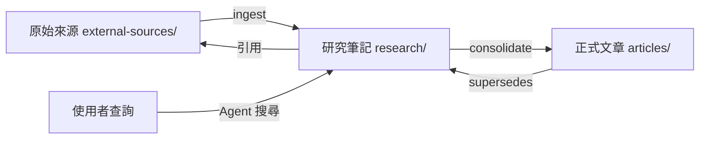
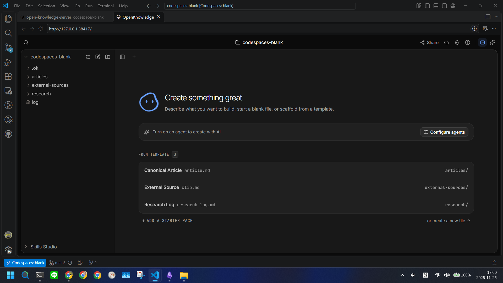
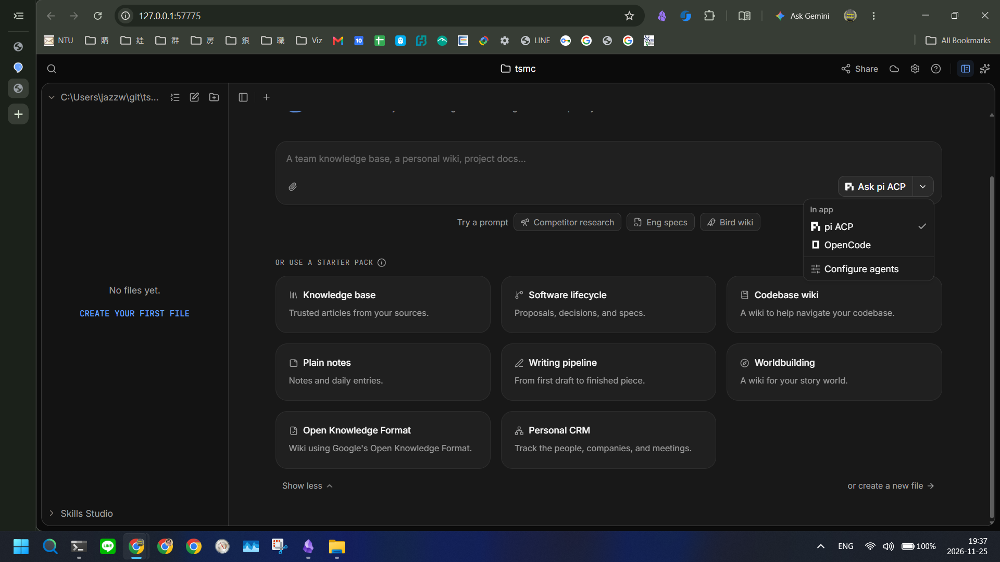

# OpenKnowledge

- Git Repo
  - https://github.com/inkeep/open-knowledge
- Document
  - https://openknowledge.ai/docs/get-started/quickstart

```
Date:       11/25/2026, 11:14:42 AM
Models:     llama.cpp/unsloth/Qwen3.5-9B
Messages:   3 user, 20 assistant, 18 tool results
Tool Calls: 19
Tokens:     ↑55k ↓16k R342k
Cost:       0.000
```
```
Date:       11/25/2026, 12:03:19 PM
Models:     llama.cpp/unsloth/Qwen3.5-9B
Messages:   1 user, 14 assistant, 14 tool results
Tool Calls: 14
Tokens:     ↑20k ↓7.3k R280k
Cost:       0.000
```

> [!NOTE]
> run bash("date -I"). 根據 "https://openknowledge.ai/docs/get-started/quickstart#ok-install-web-app" 內容，用繁體中文（台灣技術用詞）撰寫一篇技術報告，含 step-by-step 安裝、測試、驗證步驟，存成 "js/open-knowledge/open-knowledge-report.md" .

> [!NOTE]
> 請參考 https://openknowledge.ai/docs/workflows/karpathy-llm-wiki 並更新 step-by-step 測試、驗證步驟，附加到 "js/open-knowledge/open-knowledge-report.md" .

> [!NOTE]
> 請參考 https://openknowledge.ai/docs/integrations/pi 並更新 step-by-step 測試、驗證步驟，附加到 "js/open-knowledge/open-knowledge-report.md" .

## OpenKnowledge 技術安裝報告

> **報告日期**：2026-11-25  
> **來源**：[OpenKnowledge 官方快速入門](https://openknowledge.ai/docs/get-started/quickstart)、[Karpathy LLM Wiki 工作流程](https://openknowledge.ai/docs/workflows/karpathy-llm-wiki)、[Pi 整合](https://openknowledge.ai/docs/integrations/pi)  
> **版本**：v2.1

### 目錄

1. [簡介](#簡介)
2. [系統需求](#系統需求)
3. [安裝步驟](#安裝步驟)
   - [桌面應用程式 (Desktop App)](#桌面應用程式-desktop-app)
   - [Web 應用程式 (Web App)](#web-應用程式-web-app)
4. [測試步驟](#測試步驟)
   - [基本功能測試](#基本功能測試)
   - [Karpathy LLM Wiki 工作流程測試](#karpathy-llm-wiki-工作流程測試)
5. [驗證步驟](#驗證步驟)
   - [基礎驗證](#基礎驗證)
   - [工作流程驗證](#工作流程驗證)
6. [故障排除](#故障排除)
7. [參考連結](#參考連結)

### 簡介

OpenKnowledge 是一套知識庫管理工具，讓使用者能在五分鐘內建立知識庫，並與 AI 工具整合，協助知識整理與文件管理。本報告涵蓋桌面應用程式與 Web 應用程式兩種安裝方式，並提供完整測試與驗證流程。

#### Karpathy LLM Wiki 模式

OpenKnowledge 實現了 Andrej Karpathy 的 LLM Wiki 模式，具備以下特色：

- **三層結構**：`external-sources/`（原始來源）、`research/`（研究筆記）、`articles/`（正式文章）
- **來源驅動**：AI Agent 讀取、整理並連結文件，而非使用者手動組織
- **時間軸追蹤**：使用 Git 進行版本管理與資料復原
- **CRDT 編輯**：每個文件為 live CRDT (Yjs)，使用者與 Agent 可同時編輯
- **分層管理**：`research/`（provisional）與 `articles/`（canonical）分離，`consolidate` 為明確的促進步驟

#### 工作流程



工作流程：
1. **Ingest**：新的來源進入 `external-sources/`（immutable，僅讀取）
2. **Research**：Agent 合成多個來源，生成 `research/` 文件（status: draft）
3. **Consolidate**：決策後將 `research/` 促進為 `articles/`（status: stable）
4. **Query**：使用者查詢時，Agent 搜尋相關文件並引用來源

> **注意**：每層資料夾都有 `.ok/frontmatter.yml` 與 `.ok/templates/`，Agent 可自動學習各層的管理規範。

### 系統需求

#### 桌面應用程式

| 平台 | 系統需求 | 下載連結 |
|------|----------|----------|
| macOS | macOS 13 (Ventura) 或更新，Apple Silicon | [下載](https://github.com/inkeep/open-knowledge/releases/latest/download/OpenKnowledge-arm64.dmg) |
| Windows (x64) | Windows 10 或更新，x64 | [下載](https://github.com/inkeep/open-knowledge/releases/latest/download/OpenKnowledge-Setup-x64.exe) |
| Windows (Arm64) | Windows 11 或更新，Arm64 | [下載](https://github.com/inkeep/open-knowledge/releases/latest/download/OpenKnowledge-Setup-arm64.exe) |
| Linux (x64) | Linux，x64 | [下載](https://github.com/inkeep/open-knowledge/releases/latest/download/OpenKnowledge-amd64.deb) |
| Linux (Arm64) | Linux，Arm64 | [下載](https://github.com/inkeep/open-knowledge/releases/latest/download/OpenKnowledge-arm64.deb) |
| Linux (RPM x64) | Linux，RPM 格式，x64 | [下載](https://github.com/inkeep/open-knowledge/releases/latest/download/OpenKnowledge-x86_64.rpm) |
| Linux (RPM Arm64) | Linux，RPM 格式，Arm64 | [下載](https://github.com/inkeep/open-knowledge/releases/latest/download/OpenKnowledge-aarch64.rpm) |

#### Web 應用程式

| 元件 | 版本需求 | 驗證命令 |
|------|----------|----------|
| Node.js | 24 或更高版本 | `node --version` |
| Git | 已安裝 | `git --version` |

> **注意**：OpenKnowledge 使用 Git 進行時間軸與資料復原，若未安裝 Git，請先安裝。

### 安裝步驟

#### 桌面應用程式 (Desktop App)

##### 步驟 1：下載並安裝

依作業系統選擇對應安裝程式：

```bash
## macOS (Apple Silicon)
## 下載 DMG 檔案並安裝
OpenKnowledge-arm64.dmg

## Windows (x64)
## 執行安裝程式
OpenKnowledge-Setup-x64.exe

## Linux (.deb 格式)
sudo dpkg -i OpenKnowledge-amd64.deb

## Linux (RPM 格式，Fedora/CentOS)
sudo rpm -ivh OpenKnowledge-x86_64.rpm
```

##### 步驟 2：啟動應用程式

```bash
## 桌面環境直接開啟
openknowledge

## Linux Beta 版本
openknowledge-beta

## 終端機模式
ok

## Linux Beta 終端機模式
ok-beta
```

> **提示**：在 Linux 終端機執行無參數命令時，會自動開啟應用程式；透過 SSH 或無顯示環境時，會執行 `ok start` 於當前目錄。

##### 步驟 3：建立新專案

1. 首次啟動時，設定對話框提供連接 AI 工具與加入 `ok` 命令到終端機選項
2. 勾選需要的選項後，點擊 **Finish setup**
3. 選擇 **Create new project**，輸入專案名稱（例如：`Team Wiki`）
4. 可選點擊 **Browse** 變更專案儲存位置
5. 點擊 **Create** 完成建立

##### 步驟 4：初始化知識庫

1. 從落地頁選擇 **Knowledge base**
2. 保持 **Project root** 被選取
3. 點擊 **Initialize**

> **資訊**：可參閱 [OpenKnowledge 寫入系統的檔案](https://openknowledge.ai/docs/reference/what-open-knowledge-writes) 了解應用程式寫入的檔案與 `PATH` 變數變更。

#### Web 應用程式 (Web App)

Web 應用程式提供相同的編輯器，可在瀏覽器中本地存取，適用於桌面應用程式未涵蓋的平台（如 Intel Mac、伺服器）或偏好終端機的使用者。

##### 步驟 1：驗證環境

終端機執行以下命令確認 Node.js 與 Git 已安裝：

```bash
node --version
git --version
```

##### 步驟 2：安裝 CLI 並啟動編輯器

```bash
## 全局安裝 CLI
npm install -g @inkeep/open-knowledge

## 建立或進入專案目錄
mkdir my-knowledge-base && cd my-knowledge-base

## 初始化知識庫
ok init

## 啟動編輯器並於瀏覽器開啟
ok start
```

> **資訊**：`ok init` 會建立 `.ok/` 目錄，並設定以下 AI 編輯器：
> - Claude Code、Claude Desktop
> - Cursor、Codex
> - OpenCode、OpenClaw
> - Pi
> - Antigravity
> - LM Studio
> - Hermes

##### 步驟 3：開啟知識庫於 AI Agent

最快速的方式是在編輯器內使用：

1. 空狀態下的 **Ask** 按鈕，或開啟文件後底部的 **Ask AI** 欄位
2. 若有內建 AI Agent，提示將直接傳遞給內建 Agent，無需離開 OpenKnowledge

使用外部編輯器（如 Cursor、Codex、Claude Desktop）：

- `ok init` 已註冊 OpenKnowledge 與可用的 AI 編輯器
- Agent 可立即使用 OpenKnowledge 工具
- 開啟專案或右側邊欄右鍵點擊專案，選擇 **Open with AI ▸** 並選取編輯器

### 測試步驟

#### 基本功能測試

##### 步驟 1：驗證 Agent 功能

1. 確保無文件開啟
2. 看到輸入框與 **Ask** 按鈕（後方顯示 Agent 名稱）
3. 在輸入框輸入測試問題，例如：

   ```text
   什麼是大型語言模型 (Large Language Models)？
   ```

4. 點擊 **Ask** 按鈕
5. 確認 Agent 開始處理並回應

> **提示**：Agent 可能需要數秒載入專案

##### 步驟 2：測試 AI 編輯器整合

若使用外部 AI 編輯器（如 Cursor、Codex）：

1. 確認右側邊欄顯示 Agent 圖示
2. 點擊圖示查看 Agent 在知識庫中的活動
3. 若圖示為灰色，表示 Agent 尚未開始寫入，等待數秒後重新檢查

##### 步驟 3：測試文件操作

1. 右側邊欄顯示知識庫中的所有文件
2. 每個文件包含：
   - WYSIWYG 編輯模式與 Source Mode 切換
   - Frontmatter 面板（屬性設定）

3. 查看文件時，右側邊欄顯示：
   - 文件結構大綱
   - 入站與出站連結列表
   - 知識庫連結圖表視圖
   - 時間軸（Timeline），含每組變更差異與選擇性復原

4. 右側邊欄（空白空間、資料夾或檔案）右鍵功能：
   - 建立
   - 揭露/隱藏
   - 重新命名
   - 刪除（移至系統回收站）
   - **Open with AI**

#### Karpathy LLM Wiki 工作流程測試

##### 前置條件

1. 已安裝 OpenKnowledge 桌面應用程式
2. 已完成快速入門（Quickstart）並建立專案
3. 已初始化 Knowledge base starter pack

##### 步驟 1：檢查專案結構

驗證 Knowledge base starter pack 建立的結構：

```bash
## 進入專案目錄
cd my-knowledge-base

## 檢查目錄結構
ls -la

## 預期結構：
your-project/
├── external-sources/       # 原始來源（immutable）
├── research/                # 研究筆記（provisional, status: draft）
├── articles/                # 正式文章（canonical, status: stable）
├── log.md                   # 審計日誌（append-only）
├── .ok/                     # OpenKnowledge 配置目錄
│   ├── frontmatter.yml      # 專案層面配置
│   └── templates/           # 模板目錄
│       ├── clip.md          # 來源文件模板
│       ├── research-note.md # 研究筆記模板
│       └── article.md       # 正式文章模板
```

##### 步驟 2：驗證資料夾描述

每個資料夾應有 `.ok/frontmatter.yml`，提供 Agent 可讀的描述：

```bash
## 查看 external-sources 資料夾配置
cat external-sources/.ok/frontmatter.yml

## 預期內容應包含：
## - Raw sources saved verbatim
## - Immutable after capture
## - No analysis here
```

##### 步驟 3：測試 Ingest 功能

**目標**：測試來源文件進入 `external-sources/` 的流程

1. **準備測試來源**：準備一個 URL（例如 GitHub README）
2. **透過 Agent 執行 Ingest**：

   ```text
   ingest this: [https://github.com/example/framework]
   ```

3. **驗證結果**：
   - Agent 應抓取 URL 內容
   - 寫入 `external-sources/framework-readme.md`
   - Frontmatter 應包含：
     - `type: source`
     - `original_url: https://github.com/example/framework`
     - `fetch_date: YYYY-MM-DD`
     - `author`（若可提取）

4. **確認文件不可修改**：
   - 嘗試要求 Agent 修改來源文件，應拒絕
   - 或 Agent 說明來源文件為 immutable

##### 步驟 4：測試 Research 功能

**目標**：測試 Agent 合成多個來源生成研究筆記

1. **準備多個來源**：至少 3-5 個相關 URL
2. **執行 Ingest**：將所有來源 ingest 到 `external-sources/`
3. **執行 Research**：

   ```text
   research the agent-framework question; synthesize the five sources in external-sources/
   ```

4. **驗證 Research 流程**：
   - Agent 確認範圍（scoping）
   - 列出已覆蓋的來源
   - 識別缺口（gaps）
   - 生成 `research/agent-framework-evaluation.md`

5. **檢查 Frontmatter**：

   ```bash
   cat research/agent-framework-evaluation.md
   # 或查看 frontmatter
   ```

   應包含：
   - `type: research-note`
   - `status: draft`
   - `sources:` 陣列，指向 `external-sources/` 文件

   ```yaml
   sources:
     - resource: ../external-sources/framework-readme.md
     - resource: ../external-sources/framework-architecture-overview.md
   ```

6. **驗證引用鏈**：
   - 每項 claim 應引用具體來源路徑
   - 可透過查詢驗證引用正確性

##### 步驟 5：測試查詢功能

**目標**：測試 Agent 從研究筆記讀取並回應查詢

1. **執行查詢**：

   ```text
   what does the framework do when two sub-agents race on the same write?
   ```

2. **驗證回應**：
   - Agent 應從 `research/agent-framework-evaluation.md` 讀取
   - 回答應引用 `external-sources/` 中的具體段落
   - 包含 Twitter/其他來源的上下文（若有）

3. **驗證引用可追蹤**：
   - Agent 回應應提供證據來源
   - 可追溯至原始文件

##### 步驟 6：測試 Log.md 審計

**目標**：驗證所有操作記錄於 `log.md`

```bash
## 查看審計日誌
cat log.md
```

應包含：
- 每次 `ingest` 的記錄
- 每次 `research` 的記錄
- 時間戳
- 操作類型

##### 步驟 7：測試 Consolidate 功能

**目標**：測試將 `research/` 促進為 `articles/`

1. **確認決策**：模擬團隊已決定採納該框架
2. **執行 Consolidate**：

   ```text
   consolidate the agent-framework research into a canonical article
   ```

3. **驗證流程**：
   - Agent 應先詢問是否真的已決策（STOP gate）
   - 若確認，生成 `articles/agent-framework-evaluation.md`
   - Frontmatter 應包含：
     - `type: article`
     - `status: stable`
     - `supersedes: research/agent-framework-evaluation.md`

4. **檢查原始文件狀態**：
   - `research/agent-framework-evaluation.md` 應改為 `status: deprecated`
   - 應有 `superseded_by: articles/agent-framework-evaluation.md`

##### 步驟 8：測試週期性維護

**目標**：測試 Agent 執行週期性檢查

1. **測試 Orphan Detection**：

   ```text
   find stale claims in articles/, orphans, missing cross-refs
   ```

2. **測試 Link Validation**：
   - 檢查是否有死連結
   - 檢查回指（backlinks）
   - 識別孤單文件

##### 步驟 9：測試模板功能

**目標**：驗證模板自動生成正確 Frontmatter

1. **使用模板建立文件**：

   - 右側邊欄：右鍵 > **New from template**
   - 選擇 `clip.md`、`research-note.md` 或 `article.md`

2. **驗證 Frontmatter**：
   - 應自動套用模板的 Frontmatter 結構
   - 不需手動撰寫

##### 步驟 10：測試 CRDT 編輯

**目標**：驗證使用者與 Agent 可同時編輯同一文件

1. **開啟文件**：任意開啟 `research/` 中的文件
2. **使用者修改**：在編輯器中進行修改
3. **Agent 同時修改**：要求 Agent 編輯同一文件
4. **驗證收斖**：
   - 系統應自動解決衝突
   - 兩方修改應共存
   - 無資料遺失

##### 步驟 11：測試 Agent Activity Panel

**目標**：驗證 Agent 活動面板追蹤所有操作

1. **執行多次操作**：
   - Ingest 多個來源
   - 多次 Research
   - 修改文件

2. **查看 Agent Activity**：
   - 右側 Agent 圖示
   - 點擊查看活動
   - 應顯示：
     - 每次 fetch
     - 每次 write
     - 檔案屬性
     - 時間軸

##### 步驟 12：測試 Wikilink 圖表

**目標**：驗證連結圖表功能

1. **開啟連結圖表**：
   - 查看文件時，右側邊欄的連結圖表視圖

2. **驗證顯示**：
   - 入站連結（incoming links）
   - 出站連結（outgoing links）
   - 知識庫中的連結關係

### Pi 整合測試與驗證步驟

Pi 是 OpenSource 的終端機編碼整合環境（terminal coding harness），透過 bridge extension 與 OpenKnowledge 整合，而非使用 MCP。

#### 前置條件

1. **Pi CLI 安裝**：
   ```bash
   pip install pi-coding-agent
   ```

2. **OpenKnowledge CLI 安裝**：
   ```bash
   npm install -g @inkeep/open-knowledge
   ```

3. **Node.js 版本**：需要 Node.js 24+（Pi 可能透過 `npx` 安裝 OpenKnowledge CLI）

#### 步驟 1：初始化 Pi 專案

在專案目錄中執行：

```bash
cd my-knowledge-base
ok init
```

或在 OpenKnowledge 桌面 App 中開啟專案（自動執行相同操作）。

**產生的檔案結構**：

```
my-knowledge-base/.pi/
├── extensions/open-knowledge.ts       # Bridge extension
└── skills/open-knowledge/             # OpenKnowledge skills
    └── SKILL.md                       # 技能定義檔案
```

**Beta 版本**：`ok init --beta` 會產生 `.pi/extensions/open-knowledge-beta.ts`

**Bridge Extension 功能**：
- 啟動時透過 resilient launcher 啟動 OpenKnowledge MCP server
- 將每個 OpenKnowledge tool 註冊為原生 Pi tool，使用 `ok_` 前綴（如 `ok_exec`、`ok_search`、`ok_write`）
- Beta 版本使用 `ok-beta_*` 前綴
- 避免與 Pi 內建檔案工具（`edit` / `write`）衝突

#### 步驟 2：信任專案資料夾

Pi **不載入** 專案本地的 extensions 或 skills，直到專案被信任。

1. **首次執行 Pi**：
   ```bash
   cd my-knowledge-base
   pi
   ```

2. **接受信任提示**：
   - Pi 會詢問是否信任此專案資料夾
   - 點擊 **Trust** 或輸入 `trust`

3. **或使用 OpenKnowledge 桌面 App**：
   - 開啟專案時自動處理信任
   - 接受 bridge setup 提示也會授予 folder trust

**信任檔案位置**：環境變數 `PI_CODING_AGENT_DIR`

> **參考**：[Pi folder trust](https://openknowledge.ai/docs/reference/what-open-knowledge-writes#pi-folder-trust)、[Pi project trust docs](https://pi.dev/docs/latest/security#project-trust)

#### 步驟 3：驗證 Bridge Extension 安裝

檢查 `.pi/` 目錄結構：

```bash
ls -la .pi/
## 預期結果：
## .pi/
## ├── extensions/
## │   └── open-knowledge.ts      # 或 open-knowledge-beta.ts（Beta）
## └── skills/
##     └── open-knowledge/
##         └── SKILL.md
```

檢查 extension 內容：

```bash
head -20 .pi/extensions/open-knowledge.ts
## 應包含：
## - OpenKnowledge MCP server 啟動邏輯
## - Tool registration
## - ok_ 前綴的 tool 名稱
```

#### 步驟 4：驗證工具註冊

執行以下命令測試 Pi 工具：

```bash
pi

## 在 Pi 提示符輸入測試命令
> List the first 5 documents you come across in this project.
```

**預期結果**：
- Pi 呼叫 `ok_exec` tool（Beta 版本為 `ok-beta_exec`）
- 回應專案中的文件列表

**若失敗，檢查**：
- ✅ 專案是否已信任
- ✅ Node.js 版本（需要 24+）
- ✅ OpenKnowledge CLI 是否安裝
- ✅ 重新載入：`/reload` 或 restart `pi`

> **注意**：首次 tool call 可能耗時，因為 launcher 可能透過 `npx` 安裝 OpenKnowledge CLI

#### 步驟 5：測試 OpenKnowledge 工具

在 Pi 中測試各個工具：

| 工具 | 命令 | 說明 |
|------|------|------|
| `ok_exec` | `> exec("ls -la")` | 執行系統命令 |
| `ok_search` | `> search "framework"` | 搜尋文件內容 |
| `ok_write` | `> write({ document: "test.md", content: "Hello from Pi" })` | 寫入文件 |
| `ok_read` | `> read("test.md")` | 讀取文件 |
| `ok_edit` | `> edit({ document: "test.md", edits: [{ oldText: "Hello", newText: "World" }] })` | 編輯文件 |

#### 步驟 6：測試 Research 與 Consolidate 技能

OpenKnowledge skill 包含以下技能：

| 技能 | 功能 |
|------|------|
| `knowledge-base` | 基礎知識庫管理 |
| `research-with-sources` | 來源驅動的研究 |
| `consolidate-notes` | 筆記促進 |

測試流程：

```bash
## 呼叫技能
> use skill research-with-sources

## 執行研究
> research the agent-framework question

## 查看技能活動
> skill activity
```

#### 步驟 7：測試 Beta 版本（可選）

如需使用 OpenKnowledge Beta：

```bash
## 重新初始化
ok deinit
ok init --beta

## 檢查 Beta extension
ls .pi/extensions/open-knowledge-beta.ts

## 測試 Beta 工具
> List the first 5 documents you come across in this project.
## 應呼叫 ok-beta_exec
```

#### 步驟 8：故障排除

##### 問題：Open Knowledge tools unavailable

**可能原因**：
- 專案未信任
- Node.js 版本不足
- OpenKnowledge CLI 未安裝
- Bridge extension 未正確載入

**解決方案**：

```bash
## 1. 確認專案已信任
## 在 Pi 中接受信任提示

## 2. 確認 Node.js 版本
node --version
## 需要 24+

## 3. 確認 OpenKnowledge CLI 安裝
ok --version

## 4. 重新載入
pi
## 輸入：/reload

## 5. 重新初始化
ok deinit
ok init

## 6. 檢查 Bridge extension
ls .pi/extensions/
```

##### 問題：Beta 工具未載入

**解決方案**：
- 確認使用 `ok init --beta`
- 檢查 `open-knowledge-beta.ts`
- 重新啟動 Pi：`/reload`
- 確認工具前綴為 `ok-beta_*`

### 基礎驗證

#### 檢查項目清單

| 檢查項目 | 預期結果 | 驗證方式 | 狀態 |
|----------|----------|----------|------|
| Pi CLI 可用 | `pi` 命令執行無誤 | `pi --version` | |
| OpenKnowledge CLI 可用 | `ok` 命令執行無誤 | `ok --version` | |
| Node.js 24+ | 滿足版本需求 | `node --version` | |
| `.pi/` 目錄存在 | 專案根目錄有 `.pi/` | `ls -la .pi/` | |
| Bridge extension 存在 | `.pi/extensions/open-knowledge.ts` | `cat .pi/extensions/open-knowledge.ts` | |
| Skills 目錄存在 | `.pi/skills/open-knowledge/` | `ls .pi/skills/open-knowledge/` | |
| 專案信任 | Pi 已信任專案資料夾 | 檢查信任提示 | |
| OK 工具可用 | `ok_` 工具可呼叫 | 測試查詢 | |
| Research 技能可用 | 可呼叫 research-with-sources | 測試技能 | |

#### 驗證命令

```bash
## 確認 CLI 可用
pi --version
ok --version
node --version

## 確認環境變數
which pi
which ok
which openknowledge

## 檢查 Pi 配置
cat ~/.pi/config

## 檢查專案信任
## Pi 信任狀態可查看於 Pi 介面或信任提示

## 檢查 Pi 配置檔案
cat .pi/config.json

## 檢查 Bridge extension
cat .pi/extensions/open-knowledge.ts | head -50

## 檢查 Skills
cat .pi/skills/open-knowledge/SKILL.md | head -50

## 檢查審計日誌
cat log.md

## 測試 Pi 與 OK 整合
cd my-knowledge-base
pi
## 輸入：List the first 5 documents you come across in this project.
```

### 工作流程驗證

#### 驗證 Karpathy 模式正確性

| 驗證項目 | 預期結果 | 測試方法 |
|----------|----------|----------|
| Ingest 流程 | 來源文件進入 `external-sources/`，Frontmatter 正確 | 測試步驟 3 |
| Research 流程 | 合成文件進入 `research/`，status: draft | 測試步驟 4 |
| 引用鏈 | 每項 claim 引用具體來源 | 測試步驟 5 |
| Query 功能 | Agent 可從研究筆記讀取並引用來源 | 測試步驟 5 |
| Log.md 審計 | 所有操作記錄於 `log.md` | 測試步驟 6 |
| Consolidate 流程 | 決策後促進為 `articles/`，status: stable | 測試步驟 7 |
| 版本鏈 | `supersedes` 與 `superseded_by` 正確設置 | 檢查 Frontmatter |
| 模板功能 | 自動套用正確 Frontmatter | 測試步驟 9 |
| CRDT 編輯 | 使用者與 Agent 可同時編輯 | 測試步驟 10 |
| Agent Activity | 所有操作可追蹤 | 測試步驟 11 |

#### 完整工作流程測試

**目標**：驗證完整 Karpathy LLM Wiki 工作流程

1. **準備階段**（約 2 分鐘）
   - 建立新專案
   - 初始化 Knowledge base starter pack
   - 驗證資料夾結構

2. **Ingest 階段**（每來源約 30 秒）
   - Ingest 5 個相關來源
   - 驗證每個文件進入 `external-sources/`
   - 檢查 Frontmatter 正確性

3. **Research 階段**（約 1-2 分鐘）
   - 執行 Research 命令
   - 驗證生成 `research/` 文件
   - 檢查引用鏈正確性

4. **Query 階段**（約 1 分鐘）
   - 執行查詢
   - 驗證 Agent 可讀取並引用來源

5. **Consolidate 階段**（約 1 分鐘）
   - 確認決策已定
   - 執行 Consolidate
   - 驗證促進流程

6. **維護階段**（每週）
   - 執行 Research pass
   - 執行 Link validation
   - 檢查 Orphan detection

**預期完成時間**：完整流程約 10-15 分鐘

### 故障排除

#### 常見問題

##### 1. Agent 圖示為灰色

**問題**：Agent 圖示為灰色，無法執行

**解決方案**：
- 等待數秒，Agent 可能仍在載入
- 重新載入頁面
- 確認已設定 AI Agent

##### 2. MCP Server 需要批准

**問題**：Agent 詢問是否批准新的 MCP Server

**解決方案**：
- 批准 `open-knowledge`
- Cursor 使用者無需批准，見 [Cursor → 啟用專案服務器](https://openknowledge.ai/docs/integrations/cursor#enable-the-project-server)

##### 3. 避免批准所有工具呼叫

**問題**：每次使用都需要批准工具呼叫

**解決方案**：
- 設定 Agent 為 `auto-mode`、`full-access` 或同等設定

##### 4. Arch Linux 使用者

**問題**：AUR 套件由社群維護，未經 OpenKnowledge 團隊測試

**安裝方式**：
```bash
yay -S openknowledge-bin
```

##### 5. Ingest 失敗

**問題**：Ingest 命令無反應或失敗

**可能原因**：
- 網路問題
- URL 無效
- Agent 權限不足

**解決方案**：
- 確認 URL 可存取
- 檢查網路連線
- 確認 Agent 有讀取權限
- 嘗試手動複製內容並使用 `write` 而非 `ingest`

##### 6. Research 未生成文件

**問題**：Research 命令後未生成 `research/` 文件

**可能原因**：
- 來源不足（建議至少 3 個）
- Agent 尚未完成分析
- 權限問題

**解決方案**：
- 等待 Agent 完成分析
- 確認已 Ingest 足夠來源
- 檢查 Agent Activity 面板
- 重新執行 Research 命令

##### 7. Consolidate 流程卡住

**問題**：Consolidate 詢問決策後無進一步動作

**解決方案**：
- 確認已明確回答「是」或「Yes」
- 確認決策已確實作出
- 可手動執行：`consolidate` 並確認

##### 8. 模板未正確套用

**問題**：使用 `New from template` 後 Frontmatter 不完整

**解決方案**：
- 檢查模板是否正確安裝
- 手動套用 Frontmatter
- 重新初始化 Knowledge base pack

##### 9. CRDT 衝突未解決

**問題**：使用者與 Agent 同時編輯時出現衝突

**解決方案**：
- 等待系統自動收斖
- 重新載入頁面
- 檢查時間軸，找出衝突點
- 手動合併衝突

##### 10. Pi 工具不可用

**問題**：Pi 顯示 "Open Knowledge tools unavailable"

**可能原因**：
- 專案未信任
- Node.js 版本不足
- OpenKnowledge CLI 未安裝
- Bridge extension 未正確載入

**解決方案**：
```bash
## 1. 確認專案已信任
## 在 Pi 中接受信任提示

## 2. 確認 Node.js 版本
node --version
## 需要 24+

## 3. 確認 OpenKnowledge CLI 安裝
ok --version

## 4. 重新載入
pi
## 輸入：/reload

## 5. 重新初始化
ok deinit
ok init

## 6. 檢查 Bridge extension
ls .pi/extensions/
```

##### 11. Beta 版本工具未載入

**問題**：使用 Beta 後工具未正確載入

**解決方案**：
- 確認使用 `ok init --beta`
- 檢查 `open-knowledge-beta.ts`
- 重新啟動 Pi：`/reload`
- 確認工具前綴為 `ok-beta_*`

##### 12. Pi 信任問題

**問題**：Pi 不載入 `.pi/` 中的 extensions 或 skills

**解決方案**：
- 確認專案已信任
- 檢查 `PI_CODING_AGENT_DIR` 環境變數
- 重新執行信任流程
- 參考 [Pi folder trust 文件](https://openknowledge.ai/docs/reference/what-open-knowledge-writes#pi-folder-trust)

### 參考連結

#### 官方文件
- [快速入門](https://openknowledge.ai/docs/get-started/quickstart)
- [Karpathy LLM Wiki 工作流程](https://openknowledge.ai/docs/workflows/karpathy-llm-wiki)
- [編輯器功能](https://openknowledge.ai/docs/features/editor)
- [Git 同步](https://openknowledge.ai/docs/features/git/sync)
- [配置設定](https://openknowledge.ai/docs/reference/configuration)
- [技能工作室](https://openknowledge.ai/docs/features/skills)
- [Agent 活動面板](https://openknowledge.ai/docs/features/agent-activity)
- [Pi 整合](https://openknowledge.ai/docs/integrations/pi)

#### 整合
- [Claude Code](https://openknowledge.ai/docs/integrations/claude-code)
- [Cursor](https://openknowledge.ai/docs/integrations/cursor)
- [Codex](https://openknowledge.ai/docs/integrations/codex)
- [OpenCode](https://openknowledge.ai/docs/integrations/opencode)
- [OpenClaw](https://openknowledge.ai/docs/integrations/openclaw)
- [Pi](https://pi.dev)

#### 資源
- [所有版本與校驗和](https://openknowledge.ai/download)
- [STARTER_PACKS 註冊表](https://github.com/inkeep/open-knowledge/blob/main/packages/server/src/seed/starter.ts)
- [OpenKnowledge 寫入系統的檔案](https://openknowledge.ai/docs/reference/what-open-knowledge-writes)

#### Karpathy 原始模式
- [Andrej Karpathy 的 LLM Wiki Gist](https://gist.github.com/karpathy/442a6bf555914893e9891c11519de94f)
- [Source-grounded PKM](https://openknowledge.ai/docs/workflows/entity-vault)

#### Pi 相關
- [Pi 專案信任](https://openknowledge.ai/docs/reference/what-open-knowledge-writes#pi-folder-trust)
- [Pi 技能文件](https://pi.dev/docs/latest)

*報告完成於：2026-11-25*

*版本歷史：*
- **v2.1** (2026-11-25): 加入 Pi 整合詳細測試與驗證步驟，基於 [OpenKnowledge Pi 整合文檔](https://openknowledge.ai/docs/integrations/pi)
- **v2.0**: 加入 Karpathy LLM Wiki 工作流程測試與驗證步驟
- **v1.0**: 基礎安裝與測試報告

*參考文檔：[Pi 整合](https://openknowledge.ai/docs/integrations/pi)*

##### 檢查項目清單

| 檢查項目 | 預期結果 | 驗證方式 | 狀態 |
|----------|----------|----------|------|
| Pi CLI 可用 | `pi` 命令執行無誤 | `pi --version` | |
| OpenKnowledge CLI 可用 | `ok` 命令執行無誤 | `ok --version` | |
| Node.js 24+ | 滿足版本需求 | `node --version` | |
| `.pi/` 目錄存在 | 專案根目錄有 `.pi/` | `ls -la .pi/` | |
| Bridge extension 存在 | `.pi/extensions/open-knowledge.ts` | `cat .pi/extensions/open-knowledge.ts` | |
| Skills 目錄存在 | `.pi/skills/open-knowledge/` | `ls .pi/skills/open-knowledge/` | |
| 專案信任 | Pi 已信任專案資料夾 | 檢查信任提示 | |
| OK 工具可用 | `ok_` 工具可呼叫 | 測試查詢 | |
| Research 技能可用 | 可呼叫 research-with-sources | 測試技能 | |

##### 驗證命令

```bash
## 確認 CLI 可用
pi --version
ok --version
node --version

## 確認環境變數
which pi
which ok
which openknowledge

## 檢查 Pi 配置
cat ~/.pi/config

## 檢查專案信任
## Pi 信任狀態可查看於 Pi 介面或信任提示

## 檢查 Pi 配置檔案
cat .pi/config.json

## 檢查 Bridge extension
cat .pi/extensions/open-knowledge.ts | head -50

## 檢查 Skills
cat .pi/skills/open-knowledge/SKILL.md | head -50

## 檢查審計日誌
cat log.md

## 測試 Pi 與 OK 整合
cd my-knowledge-base
pi
## 輸入：List the first 5 documents you come across in this project.
```

#### 工作流程驗證

##### 驗證 Karpathy 模式正確性

| 驗證項目 | 預期結果 | 測試方法 |
|----------|----------|----------|
| Ingest 流程 | 來源文件進入 `external-sources/`，Frontmatter 正確 | 測試步驟 3 |
| Research 流程 | 合成文件進入 `research/`，status: draft | 測試步驟 4 |
| 引用鏈 | 每項 claim 引用具體來源 | 測試步驟 5 |
| Query 功能 | Agent 可從研究筆記讀取並引用來源 | 測試步驟 5 |
| Log.md 審計 | 所有操作記錄於 `log.md` | 測試步驟 6 |
| Consolidate 流程 | 決策後促進為 `articles/`，status: stable | 測試步驟 7 |
| 版本鏈 | `supersedes` 與 `superseded_by` 正確設置 | 檢查 Frontmatter |
| 模板功能 | 自動套用正確 Frontmatter | 測試步驟 9 |
| CRDT 編輯 | 使用者與 Agent 可同時編輯 | 測試步驟 10 |
| Agent Activity | 所有操作可追蹤 | 測試步驟 11 |

##### 完整工作流程測試

**目標**：驗證完整 Karpathy LLM Wiki 工作流程

1. **準備階段**（約 2 分鐘）
   - 建立新專案
   - 初始化 Knowledge base starter pack
   - 驗證資料夾結構

2. **Ingest 階段**（每來源約 30 秒）
   - Ingest 5 個相關來源
   - 驗證每個文件進入 `external-sources/`
   - 檢查 Frontmatter 正確性

3. **Research 階段**（約 1-2 分鐘）
   - 執行 Research 命令
   - 驗證生成 `research/` 文件
   - 檢查引用鏈正確性

4. **Query 階段**（約 1 分鐘）
   - 執行查詢
   - 驗證 Agent 可讀取並引用來源

5. **Consolidate 階段**（約 1 分鐘）
   - 確認決策已定
   - 執行 Consolidate
   - 驗證促進流程

6. **維護階段**（每週）
   - 執行 Research pass
   - 執行 Link validation
   - 檢查 Orphan detection

**預期完成時間**：完整流程約 10-15 分鐘

## 2026-11-25

### 實測安裝

- 環境：Windows 11 & Github Codespace
```bash
@jazzwang ➜ /workspaces/codespaces-blank (main) $ npm install -g npm@12.2.3
## 全域安裝 CLI
@jazzwang ➜ /workspaces/codespaces-blank (main) $ npm install -g @inkeep/open-knowledge
changed 174 packages in 6s
```
- 因為不太確定這段錯誤訊息的主因跟影響範圍，先不處理。 #TODO
```bash
npm warn install-scripts 1 package had install scripts blocked because they are not covered by allowScripts:
npm warn install-scripts   @parcel/watcher@2.6.0 (install: node scripts/build-from-source.js)
npm warn install-scripts
npm warn install-scripts Run `npm install -g --allow-scripts=@parcel/watcher` to allow these scripts once, or `npm config set allow-scripts=@parcel/watcher --location=user` to allow them for all global installs.
```

### 初始化知識庫

- 備註：在 Github Codespace 就不特別建立 Git Repo (`git init`，因為已經存在 `.git` 了) 
- 使用 OpenKnowledge CLI 進行初始化
  - 先選 `Project-level` (取消 `User-level`)
  - 接著選擇 `Local only` (目前的目標跟用途是個人知識管理 PKM，所以暫時不必考慮團隊分享的作法)
```bash
@jazzwang ➜ /workspaces/codespaces-blank (main) $ ok init
✔ Where should the MCP server be configured?
 Project-level  (.mcp.json, .cursor/mcp.json, …)
[09:13:44] INFO (skills): OpenKnowledge skill installed to 1 location(s): /home/codespace/.copilot/skills/open-knowledge-discovery
    event: "skill-install.installed"
    version: "0.89.16"
    hosts: [
      "copilot"
    ]
    paths: [
      "/home/codespace/.copilot/skills/open-knowledge-discovery"
    ]
? How do you want to handle OpenKnowledge config files (.ok/, .mcp.json)?
  Share with my team (commit alongside content)
❯ Local only (keep out of git via .git/info/exclude)

OK config stays on this machine only; teammates do not see it. Safe escape hatch via `ok config-sharing share`.
```
- 完整初始化結果：
```bash
@jazzwang ➜ /workspaces/codespaces-blank (main) $ ok init
✔ Where should the MCP server be configured?
 Project-level  (.mcp.json, .cursor/mcp.json, …)
[09:13:44] INFO (skills): OpenKnowledge skill installed to 1 location(s): /home/codespace/.copilot/skills/open-knowledge-discovery
    event: "skill-install.installed"
    version: "0.89.16"
    hosts: [
      "copilot"
    ]
    paths: [
      "/home/codespace/.copilot/skills/open-knowledge-discovery"
    ]
✔ How do you want to handle OpenKnowledge config files (.ok/, .mcp.json)? Local only (keep out of git via .git/info/exclude)
Content scaffolded at /workspaces/codespaces-blank/.ok/
  Created: .gitignore, config.yml, .okignore

MCP server configuration:
  No supported editor config directories detected; skipped MCP registration

Project-local skills:
  GitHub Copilot (project) OpenKnowledge MCP is not configured; skipped

User-global skills:
  open-knowledge-discovery  installed for GitHub Copilot

Content:
  Found 0 markdown files in ./

  To adjust scope, add patterns to .okignore at the project root.
  To change the content root, edit .ok/config.yml → content.dir.

  Re-check anytime: open-knowledge preview

Sharing mode:
  local-only — appended 8 path(s) to /workspaces/codespaces-blank/.git/info/exclude (per-clone, not committed).

Next steps: (optional) scaffold the starter knowledge-base structure:
  - ok seed --list-packs   — browse the starter packs
  - ok seed                — scaffold an empty repo
```

> [!NOTE]
> - 之所以會挑這套來測試，是因為:
>   - (1) 支援 Google Open Knowledge Format (OKF) 
>   - (2) 支援 YC GBrain 
>   - (3) 有一些範本，像是 `software-lifecycle` 跟 `codebase-wiki`

- 底下照 `ok init` 的 Next steps 建議，先跑 `ok seed --list-packs` 看一下有哪些選項。

```bash
@jazzwang ➜ /workspaces/codespaces-blank (main) $ ok seed --list-packs
Available packs:
  knowledge-base  — Knowledge base: Trusted articles from your sources.
  software-lifecycle  — Software lifecycle: Proposals, decisions, and specs.
  codebase-wiki  — Codebase wiki: A wiki to help navigate your codebase.
  plain-notes  — Plain notes: Notes and daily entries.
  okf  — Open Knowledge Format: Wiki using Google's Open Knowledge Format.
  writing-pipeline  — Writing pipeline: From first draft to finished piece.
  entity-vault  — Personal CRM: Track the people, companies, and meetings.
  worldbuilding  — Worldbuilding: A wiki for your story world.
```
- 原本想要結合 `LLM Wiki` 跟 `GBrain` 的作法，不過這裡沒看到 `LLM Wiki`，先挑第一個 `knowledge-base` 試試看這個範本。我猜應該是對應 `LLM Wiki` 的 `工作流 (Workflow)` 跟 `目錄結構 (structure)`
- `ok init` 初始化後的目錄結構
```bash
@jazzwang ➜ /workspaces/codespaces-blank (main) $ ls -al
total 20
drwxrwxrwx+ 4 codespace root      4096 Nov 25 09:13 .
drwxr-xrwx+ 5 codespace root      4096 Nov 25 04:48 ..
drwxrwxrwx+ 9 codespace root      4096 Nov 25 09:00 .git
drwxrwxrwx+ 2 codespace codespace 4096 Nov 25 09:13 .ok
-rw-rw-rw-  1 codespace codespace  584 Nov 25 09:13 .okignore
@jazzwang ➜ /workspaces/codespaces-blank (main) $ ls -al .ok
total 16
drwxrwxrwx+ 2 codespace codespace 4096 Nov 25 09:13 .
drwxrwxrwx+ 4 codespace root      4096 Nov 25 09:13 ..
-rw-rw-rw-  1 codespace codespace 1134 Nov 25 09:13 .gitignore
-rw-rw-rw-  1 codespace codespace 2617 Nov 25 09:13 config.yml
```
- 套用 `knowledge-base` 的範本
```bash
@jazzwang ➜ /workspaces/codespaces-blank (main) $ ok seed --pack knowledge-base
Plan:

Folders to create:
  + external-sources/
  + external-sources/.ok/
  + external-sources/.ok/templates/
  + research/
  + research/.ok/
  + research/.ok/templates/
  + articles/
  + articles/.ok/
  + articles/.ok/templates/

Files to create:
  + external-sources/.ok/frontmatter.yml
  + external-sources/.ok/templates/clip.md
  + research/.ok/frontmatter.yml
  + research/.ok/templates/research-log.md
  + articles/.ok/frontmatter.yml
  + articles/.ok/templates/article.md
  + log.md

Apply? [Y/n] 
```
- 顯示沒有找到 Agent Host，所以沒裝 Pack Skills
```bash
[09:29:36] INFO (seed): no existing agent host is available — pack skills not installed
    packId: "knowledge-base"
✓ Seeded Knowledge base (16 entries, 12ms)
! The Knowledge base skills were not installed: this project has no agent folder for them. Open Knowledge only writes skills into a folder that already exists (.agents/, .claude/, .cursor/, .codex/, .github/skills/, .opencode/, .pi/) and never creates one for you. Create the folder your agent uses, then run `ok seed` again to install them.
```

> [!TIP]
> 感想：
> - (1) Open Knowledge 的 seed 範本應該是包含 **"目錄結構"** 與 對應的 **"Agent Skill"**
> - (2) 照這個設計思維，應該可以==自訂 Pack== #TODO
> - (3) 照文件看起來 OKF 跟 GBrain 的支援，是要額外裝 **Plugin**

- 啟動編輯器並於瀏覽器開啟
```bash
@jazzwang ➜ /workspaces/codespaces-blank (main) $ ok

  ╭─────────────────────────────────────────────────────────╮
  │  open-knowledge v0.89.16                                │
  │                                                         │
  │  Local:   http://127.0.0.1:38417                        │
  │                                                         │
  │  Open the Editor URL in your browser to start editing.  │
  │                                                         │
  │  Press Ctrl+C to stop                                   │
  ╰─────────────────────────────────────────────────────────╯

Could not auto-open browser (spawn xdg-open ENOENT); visit http://127.0.0.1:38417 manually
[09:59:23] WARN (renderer): [claude-desktop-integration] fetch /api/skill/install-state timed out (>250ms) — falling back to localStorage guard
    trace_id: "823f807e611440661b4569f009be26e7"
    span_id: "3f21fa3ee7ef737d"
    trace_flags: 1
    source: "renderer-console"
    transport: "web"
    clientSurface: "browser"
    clientTs: 1795600762976
```

- 整個網頁界面還蠻好看的，類似 Obisdian 的界面。


> [!NOTE]
> 看來測試的順序必須要做修改，才有辦法測「Ask 按鈕」
> - STEP 1 - 安裝 `Pi` 或 `OpenCode`
> - STEP 2 - 安裝 `Open Knowledge` 的 CLI 跟 Web UI

### 步驟 1：驗證 Agent 功能

- 在 Windows 11 本機環境（已安裝 OpenCode 跟 Pi Agent），
- 裝好 Open Knowledge CLI 以後，跑 `ok init` 之後跑 `ok start` 
- 看到的是有兩個 Agent 可以問，多個 Pack 可以選的 Web UI

- 點選「Personal CRM」（等於 GBrain 相容的架構）
- 發現會自動 git commit
```bash
~/git/pkm$ git log --oneline
9ffaf50 (HEAD -> main, origin/main, origin/HEAD) Auto-save: 6 files changed
9cb60b0 Auto-save: 17 files changed
bdfbb53 Initial commit
```
- 切換到「`Concepts`」目錄，並在下方對話框輸入「`什麼是大型語言模型 (Large Language Models)？`」，點擊「Ask Pi」按鈕
- 結果原本空的目錄，會生出一個 LLM.md，內容是透過 Pi Agent 搭配預設 LLM 模型的研究結果。

- 而且還會自動 git commit 說新增了 `concepts/LLM.md`
```bash
~/git/pkm$ git log --oneline
7cac590 (HEAD -> main, origin/main, origin/HEAD) Auto-save: Updated concepts/LLM.md
9ffaf50 Auto-save: 6 files changed
9cb60b0 Auto-save: 17 files changed
bdfbb53 Initial commit
```
- 做到這邊，目錄結構長這樣：
```bash
~/git/pkm$ tree -a --gitignore
.
├── .gitignore
├── .ok
│   ├── .gitignore
│   ├── config.yml
│   └── skills-lock.json
├── .okignore
├── .opencode
│   └── skills
│       ├── open-knowledge
│       │   ├── references
│       │   │   ├── anti-patterns.md
│       │   │   ├── cadence-and-logs.md
│       │   │   ├── components-and-visuals.md
│       │   │   ├── conflict-resolution.md
│       │   │   ├── corpus-qa.md
│       │   │   ├── doc-editing.md
│       │   │   ├── folder-model.md
│       │   │   ├── ingest-and-sources.md
│       │   │   ├── linking.md
│       │   │   ├── media-and-assets.md
│       │   │   ├── onboard-existing-repo.md
│       │   │   ├── preview.md
│       │   │   ├── setup.md
│       │   │   ├── starter-packs.md
│       │   │   ├── template-authoring.md
│       │   │   └── writing.md
│       │   └── SKILL.md
│       └── personal-crm
│           └── SKILL.md
├── .pi
│   ├── extensions
│   │   └── open-knowledge.ts
│   └── skills
│       ├── open-knowledge
│       │   ├── references
│       │   │   ├── anti-patterns.md
│       │   │   ├── cadence-and-logs.md
│       │   │   ├── components-and-visuals.md
│       │   │   ├── conflict-resolution.md
│       │   │   ├── corpus-qa.md
│       │   │   ├── doc-editing.md
│       │   │   ├── folder-model.md
│       │   │   ├── ingest-and-sources.md
│       │   │   ├── linking.md
│       │   │   ├── media-and-assets.md
│       │   │   ├── onboard-existing-repo.md
│       │   │   ├── preview.md
│       │   │   ├── setup.md
│       │   │   ├── starter-packs.md
│       │   │   ├── template-authoring.md
│       │   │   └── writing.md
│       │   └── SKILL.md
│       └── personal-crm
│           └── SKILL.md
├── ACCESS_POLICY.md
├── companies
│   └── .ok
│       ├── frontmatter.yml
│       └── templates
│           └── company.md
├── concepts
│   ├── .ok
│   │   ├── frontmatter.yml
│   │   └── templates
│   │       └── concept.md
│   └── LLM.md
├── HEARTBEAT.md
├── log.md
├── media
│   └── .ok
│       ├── frontmatter.yml
│       └── templates
│           └── transcript.md
├── meetings
│   └── .ok
│       ├── frontmatter.yml
│       └── templates
│           └── meeting.md
├── opencode.json
├── originals
│   └── .ok
│       ├── frontmatter.yml
│       └── templates
│           └── original.md
├── people
│   └── .ok
│       ├── frontmatter.yml
│       └── templates
│           └── person.md
├── SOUL.md
└── USER.md

31 directories, 61 files
```
- 測試是否可以『混搭』兩種 Pack
```bash
~/git/pkm$ ok seed -p knowledge-base
Plan:

Folders to create:
  + external-sources/
  + external-sources\.ok/
  + external-sources\.ok\templates/
  + research/
  + research\.ok/
  + research\.ok\templates/
  + articles/
  + articles\.ok/
  + articles\.ok\templates/

Files to create:
  + external-sources\.ok\frontmatter.yml
  + external-sources\.ok\templates\clip.md
  + research\.ok\frontmatter.yml
  + research\.ok\templates\research-log.md
  + articles\.ok\frontmatter.yml
  + articles\.ok\templates\article.md

Already present (skipped):
  · log.md (already-exists)

Apply? [Y/n]
```
- 檢查目錄結構
```bash
~/git/pkm$ tree -a --gitignore
.
├── .gitignore
├── .ok
│   ├── .gitignore
│   ├── config.yml
│   └── skills-lock.json
├── .okignore
├── .opencode
│   └── skills
│       ├── consolidate-notes
│       │   └── SKILL.md
│       ├── knowledge-base
│       │   └── SKILL.md
│       ├── open-knowledge
│       │   ├── references
│       │   │   ├── anti-patterns.md
│       │   │   ├── cadence-and-logs.md
│       │   │   ├── components-and-visuals.md
│       │   │   ├── conflict-resolution.md
│       │   │   ├── corpus-qa.md
│       │   │   ├── doc-editing.md
│       │   │   ├── folder-model.md
│       │   │   ├── ingest-and-sources.md
│       │   │   ├── linking.md
│       │   │   ├── media-and-assets.md
│       │   │   ├── onboard-existing-repo.md
│       │   │   ├── preview.md
│       │   │   ├── setup.md
│       │   │   ├── starter-packs.md
│       │   │   ├── template-authoring.md
│       │   │   └── writing.md
│       │   └── SKILL.md
│       ├── personal-crm
│       │   └── SKILL.md
│       └── research-with-sources
│           └── SKILL.md
├── .pi
│   ├── extensions
│   │   └── open-knowledge.ts
│   └── skills
│       ├── consolidate-notes
│       │   └── SKILL.md
│       ├── knowledge-base
│       │   └── SKILL.md
│       ├── open-knowledge
│       │   ├── references
│       │   │   ├── anti-patterns.md
│       │   │   ├── cadence-and-logs.md
│       │   │   ├── components-and-visuals.md
│       │   │   ├── conflict-resolution.md
│       │   │   ├── corpus-qa.md
│       │   │   ├── doc-editing.md
│       │   │   ├── folder-model.md
│       │   │   ├── ingest-and-sources.md
│       │   │   ├── linking.md
│       │   │   ├── media-and-assets.md
│       │   │   ├── onboard-existing-repo.md
│       │   │   ├── preview.md
│       │   │   ├── setup.md
│       │   │   ├── starter-packs.md
│       │   │   ├── template-authoring.md
│       │   │   └── writing.md
│       │   └── SKILL.md
│       ├── personal-crm
│       │   └── SKILL.md
│       └── research-with-sources
│           └── SKILL.md
├── ACCESS_POLICY.md
├── articles
│   └── .ok
│       ├── frontmatter.yml
│       └── templates
│           └── article.md
├── companies
│   └── .ok
│       ├── frontmatter.yml
│       └── templates
│           └── company.md
├── concepts
│   ├── .ok
│   │   ├── frontmatter.yml
│   │   └── templates
│   │       └── concept.md
│   └── LLM.md
├── external-sources
│   └── .ok
│       ├── frontmatter.yml
│       └── templates
│           └── clip.md
├── HEARTBEAT.md
├── log.md
├── media
│   └── .ok
│       ├── frontmatter.yml
│       └── templates
│           └── transcript.md
├── meetings
│   └── .ok
│       ├── frontmatter.yml
│       └── templates
│           └── meeting.md
├── opencode.json
├── originals
│   └── .ok
│       ├── frontmatter.yml
│       └── templates
│           └── original.md
├── people
│   └── .ok
│       ├── frontmatter.yml
│       └── templates
│           └── person.md
├── research
│   └── .ok
│       ├── frontmatter.yml
│       └── templates
│           └── research-log.md
├── SOUL.md
└── USER.md

46 directories, 73 files
```
- 測試 LLM Wiki 工作流
```bash
~/git/pkm$ ok start -p 3838

  ╭─────────────────────────────────────────────────────────╮
  │  open-knowledge v0.89.16                                │
  │                                                         │
  │  Local:   http://127.0.0.1:3838                         │
  │                                                         │
  │  Open the Editor URL in your browser to start editing.  │
  │                                                         │
  │  Press Ctrl+C to stop                                   │
  ╰─────────────────────────────────────────────────────────╯

[12:28:41] WARN (shadow-repo): [shadow-repo] could not read the index to clear excluded entries ΓÇö none were dropped and an unknown number are still staged (non-fatal)
    trace_id: "d01aafbacddc737c04e0c43252e8cd37"
    span_id: "ae9cd1cfa3b9011f"
    trace_flags: 1
    dropped: 0
    leftStaged: "unknown"
    err: {
      "type": "yk",
      "message": "fatal: this operation must be run in a work tree\n",
      "stack":
          Error: fatal: this operation must be run in a work tree
              at Object.action 
      "task": {
        "commands": [
          "ls-files",
          "-z",
          "-i",
          "-c",
          "-x",
          "**/.ok/local/",
          "-x",
          "**/.ok/worktrees/",
          "-x",
          "**/.ok/cache/",
          "-x",
          "**/.ok/tmp/",
          "-x",
          "**/.ok/principal.json",
          "-x",
          "**/.ok/state.json",
          "-x",
          "**/.ok/server.lock",
          "-x",
          "**/.ok/ui.lock",
          "-x",
          "**/.ok/sync-state.json",
          "-x",
          "**/.ok/conflicts.json",
          "-x",
          "**/.ok/last-spawn-error.log",
          "-x",
          "**/.ok/watcher-settle-fence-*",
          "-x",
          "*.tmp.[0-9a-f][0-9a-f][0-9a-f][0-9a-f][0-9a-f][0-9a-f][0-9a-f][0-9a-f]-[0-9a-f][0-9a-f][0-9a-f][0-9a-f]-[0-9a-f][0-9a-f][0-9a-f][0-9a-f]-[0-9a-f][0-9a-f][0-9a-f][0-9a-f]-[0-9a-f][0-9a-f][0-9a-f][0-9a-f][0-9a-f][0-9a-f][0-9a-f][0-9a-f][0-9a-f][0-9a-f][0-9a-f][0-9a-f]"
        ],
        "format": "utf-8"
      }
```
- 看到一些錯誤訊息，看起來跟遍歷 `.ok` 子目錄有關。
- 看到新的 git commit
```bash
~/git/pkm$ git log --oneline
fc1e1a6 (HEAD -> main, origin/main, origin/HEAD) Auto-save: Updated .opencode/skills/consolidate-notes/SKILL.md, .opencode/skills/knowledge-base/SKILL.md, .opencode/skills/research-with-sources/SKILL.md
7cac590 Auto-save: Updated concepts/LLM.md
9ffaf50 Auto-save: 6 files changed
9cb60b0 Auto-save: 17 files changed
bdfbb53 Initial commit
```

### 步驟 2：驗證資料夾描述

- 略，確實有觀察到目錄結構正確。

### 步驟 3：測試 Ingest 功能

- 參考「`步驟 3：測試 Ingest 功能`」，進入 「`external-sources`」 目錄
- 然後在下方的對話框輸入
```
ingest this: [https://github.com/inkeep/open-knowledge/blob/main/README.md]
```
- 按下「Ask Pi ACP」按鈕，右側需要再按一次「Approve」，才能讓 Pi 信任這個工作目錄

### 步驟 4：測試 Research 功能

- 參考「`步驟 4：測試 Research 功能`」，維持在「`external-sources`」 目錄
- 小目標：準備至少 3-5 個相關 URL，將所有來源 ingest 到 external-sources/
- 在已經開啟的 Pi 對話框中，輸入以下提示詞：
```
ingest those:
1. https://github.com/langchain-ai/langchain/blob/master/README.md
2. https://github.com/langchain-ai/langgraph/blob/main/README.md
3. https://github.com/run-llama/llama_index/blob/main/README.md
```
- 關閉所有開啟中的 Markdown 文件，在對話框中輸入以下提示詞，然後按下「Ask Pi ACP」按鈕：
```
research the agent-framework question; synthesize the five sources in external-sources/
```
- 等 Pi Agent 執行過程中，先列出 git commit
```bash
~/git/pkm$ git log --oneline
8c6651d (HEAD -> main, origin/main, origin/HEAD) Auto-save: Updated external-sources/llama-index-readme.md
a6c2fd1 Auto-save: Updated external-sources/langchain-readme.md, external-sources/langgraph-readme.md, external-sources/llama-index-readme.md
8e3574b Auto-save: Updated external-sources/open-knowledge-readme.md
0890640 Auto-save: Updated external-sources/open-knowledge-readme.md
372cb99 Auto-save: Updated external-sources/open-knowledge-readme.md
fc1e1a6 Auto-save: Updated .opencode/skills/consolidate-notes/SKILL.md, .opencode/skills/knowledge-base/SKILL.md, .opencode/skills/research-with-sources/SKILL.md
... 略 ...
```
- external-sources 的目錄結構是 ingest 四個不同網址的 `README.md`
```bash
~/git/pkm$ tree external-sources/
external-sources/
├── langchain-readme.md
├── langgraph-readme.md
├── llama-index-readme.md
└── open-knowledge-readme.md

1 directory, 4 files
```
- 之所以會有一些 Auto-save 的 git commit，是因為我嘗試修掉「相對路徑」不存在的錯誤訊息。
- Pi Agent 完成 Research 後，看到新的 git commit
```bash
~/git/pkm$ git log --oneline
d00f21a (HEAD -> main, origin/main, origin/HEAD) Auto-save: Updated research/agent-frameworks-synthesis.md
8c6651d Auto-save: Updated external-sources/llama-index-readme.md
... 略 ...
```
- 多了 `research/agent-frameworks-synthesis.md`
```bash
~/git/pkm$ tree research/
research/
└── agent-frameworks-synthesis.md

1 directory, 1 files
```
- 使用平常 LLM 翻譯的腳本，生成 `research/agent-frameworks-synthesis.md`
```
~/git/pkm$ tree research/
research/
├── agent-frameworks-synthesis.md
└── agent-frameworks-synthesis.zh-tw.md

1 directory, 2 files
```
- 看樣子只要 Open Knowledge 的 Auto-Pull 功能有打開，每 30 秒到一分鐘（預設值）就會幫我把這個目錄底下的所有檔案都 commit 同步到 git repo 上游
```
~/git/pkm$ git log --oneline
3069b8e (HEAD -> main, origin/main, origin/HEAD) Auto-save: 17 files changed
fbebb53 Auto-save: Updated research/agent-frameworks-synthesis.zh-tw.md
d68b5e2 Auto-save: Updated pi-session-2026-11-25T12-47-03-723Z_01a212be-cc2a-72c3-86e5-13272cafa5d2.html, pi-session-2026-11-25T13-28-16-509Z_01a212e4-877c-750c-b278-5ee8bebce9fe.html
d00f21a Auto-save: Updated research/agent-frameworks-synthesis.md
8c6651d Auto-save: Updated external-sources/llama-index-readme.md
... 略 ...
```
- 觀察匯出的 `pi-session*.html` ，取出 User Prompt
- 第一個 Pi Session 對話 - 移到 `external-sources/ingest-4-readme-files.pi-session.html`

```
Date:       11/25/2026, 8:47:03 PM
Models:     llama.cpp/unsloth/Qwen3.5-9B
Messages:   2 user, 10 assistant, 12 tool results
Tool Calls: 12
Tokens:     ↑52k ↓9.2k R192k
Cost:       0.000
```

> [!NOTE]
> 08:47:07 PM
>
> Note on your environment: you are running inside the OpenKnowledge app, connected over ACP (Agent Client Protocol) — not inside your own terminal app. Your host CLI's terminal UI is not present, so its built-in slash commands (such as /tasks or /bashes) and keyboard shortcuts (such as Ctrl+O) do not exist here; never recommend them. The only slash commands available to the user are the ones you advertise over ACP.
>
> This project uses OpenKnowledge. Its agent skill is at C:\Users\jazzw\git\pkm\.ok\local\agent-skill\open-knowledge\SKILL.md. Read it before editing any markdown here; it overrides generic markdown habits, and you may read its references/ files by path when it points to them. If you already have the open-knowledge skill loaded, skip the read.
>
> You're an agent working inside OpenKnowledge, with its MCP tools available to you. Let's work on the @external-sources folder using OpenKnowledge.
> 
>> ingest this: [https://github.com/inkeep/open-knowledge/blob/main/README.md]

> [!NOTE]
> 09:15:19 PM
> 
> ingest those:
> 1. https://github.com/langchain-ai/langchain/blob/master/README.md
> 2. https://github.com/langchain-ai/langgraph/blob/main/README.md
> 3. https://github.com/run-llama/llama_index/blob/main/README.md

- 第二個 Pi Session - 移到 `research/agent-frameworks-synthesis.pi-session.html`

```text
Date:       11/25/2026, 9:28:16 PM
Models:     llama.cpp/unsloth/Qwen3.5-9B
Messages:   1 user, 11 assistant, 13 tool results
Tool Calls: 13
Tokens:     ↑32k ↓7.9k R256k
Cost:       0.000
```

> [!NOTE]
> 09:28:20 PM
>
> Note on your environment: you are running inside the OpenKnowledge app, connected over ACP (Agent Client Protocol) — not inside your own terminal app. Your host CLI's terminal UI is not present, so its built-in slash commands (such as /tasks or /bashes) and keyboard shortcuts (such as Ctrl+O) do not exist here; never recommend them. The only slash commands available to the user are the ones you advertise over ACP.
>
> This project uses OpenKnowledge. Its agent skill is at C:\Users\jazzw\git\pkm\.ok\local\agent-skill\open-knowledge\SKILL.md. Read it before editing any markdown here; it overrides generic markdown habits, and you may read its references/ files by path when it points to them. If you already have the open-knowledge skill loaded, skip the read.
>
> You're an agent working inside OpenKnowledge, with its MCP tools available to you. This is an OpenKnowledge project: load the open-knowledge skill and use the OpenKnowledge MCP tools for all markdown — don't probe for .ok/ or use native file tools on .md / .mdx. Here's what I'd like to do in this OpenKnowledge project:
>
>> research the agent-framework question; synthesize the five sources in external-sources/

- 改完之後，又自動同步了 git :P
```bash
~/git/pkm$ git log --oneline
f9ec470 (HEAD -> main, origin/main, origin/HEAD) Auto-save: Updated pi-session-2026-11-25T13-28-16-509Z_01a212e4-877c-750c-b278-5ee8bebce9fe.html, research/agent-frameworks-synthesis.pi-session.html
e9128fe Auto-save: Updated external-sources/ingest-4-readme-files.pi-session.html, pi-session-2026-11-25T12-47-03-723Z_01a212be-cc2a-72c3-86e5-13272cafa5d2.html
3069b8e Auto-save: 17 files changed
... 略 ...
```
- 從 Web UI 做了一些修改，先關閉 OpenCode 的連結，並且移除全域的 `open-knowledge-discovery` Skill
```bash
~/git/pkm$ npx skills rm -g
```
- 請 Pi Agent 幫我填 `USER.md`
```
Date:       11/25/2026, 9:58:56 PM
Models:     llama.cpp/unsloth/Qwen3.5-9B
Messages:   10 user, 13 assistant, 4 tool results
Tool Calls: 4
Tokens:     ↑41k ↓1.3k R222k
Cost:       0.000
```

> [!NOTE]
> 09:59:00 PM
>
> Note on your environment: you are running inside the OpenKnowledge app, connected over ACP (Agent Client Protocol) — not inside your own terminal app. Your host CLI's terminal UI is not present, so its built-in slash commands (such as /tasks or /bashes) and keyboard shortcuts (such as Ctrl+O) do not exist here; never recommend them. The only slash commands available to the user are the ones you advertise over ACP.
>
> This project uses OpenKnowledge. Its agent skill is at C:\Users\jazzw\git\pkm\.ok\local\agent-skill\open-knowledge\SKILL.md. Read it before editing any markdown here; it overrides generic markdown habits, and you may read its references/ files by path when it points to them. If you already have the open-knowledge skill loaded, skip the read.
> 
> You're an agent working inside OpenKnowledge, with its MCP tools available to you. Let's work on @USER.md using OpenKnowledge.
> 
> > 請幫我填寫這份文件，若需要我的輸入，請逐一問我
- 逐一回答問題後，關閉 OpenKnowledge 的 Agent session
- 回到 `Bash` 中，用 `pi -r` 接回上一個 session，並匯出成 `USER.pi-session.html`
- 接著，從 Web UI 界面關閉 OpenCode 的 Agent。
- 從 `git status` 發現已經被 OpenKnowledge 的 Auto-Pull 將 `.opencode` 的多個檔案都從 git repo 移除。 
- 手動把 `ok init` 自動生成的 `.opencode` 相關檔案，從 git repo 中移除
```bash
~/git/pkm$ git commit -a -m "chore: remove .opencode (disable OpenCode from OpenKnowledge Web UI)"
```
- 手動把 `ok init` 自動生成的 `.pi` 相關檔案，加入 git repo
```bash
~/git/pkm$ git add .pi/
~/git/pkm$ git commit -a -m "chore: force to keep Pi ACP Skills."
```
- 最新的 git commit log
```bash
~/git/pkm$ git log -5 --oneline
0cf1bbf (HEAD -> main, origin/main, origin/HEAD) chore: force to keep Pi ACP Skills.
3cacc44 chore: remove .opencode (disable OpenCode from OpenKnowledge Web UI)
8b9223c Auto-save: Updated USER.pi-session.html
e19af84 Auto-save: Updated USER.md
f9ec470 Auto-save: Updated pi-session-2026-11-25T13-28-16-509Z_01a212e4-877c-750c-b278-5ee8bebce9fe.html, research/agent-frameworks-synthesis.pi-session.html
```
### 步驟 5：測試查詢功能

- 繼續做「步驟 5：測試查詢功能」
- 這次，試試看如果是從 Pi CLI 界面會發生什麼事：
```bash
~/git/pkm$ pi -p "what does the framework do when two sub-agents race on the same write?"
Based on the documentation I've found, here's how OpenKnowledge handles when two sub-agents race on the same write:

## Concurrent Write Resolution in OpenKnowledge

OpenKnowledge uses a **CRDT (Conflict-free Replicated Data Type)** mechanism with a sophisticated outcome system that provides three possible outcomes when concurrent writes occur:

### Key Outcomes

| Outcome | What Happens | Action Required |
|---------|--------------|-----------------|
| **`both-kept`** | Both writes land and are saved. The changed block appears twice in the doc (your version first, then the outside version). | Re-read to see the duplicate, then remove one with a regular `edit` if needed. Never repeat the write. |
| **`merged-first`** | An outside change was merged in before your write was saved. Your write landed. | Re-read before the next edit. Never repeat the write. |
| **`refused`** | The write wasn't saved. This includes `concurrent-overwrite-refused` (409). | Follow `nextStep`: wait the specified seconds and retry, re-read then re-apply only what's missing, or tell the user and stop. |
| **`projection-held`** | Write is in the doc but not yet on disk; server saves it automatically. | Never repeat the write; re-read before the next edit. |

### Critical Rules

1. **You cannot resolve conflicts over MCP** — there's no conflict tool, no write tool takes a conflict parameter, and `exec` is read-only.

2. **Never repeat a write that landed** — outcomes like `merged-first`, `both-kept`, and `projection-held` should be re-read, not repeated.

3. **For `nextStep: none` refusals** — tell the user which file it is and what the result says, then carry on with other work. Nothing you send changes it.

4. **For `nextStep: retry` refusals** — wait the seconds specified in `retryAfterSeconds`, then send the write again.

5. **For `nextStep: re-read` refusals** — re-read the document, then apply only what's missing.

### Key Points

- Both agent writes are preserved — neither is silently discarded
- The framework provides detailed outcome metadata (`outcome`, `saved`, `nextStep`) to guide recovery
- For simple conflicts (`both-kept`), the duplicate text is visible in the document
- For more serious conflicts (`doc-in-conflict`, `stale-external-write`), the edit is kept in the document's history/timeline and the user must resolve it in the app

The system is designed so that **no write is lost**, but **no write is duplicated in the file system** — all divergent edits are tracked in the document's history timeline until a human resolves them in the OpenKnowledge app.
```
- 改用 Web UI 測試查詢，結果差不多。都是參考 `.pi` 底下關於 OpenKnowledge 的 Skill 檔案
- 使用 `pi -c` 並將 session 匯出至 `step
```text
Date:       11/25/2026, 10:58:09 PM
Models:     llama.cpp/unsloth/Qwen3.5-9B
Messages:   1 user, 9 assistant, 8 tool results
Tool Calls: 8
Tokens:     ↑29k ↓1.3k R174k
Cost:       0.000
```
- 以下是 User Prompt:

> [!NOTE]
> 10:58:11 PM
>
> Note on your environment: you are running inside the OpenKnowledge app, connected over ACP (Agent Client Protocol) — not inside your own terminal app. Your host CLI's terminal UI is not present, so its built-in slash commands (such as /tasks or /bashes) and keyboard shortcuts (such as Ctrl+O) do not exist here; never recommend them. The only slash commands available to the user are the ones you advertise over ACP.
>
> This project uses OpenKnowledge. Its agent skill is at C:\Users\jazzw\git\pkm\.ok\local\agent-skill\open-knowledge\SKILL.md. Read it before editing any markdown here; it overrides generic markdown habits, and you may read its references/ files by path when it points to them. If you already have the open-knowledge skill loaded, skip the read.
>
> You're an agent working inside OpenKnowledge, with its MCP tools available to you. This is an OpenKnowledge project: load the open-knowledge skill and use the OpenKnowledge MCP tools for all markdown — don't probe for .ok/ or use native file tools on .md / .mdx. Here's what I'd like to do in this OpenKnowledge project:
> 
> > what does the framework do when two sub-agents race on the same write?

- 其中一個 `ok_search` Tool 的紀錄
```markdown
ok_search
{
  "query": "write race conflict sub-agent race condition",
  "cwd": "C:/Users/jazzw/git/pkm"
}
## Search results for "write race conflict sub-agent race condition" (20 hits, intent: full_text)
### Write outcomes and conflicts (.pi/skills/open-knowledge/references/conflict-resolution)
Score 1792.25 — kind: page
### Writing — depth (.pi/skills/open-knowledge/references/writing)
Score 74.63 — kind: page
### Editing frontmatter vs body (.pi/skills/open-knowledge/references/doc-editing)
Score 68.53 — kind: page
### LangGraph - GitHub README (external-sources/langgraph-readme)
Score 60.01 — kind: page
### consolidate-notes (.opencode/skills/consolidate-notes/SKILL)
Score 56.12 — kind: page
### research-with-sources (.opencode/skills/research-with-sources/SKILL)
Score 55.02 — kind: page
### 大型語言模型 (LLM) (concepts/LLM)
Score 53.27 — kind: page
### LlamaIndex - GitHub README (external-sources/llama-index-readme)
Score 52.91 — kind: page
### Access policy (ACCESS_POLICY)
Score 50.09 — kind: page
### Agent Frameworks: LangChain, LangGraph, LlamaIndex, and OpenKnowledge (research/agent-frameworks-synthesis)
Score 47.28 — kind: page
### knowledge-base (.opencode/skills/knowledge-base/SKILL)
Score 45.68 — kind: page
### Cadence + log discipline (.pi/skills/open-knowledge/references/cadence-and-logs)
Score 45.63 — kind: page
### personal-crm (.opencode/skills/personal-crm/SKILL)
Score 35.77 — kind: page
### open-knowledge (.pi/skills/open-knowledge/SKILL)
Score 33.61 — kind: page
### Anti-patterns — full table (.pi/skills/open-knowledge/references/anti-patterns)
Score 33.05 — kind: page
### Components + visuals — markdown-native forms and `html preview` embeds (.pi/skills/open-knowledge/references/components-and-visuals)
Score 29.94 — kind: page
### Onboard an existing repo — convention extraction + link-graph activation (.pi/skills/open-knowledge/references/onboard-existing-repo)
Score 23.06 — kind: page
### Ingest — capture an external source as raw reference material (.pi/skills/open-knowledge/references/ingest-and-sources)
Score 20.07 — kind: page
### Folder model — frontmatter + templates structure (.pi/skills/open-knowledge/references/folder-model)
Score 19.90 — kind: page
### Setting up OpenKnowledge (.pi/skills/open-knowledge/references/setup)
Score 18.65 — kind: page
```

### 步驟 6：測試 Log.md 審計

- 繼續執行「步驟 6：測試 Log.md 審計」
```bash
~/git/pkm$ cat log.md
```
- 從結果來看，原本的實驗描述是「幻覺」。
```markdown
---
title: Work Log
description: Append-only audit trail. After each turn that creates, edits, or restructures content in the vault, append one dated entry here (one per turn, not per file).
---

# Work Log

Append-only audit trail. **Append a dated entry after any turn that creates, edits, or restructures content in the vault.** One entry per turn, not per file.

What to log:

- New entity dossiers stubbed (`people/` / `companies/` / `concepts/`)
- Meeting notes captured
- GBrain automation summaries, if you choose to copy or route them back into the vault
- Original-thinking captures
- Folder restructures or rule changes

**Reference docs as markdown links, not bare paths.** Every doc you touched should appear as `[name](./path/to/doc.md)` so the log shows up in `links({ kind: "backlinks" })` for those docs.

Example entry shape:

\```markdown
## YYYY-MM-DD: <short title>

- <what was done>
- Dossiers updated: [Jane Founder](./people/jane-founder.md), [Jane Co](./companies/jane-co.md)
- Meetings logged: [2026-05-12 coffee](./meetings/2026-05-12-jane-founder-coffee.md)
- Open follow-ups: <topic-1>, <topic-2>
\```
```

### 步驟 7：測試 Consolidate 功能

- 繼續測試「步驟 7：測試 Consolidate 功能」
- 在 OpenKnowledge 對話框中，輸入以下提示詞，然後按下「Ask Pi ACP」
   ```
   consolidate the agent-framework research into a canonical article
   ```

- 匯出 Pi Session，以下是 User Prompt

```
Date:       11/25/2026, 11:01:22 PM
Models:     llama.cpp/unsloth/Qwen3.5-9B
Messages:   2 user, 13 assistant, 17 tool results, 1 compactions
Tool Calls: 17
Tokens:     ↑71k ↓11k R327k
Cost:       0.000
```

> [!NOTE]
> 11:15:54 PM
>
> Note on your environment: you are running inside the OpenKnowledge app, connected over ACP (Agent Client Protocol) — not inside your own terminal app. Your host CLI's terminal UI is not present, so its built-in slash commands (such as /tasks or /bashes) and keyboard shortcuts (such as Ctrl+O) do not exist here; never recommend them. The only slash commands available to the user are the ones you advertise over ACP.
>
> This project uses OpenKnowledge. Its agent skill is at C:\Users\jazzw\git\pkm\.ok\local\agent-skill\open-knowledge\SKILL.md. Read it before editing any markdown here; it overrides generic markdown habits, and you may read its references/ files by path when it points to them. If you already have the open-knowledge skill loaded, skip the read.
>
> > consolidate the agent-framework research into a canonical article

- 過程中，遇到 frontmatter YARML Lint 的問題

> [!NOTE]
> 11:23:26 PM
>
> since title has a ":", please use the following frontmatter YAML instead
> 
> ```
> title: "Agent Frameworks: LangChain, LangGraph, LlamaIndex, and OpenKnowledge"
> ```

- 不過在執行我輸入的 User Prompt 之前，LLM 找到問題，並修正了 YAML Lint 的狀況

### 步驟 8：測試週期性維護

- 繼續測試「步驟 8：測試週期性維護」
- 在 OpenKnowledge 對話框中，輸入以下提示詞，然後按下「Ask Pi ACP」
   ```
   find stale claims in articles/, orphans, missing cross-refs
   ```

- 從 OpenKnowledge 生成的 User Prompt，我感覺在呼叫 Pi Agent 之前，OpenKnowledge 有跑一些判斷來生成額外的描述，套在終端使用者（End User，我）手動輸入的提示詞外面。
- 這段是 OpenKnowledge Web UI 上看到的提示詞：

> [!NOTE]
> You're an agent working inside OpenKnowledge, with its MCP tools available to you. This is an OpenKnowledge project: load the `open-knowledge` skill and use the OpenKnowledge MCP tools for all markdown — don't probe for `.ok/` or use native file tools on `.md` / `.mdx`. Here's what I'd like to do in this OpenKnowledge project:
>
> > find stale claims in articles/, orphans, missing cross-refs

- 這段是 Pi Agent 收到的提示詞：

> [!NOTE]
