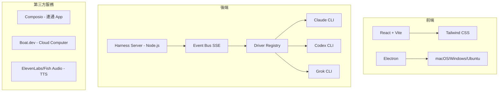
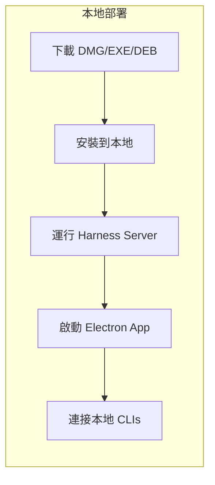
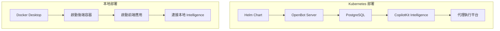
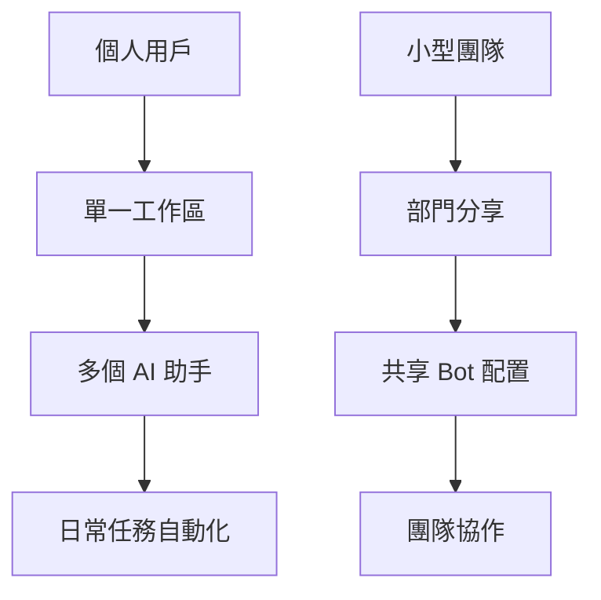
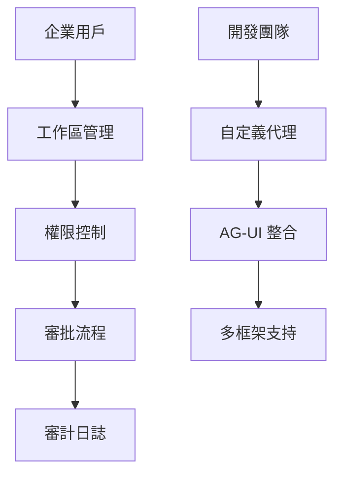
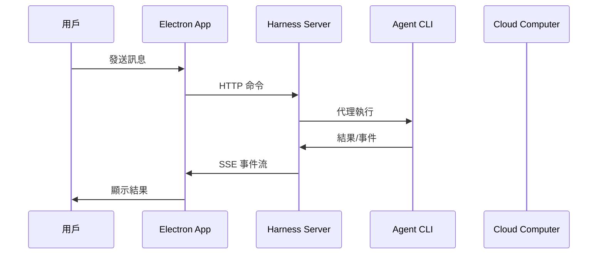
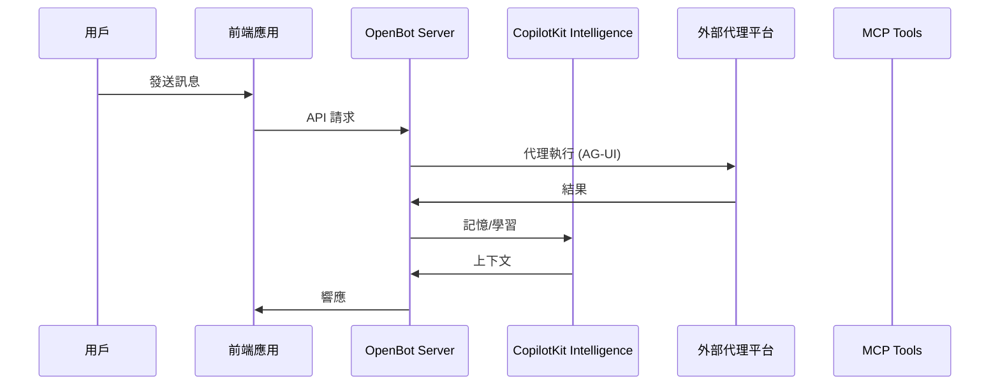

# OpenBot vs OpenMausBot 比較分析

## 概述

| 專案 | 組織 | 主要定位 |
|------|------|----------|
| **OpenMausBot** | milind-soni/OpenMausBot | 開源 Grok Bot 替代方案，Telegram 風格的聊天應用程式，每個聊天都是真實的 AI 代理 |
| **OpenBot** | CopilotKit/OpenBot | 模組化、可自託管的企業級工作區，支援多平台前端和自定義代理 |

---

## 技術棧比較

### OpenMausBot



**核心技術:**
- **前端:** React 19, Vite, Tailwind CSS
- **桌面殼:** Electron (macOS, Windows, Ubuntu)
- **後端:** Node.js, TypeScript, HTTP + SSE
- **代理執行:** Claude CLI, Codex CLI, Grok CLI (本地運行)
- **建構工具:** pnpm
- **許可證:** Apache 2.0

**主要依賴:**
- Claude, Codex, Grok CLIs (用戶需自行安裝)
- Composio (500+ 連通應用)
- Boat.dev (Cloud Computer)
- ElevenLabs, Fish Audio (TTS)
- Cua Driver (本地電腦控制)

### OpenBot

```mermaid
graph TD
    subgraph "前端"
        A1[Mac/Windows Desktop]
        A2[Web App]
        A3[iOS/Android]
        A4[Slack/Teams]
    end
    
    subgraph "後端"
        B1[OpenBot Server - Python]
        B2[Backend Images - Docker]
        B3[PostgreSQL]
    end
    
    subgraph "代理層"
        C1[AG-UI Protocol]
        C2[Claude Agent SDK]
        C3[Agent Framework (ADK/Strands)]
        C4[LangChain/Mastra]
    end
    
    subgraph "服務"
        D1[CopilotKit Intelligence]
        D2[MCP Tools]
        D3[Composio]
    end
```

**核心技術:**
- **前端:** 多平台 (Mac/Windows/Web/iOS/Android/Slack/Teams)
- **後端:** Python, Docker, Kubernetes (Helm Charts)
- **代理框架:** AG-UI, Claude Agent SDK, Google ADK, AWS Strands, LangChain, Mastra, CrewAI
- **數據庫:** PostgreSQL
- **許可證:** MIT (應用程式模板), CopilotKit Intelligence 另行授權

**主要依賴:**
- CopilotKit Intelligence (記憶、學習、企業治理)
- AG-UI (代理統一介面協議)
- 多代理框架 (Anthropic Claude SDK, Microsoft ADK, Google Agent Platform)
- MCP (Model Context Protocol) 工具
- 自定義模型 (OpenAI, Anthropic, Gemini, OpenAI-compatible endpoints)

---

## 功能比較

| 功能 | OpenMausBot | OpenBot |
|------|-------------|---------|
| **代理管理** | 每個 Bot 獨立，類似聯絡人管理 | 工作區概念，多個 Bot 共享 |
| **聊天介面** | Telegram 風格，每個 Bot 獨立對話 | 統一工作區，多代理協作 |
| **電腦控制** | Cloud VM / Local VM / Local (opt-in) | Kubernetes sandbox / External providers |
| **連通應用** | Composio Sessions (500+ apps) | MCP Tools + Composio |
| **語音功能** | TTS (ElevenLabs/Fish/Grok/Mac) + 語音輸入 | 未明確說明 |
| **團隊共享** | 分享 Bot/部門，GitHub 發布 | 企業級權限，公司登入 |
| **審批機制** | 每個操作都需要審批卡 | 角色權限，審批策略 |
| **自託管** | 本地運行，無雲端依賴 | 完全可自託管，Kubernetes |
| **白標籤** | 不支持 | 支持 (MIT 授權) |

---

## 部署比較

### OpenMausBot



**部署選項:**
- **macOS:** Apple silicon/Intel .dmg (已簽名與 notary)
- **Windows:** x64 .exe 安裝程序
- **Ubuntu:** .deb / .AppImage (beta)
- **Fedora:** .rpm (community-supported)

**源代碼部署:**
```bash
git clone https://github.com/milind-soni/OpenMausBot
pnpm install
pnpm dev:server    # 127.0.0.1:8799
pnpm dev           # 127.0.0.1:5199
pnpm dev:desktop   # Electron shell
```

**需求:**
- Node 24+
- pnpm
- 至少一個代理 CLI (claude/codex/grok) 已安裝並登入

### OpenBot



**部署選項:**
- **Kubernetes:** AWS EKS, Azure AKS, Google GKE, 自定義集群
- **本地:** Docker Desktop (Mac/Windows)
- **Web:** 可訪問的後端 API

**Kubernetes 部署:**
```bash
helm install openbot https://github.com/CopilotKit/OpenBot/releases/download/v1.1.0/openbot-bundle-0.1.0.tgz \
  --namespace openbot --create-namespace \
  --values openbot-values.yaml
```

**源代碼部署:**
```bash
git clone https://github.com/CopilotKit/OpenBot.git
cd OpenBot
cp .env.example .env
bun install
bash scripts/start.sh
```

**需求:**
- Docker (PostgreSQL, API server, Bots)
- Bun 1.4+
- CopilotKit 帳戶 (Intelligence)
- 模型 API key (OpenAI/Anthropic/Google)

---

## 開源許可

| 專案 | 主要許可 | 限制 |
|------|---------|------|
| **OpenMausBot** | Apache 2.0 | 允許商業使用、修改、分發；要求保留版權和許可聲明 |
| **OpenBot** | MIT | 非常寬鬆的許可，允許商業使用、修改、分發，無需保留版權聲明 |

**注意:** OpenBot 的 CopilotKit Intelligence 服務另行授權，需要付費許可才能在生產環境使用。

---

## 使用案例

### OpenMausBot



**適合場景:**
- 個人 AI 助手管理
- 多角色扮演 (工作/個人/專案)
- 本地優先的隱私需求
- 與現有代理 (Claude/Codex/Grok) 整合

### OpenBot



**適合場景:**
- 企業級代理工作區
- 多代理協作與管理
- 需要審計和權限控制
- 需要自託管或完全控制
- 多平台前端需求 (Web/Mobile/Desktop)

---

## 架構差異

### OpenMausBot: 集中式架構



### OpenBot: 分散式架構



---

## 總結比較

| 比較項目 | OpenMausBot | OpenBot |
|---------|-------------|---------|
| **主要語言** | TypeScript/JavaScript | Python |
| **桌面框架** | Electron | 自定義/跨平台 |
| **後端框架** | Node.js + SSE | Python + Docker |
| **許可證** | Apache 2.0 | MIT (應用) + 另行授權 (Intelligence) |
| **代理執行** | 本地 CLI 依賴 | AG-UI 統一協議 |
| **連通應用** | Composio Sessions | MCP + Composio |
| **團隊功能** | GitHub 分享 | 企業級權限管理 |
| **自託管** | 完全本地 | Kubernetes/本地 |
| **白標籤** | 不支持 | 支持 |
| **學習曲線** | 中等 | 較陡峭 (需要 Kubernetes) |
| **目標用戶** | 個人/小型團隊 | 企業/開發團隊 |
| **代理來源** | 特定 CLI (Claude/Codex/Grok) | 任意代理 (透過 AG-UI) |

---

## 選擇建議

### 選擇 OpenMausBot，如果：
- ✅ 想要 Telegram 風格的簡單界面
- ✅ 主要使用 Claude/Codex/Grok 代理
- ✅ 偏好本地優先、無雲端依賴
- ✅ 需要簡單的團隊共享 (GitHub)
- ✅ 不想學習 Kubernetes 複雜性

### 選擇 OpenBot，如果：
- ✅ 需要企業級權限和審計
- ✅ 想要支持多平台前端 (Web/Mobile/Desktop)
- ✅ 需要自定義代理執行平台
- ✅ 需要完全自託管或白標籤
- ✅ 團隊需要複雜的權限管理
- ✅ 已經使用 AG-UI 生態系統

---

*比較日期：2024-11-19*
*資料來源：GitHub 倉庫分析*
