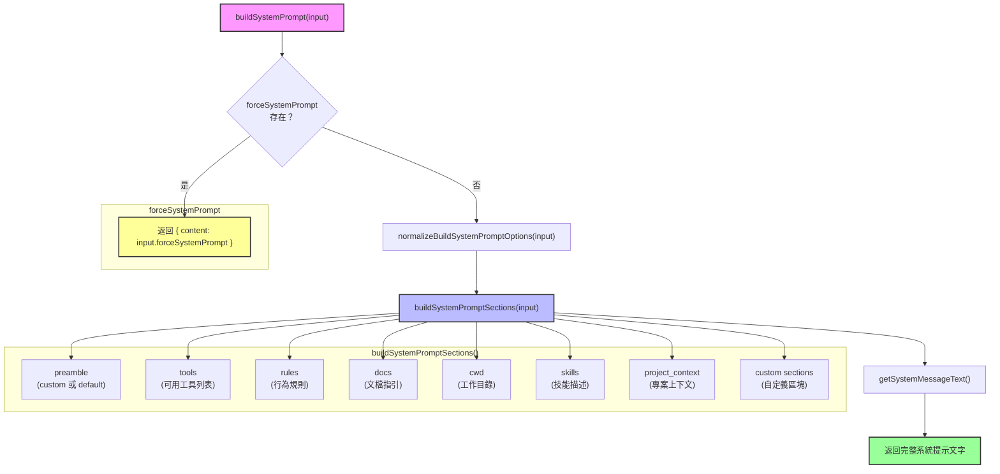
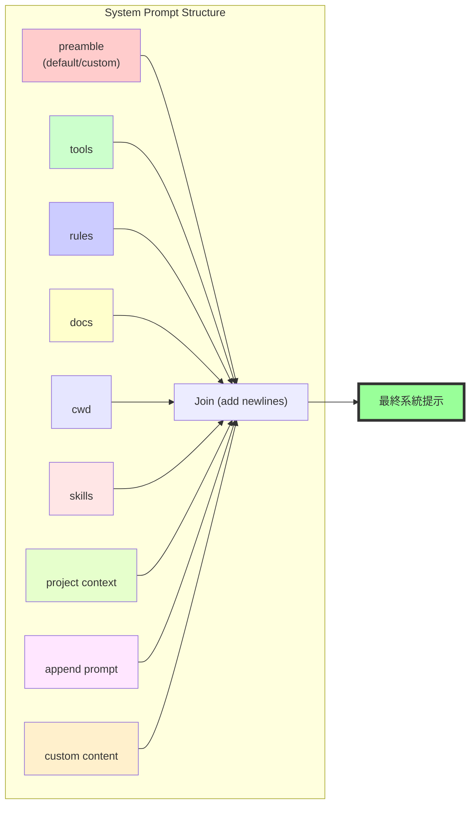

# PI Agent 預設系統提示

```
Date:       11/17/2026, 9:28:07 PM
Models:     llama.cpp/unsloth/Qwen3.5-9B
Messages:   3 user, 18 assistant, 15 tool results
Tool Calls: 15
Tokens:     ↑38k ↓7.1k R176k
Cost:       0.000
```

> [!NOTE]
> where can I find the default system prompt of pi agent?

## 位置

預設系統提示的建構邏輯位於：

```
@earendil-works/pi-coding-agent/dist/core/system-prompt.js
```

## 系統提示結構

PI Agent 的系統提示由多個獨立的 section 組成，透過 `buildSystemPromptSections()` 函式建構。

每個 section 在最終輸出時會包裹在 `<section_name>` 標籤中，除了 `preamble`。

### 預設組件

#### 1. preamble（開頭）
預設文字：
```
You are a coding assistant running inside pi, a coding agent harness. Help users inspect files, run commands, and modify code.
```

使用 `customPrompt` 選項可完全替換此部分。

#### 2. tools（可用工具）
列出目前可用的工具及其簡短說明，格式為：
```
- `read`: 讀取檔案內容
- `bash`: 執行 bash 命令
- `edit`: 編輯檔案
- `write`: 寫入檔案
```

如果沒有配置 `toolSnippets`，則顯示 `(none)`。

#### 3. rules（行為規則）
自動生成的規則包括：
- 使用 bash/PowerShell 進行檔案操作（如 ls、rg、find）
- 回答要簡潔
- 顯示檔案路徑要清楚

可透過 `toolGuidelines` 和 `promptGuidelines` 自定義規則。

#### 4. docs（文檔指引）
指向 PI 官方文件的完整路徑：
- Main documentation
- Additional docs  
- Examples

此部分讀取時會解析相對路徑，指向實際的 `docs/` 和 `examples/` 目錄。

#### 5. cwd（工作目錄）
當前工作目錄的絕對路徑，使用正斜線分隔。

#### 6. skills（技能）
如果有安裝的技能，會在此處描述技能的功能，並指出可用的讀取工具。

#### 7. project_context（專案上下文）
如果有指定 `contextFiles`，會包含專案特定的指示，格式為：
```
<project_instructions path="file_path">
content
</project_instructions>
```

## 自定義選項

### 1. customPrompt
直接替換整個 preamble，完全自定義開頭。

### 2. appendSystemPrompt
附加到系統提示末尾的自定義文字，不會被其他組件干擾。

### 3. sections
自定義提示區塊，可用的 section 名稱包括：
- `custom_rules`
- `custom_instructions`
- `custom_context`
- `custom_tools`
- 任何符合命名規則 `^[a-z][a-z0-9_-]*$` 的名稱（除了 `preamble`）

**注意**：section 名稱不能包含特殊字元，且不能是 `preamble`。

### 4. toolGuidelines
為特定工具提供自定義使用指引：
```javascript
{
  bash: ["Use echo command for debugging"],
  grep: ["Always use -i flag for case-insensitive search"]
}
```

### 5. promptGuidelines
通用的提示指引規則：
```javascript
[
  "Think before you answer",
  "Break down complex tasks"
]
```

### 6. forceSystemPrompt
完全覆蓋預設系統提示，使用自定義的完整 prompt。此選項會繞過所有 section 建構。

## 系統提示建構流程




## 完整範例

```javascript
const options = {
  selectedTools: ["read", "bash", "edit", "write"],
  hiddenTools: [],
  toolGuidelines: {
    bash: ["Always use --help flag to check available options"],
    grep: ["Use -r for recursive search"]
  },
  promptGuidelines: [
    "Think step by step for complex tasks",
    "Ask for clarification when requirements are unclear"
  ],
  appendSystemPrompt: "Remember to be helpful and concise.",
  sections: {
    custom_rules: [
      "Never run destructive commands without confirmation",
      "Always check file contents before editing"
    ],
    custom_instructions: [
      "Follow coding best practices",
      "Document changes in comments"
    ]
  },
  toolSnippets: {
    read: "Read and display file contents",
    bash: "Execute shell commands and capture output"
  },
  contextFiles: [
    { path: "README.md", content: "..." },
    { path: "package.json", content: "..." }
  ],
  forceSystemPrompt: undefined // 不使用此選項會使用預設結構
};
```
## 檔案位置

- **建構邏輯**: `@earendil-works/pi-coding-agent/dist/core/system-prompt.js`
- **工具文字**: `@earendil-works/pi-coding-agent/dist/core/tool-guidelines.js`
- **技能格式化**: `@earendil-works/pi-coding-agent/dist/core/skills.js`
- **系統訊息渲染**: `@earendil-works/pi-ai/dist/utils/text.js`
- **類型宣告**: `@earendil-works/pi-coding-agent/dist/core/system-prompt.d.ts`

## 系統提示 Section 命名規則

Section 名稱必須符合正则表達式 `^[a-z][a-z0-9_-]*$`，且不能是 `preamble`。

有效範例：
- `custom_rules`
- `custom_instructions`
- `addendum`
- `project_context`

無效範例：
- `PREAMBLE` (大小寫錯誤)
- `custom.rules` (包含點號)
- `preamble` (保留字)
## 相關函式

| 函式 | 說明 |
|------|------|
| `buildSystemPrompt(input)` | 建構完整的系統提示文字，返回 `string` |
| `buildSystemPromptState(input)` | 建構系統提示狀態，返回 `{ content, sections }` |
| `buildSystemPromptSections(input)` | 建構各個 section，返回 `{ [name]: text }` 物件 |
| `normalizeBuildSystemPromptOptions(input)` | 正規化輸入選項，返回標準化物件 |
| `diffSystemPromptSections(previous, current)` | 比對 section 差異，返回 patch 物件或 `undefined` |
| `getSystemMessageText(message)` | 渲染系統訊息為文字，返回 `string` |

## 相關資料結構

```typescript
interface SystemPromptState {
  content?: string;      // forceSystemPrompt 時使用
  sections?: {           // 預設結構使用
    [key: string]: string | null;
  };
}

interface BuildOptions {
  customPrompt?: string;
  forceSystemPrompt?: string;
  selectedTools?: string[];
  hiddenTools?: string[];
  toolSnippets?: Record<string, string>;
  toolGuidelines?: Record<string, string[]>;
  promptGuidelines?: string[];
  appendSystemPrompt?: string;
  sections?: Record<string, string>;
  cwd?: string;
  contextFiles?: Array<{ path: string; content: string }>;
  skills?: Array<{ name: string; description: string }>; // 或類似結構
}
```