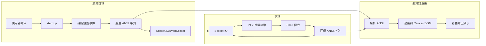

# xterm.js 技術報告

## 一、概述

**xterm.js** 是一個由 TypeScript 撰寫的瀏覽器端前端元件，可讓應用程式在網頁中呈現功能完整的終端機（Terminal）。該專案由 VS Code 團隊維護，已廣泛應用於 VS Code、Hyper、Theia 等流行開發工具中。

### 核心特性

- **終端機應用程式即插即用**：支援大多數終端機應用程式（如 `bash`、`vim`、`tmux`），包含對 curses 應用程式和滑鼠事件的支援
- **效能卓越**：極速執行，並提供可選的 GPU 加速渲染器
- **完整的 ANSI/VT 轉義序列支援**：正確解析並渲染終端機控制碼
- **滑鼠事件支援**：支援選擇文字、滑鼠點擊等互動

### 架構說明



### 重要提醒

**xterm.js 不是終端機應用程式本身，也不是 shell**，而是一個終端機模擬器（emulator）。它負責渲染終端機輸出、解釋 ANSI/VT 轉義序列、捕捉鍵盤輸入，並提供終端機 UI。若要提供完整的互動式 Shell，必須將其連接到後端的偽終端（PTY）、SSH 會話、容器、虛擬機或其他程式。

## 二、安裝步驟

### 步驟 1：安裝核心套件

使用 npm 安裝核心套件：

```bash
npm install --save @xterm/xterm
```

或使用 Yarn：

```bash
yarn add @xterm/xterm
```

> **注意**：套件已遷移至 `@xterm` 命名空間。舊版的 `xterm` 和 `xterm-*` 套件已棄用，不再維護。

### 步驟 2：安裝必要的 Addon 套件（可選）

根據需求選擇性安裝：

```bash
# 自動調整終端機大小以適應容器
npm install --save @xterm/addon-fit

# 連接後端（如 WebSocket、SSH）
npm install --save @xterm/addon-attach

# GPU 加速渲染（WebGL）
npm install --save @xterm/addon-webgl
```

### 步驟 3：導入模組和 CSS

在 HTML 檔案中導入核心 CSS 樣式：

```html
<!DOCTYPE html>
<html lang="zh-TW">
<head>
    <meta charset="UTF-8">
    <meta name="viewport" content="width=device-width, initial-scale=1.0">
    <title>xterm.js 終端機測試</title>
    
    <!-- 導入核心 CSS -->
    <link rel="stylesheet" href="https://cdn.jsdelivr.net/npm/@xterm/xterm/css/xterm.css">
    
    <!-- 可選：導入 Fit Addon CSS -->
    <link rel="stylesheet" href="https://cdn.jsdelivr.net/npm/@xterm/addon-fit/css/fit-addon.css">
</head>
<body>
    <!-- 終端機容器 -->
    <div id="terminal" style="height: 600px; width: 100%;"></div>
    
    <!-- 引入 JavaScript -->
    <script type="module">
        import { Terminal } from '@xterm/xterm';
        import { FitAddon } from '@xterm/addon-fit';
        import { AttachAddon } from '@xterm/addon-attach';
        
        // 初始化終端機
        const term = new Terminal({
            cursorBlink: true,
            fontSize: 14,
            fontFamily: 'Consolas, "Courier New", monospace',
        });
        
        term.open(document.getElementById('terminal'));
        
        // 可選：啟用 Fit Addon（自動調整大小）
        const fitAddon = new FitAddon();
        term.loadAddon(fitAddon);
        
        console.log('xterm.js 初始化完成');
    </script>
</body>
</html>
```

## 三、測試步驟

### 步驟 1：建立基本測試頁面

創建 `test.html` 檔案：

```html
<!DOCTYPE html>
<html lang="zh-TW">
<head>
    <meta charset="UTF-8">
    <title>xterm.js 測試</title>
    <link rel="stylesheet" href="https://cdn.jsdelivr.net/npm/@xterm/xterm/css/xterm.css">
</head>
<body>
    <div id="terminal" style="height: 500px; width: 100%; background: #1e1e1e;"></div>
    
    <script type="module">
        import { Terminal } from '@xterm/xterm';
        
        // 建立終端機實例
        const term = new Terminal({
            cursorBlink: true,
            fontSize: 16,
            fontFamily: 'Consolas, "Courier New", monospace',
            theme: {
                background: '#1e1e1e',
                foreground: '#cccccc',
                cursor: '#00ff00',
                cursorAccent: '#000000',
            },
        });
        
        // 開啟終端機
        term.open(document.getElementById('terminal'));
        
        // 測試輸出
        console.log('xterm.js 測試開始');
    </script>
</body>
</html>
```

### 步驟 2：測試基本功能

在瀏覽器中開啟測試頁面，執行以下測試項目：

| 測試項目 | 操作說明 | 預期結果 |
|---------|---------|---------|
| 文字輸入 | 輸入 `echo "Hello xterm.js"` | 文字正常顯示 |
| ANSI 顏色 | 執行 `echo -e "\033[31mRed\033[32mGreen\033[0m"` | 顯示彩色文字 |
| 滑鼠選擇 | 使用滑鼠選擇文字 | 能選擇並複製文字 |
| 游標閃爍 | 觀察游標狀態 | 游標應持續閃爍 |

### 步驟 3：測試組合鍵

測試以下組合鍵功能：

```javascript
// 測試 Ctrl+C（應發送 Ctrl+C 序列）
term.write('\r\n', () => {
    console.log('發送 Ctrl+C');
});

// 測試 Tab 鍵
term.write('\t', () => {
    console.log('發送 Tab');
});
```

## 四、驗證步驟

### 驗證項目 1：ANSI 轉義序列解析

創建 `verify-ansi.html`：

```html
<!DOCTYPE html>
<html lang="zh-TW">
<head>
    <meta charset="UTF-8">
    <title>xterm.js ANSI 驗證</title>
    <link rel="stylesheet" href="https://cdn.jsdelivr.net/npm/@xterm/xterm/css/xterm.css">
</head>
<body>
    <h3>ANSI 轉義序列驗證測試</h3>
    <div id="terminal" style="height: 500px; width: 100%;"></div>
    
    <script type="module">
        import { Terminal } from '@xterm/xterm';
        
        const term = new Terminal({
            cursorBlink: false,
            fontSize: 16,
        });
        
        term.open(document.getElementById('terminal'));
        
        // 測試 ANSI 顏色序列
        const ansiTests = [
            { name: '前景色測試', command: `
                echo "=== 前景色測試 ==="
                echo -e "\\033[30m 黑色 \\033[31m 紅色 \\033[32m 綠色 \\033[33m 黃色 \\033[34m 藍色 \\033[35m 洋紅 \\033[36m 青色 \\033[37m 白色"
                echo -e "\\033[90m 淺黑 \\033[91m 淺紅 \\033[92m 淺綠 \\033[93m 淺黃 \\033[94m 淺藍 \\033[95m 淺洋紅 \\033[96m 淺青"
            ` },
            { name: '背景色測試', command: `
                echo "=== 背景色測試 ==="
                echo -e "\\033[40m 黑色背景 \\033[41m 紅色背景 \\033[42m 綠色背景 \\033[43m 黃色背景"
                echo -e "\\033[100m 淺黑背景 \\033[101m 淺紅背景 \\033[102m 淺綠背景"
            ` },
            { name: '字體樣式', command: `
                echo "=== 字體樣式 ==="
                echo -e "\\033[1m 粗體 \\033[4m 下劃線 \\033[5m 閃爍 \\033[2m 非粗體 \\033[24m 無下劃線"
            ` },
            { name: '清除畫面', command: `
                echo -e "\\033[2J\\033[H"
                echo "=== 測試完成 ==="
                echo "ANSI 序列驗證通過"
            ` }
        ];
        
        // 執行測試
        let testIndex = 0;
        async function runTests() {
            while (testIndex < ansiTests.length) {
                console.log(`執行測試 ${testIndex + 1}/${ansiTests.length}`);
                term.write(ansiTests[testIndex].command);
                testIndex++;
                await new Promise(resolve => setTimeout(resolve, 500));
            }
        }
        
        runTests();
    </script>
</body>
</html>
```

### 驗證項目 2：事件監聽驗證

創建 `verify-events.html`：

```html
<!DOCTYPE html>
<html lang="zh-TW">
<head>
    <meta charset="UTF-8">
    <title>xterm.js 事件驗證</title>
    <link rel="stylesheet" href="https://cdn.jsdelivr.net/npm/@xterm/xterm/css/xterm.css">
</head>
<body>
    <div id="terminal" style="height: 500px; width: 100%;"></div>
    <div id="output" style="margin-top: 20px; padding: 10px; border: 1px solid #ccc; background: #f5f5f5;"></div>
    
    <script type="module">
        import { Terminal } from '@xterm/xterm';
        
        const term = new Terminal({
            cursorBlink: false,
            fontSize: 14,
        });
        
        term.open(document.getElementById('terminal'));
        
        // 儲存測試結果
        const results = [];
        
        // 監聽數據事件（使用者輸入）
        const dataListener = term.onData(data => {
            results.push(`[DATA] 收到: ${data}`);
            console.log(`Data Event: ${data}`);
        });
        
        // 監聽鍵盤事件
        const keyListener = term.onKey(event => {
            results.push(`[KEY] 按下: ${event.key} (code: ${event.domEvent.code})`);
            console.log(`Key Event: ${event.key}`);
        });
        
        // 監聽尺寸變化
        term.onResize(({ cols, rows }) => {
            results.push(`[RESIZE] 尺寸: ${cols}x${rows}`);
        });
        
        // 監聽 title 變化
        term.onTitleChange(title => {
            results.push(`[TITLE] 標題: ${title}`);
        });
        
        // 輸出結果到 DOM
        function updateOutput() {
            const output = document.getElementById('output');
            output.innerHTML = results.join('<br>');
        }
        
        // 測試數據輸入
        console.log('=== 事件監聽驗證開始 ===');
        
        // 模擬輸入 "test"
        setTimeout(() => {
            term.write('test\n');
        }, 500);
        
        // 模擬按下 Tab 鍵
        setTimeout(() => {
            term.write('\t');
        }, 1500);
        
        // 模擬按下 Ctrl+A
        setTimeout(() => {
            const ctrlA = new Uint8Array([3, 65]); // Ctrl+A
            term.write(new Uint8Array(ctrlA));
        }, 2500);
        
        // 監聽輸出
        term.onData(data => {
            updateOutput();
        });
    </script>
</body>
</html>
```

### 驗證項目 3：後端連接驗證

創建 `verify-backend.html`（搭配 WebSocket 後端）：

```html
<!DOCTYPE html>
<html lang="zh-TW">
<head>
    <meta charset="UTF-8">
    <title>xterm.js 後端連接驗證</title>
    <link rel="stylesheet" href="https://cdn.jsdelivr.net/npm/@xterm/xterm/css/xterm.css">
</head>
<body>
    <div id="terminal" style="height: 600px; width: 100%;"></div>
    
    <script type="module">
        import { Terminal } from '@xterm/xterm';
        import { FitAddon } from '@xterm/addon-fit';
        import { AttachAddon } from '@xterm/addon-attach';
        
        const term = new Terminal({
            cursorBlink: true,
            fontSize: 16,
        });
        
        term.open(document.getElementById('terminal'));
        
        // 安裝 Fit Addon 和 Attach Addon
        const fitAddon = new FitAddon();
        term.loadAddon(fitAddon);
        
        const attachAddon = new AttachAddon(socket => {
            console.log('WebSocket 連接已建立');
            
            socket.onopen = () => {
                console.log('WebSocket 已開啟');
            };
            
            socket.onmessage = event => {
                term.write(event.data);
                console.log('收到後端數據:', event.data);
            };
            
            socket.onerror = error => {
                console.error('WebSocket 錯誤:', error);
            };
            
            socket.onclose = () => {
                console.log('WebSocket 已關閉');
            };
        });
        
        term.loadAddon(attachAddon);
        
        // 連線到 WebSocket 後端
        const socket = new WebSocket('ws://localhost:3000');
        
        console.log('正在連接 WebSocket...');
    </script>
</body>
</html>
```

## 五、常見問題與解決方案

### 問題 1：套件名稱混淆

| 舊套件 | 新套件 | 狀態 |
|--------|--------|------|
| `xterm` | `@xterm/xterm` | 已棄用 |
| `xterm-attach` | `@xterm/addon-attach` | 已棄用 |
| `xterm-fit` | `@xterm/addon-fit` | 已棄用 |
| `xterm-webgl` | `@xterm/addon-webgl` | 已棄用 |

### 問題 2：終端機背景閃白

**原因**：CSS 背景顏色未設定，導致頁面載入時的閃白現象。

**解決方案**：

```css
/* 在 HTML 中直接設定 */
<div id="terminal" style="height: 600px; width: 100%; background: #1e1e1e;"></div>

/* 或使用 CSS 檔案 */
#terminal {
    background-color: #1e1e1e;
}
```

### 問題 3：自動調整大小失效

**解決方案**：確保正確安裝並導入 Fit Addon：

```bash
npm install --save @xterm/addon-fit
```

```html
<link rel="stylesheet" href="https://cdn.jsdelivr.net/npm/@xterm/addon-fit/css/fit-addon.css">
```

```javascript
import { FitAddon } from '@xterm/addon-fit';
const fitAddon = new FitAddon();
term.loadAddon(fitAddon);
```

### 問題 4：滑鼠事件不工作

**原因**：CSS `user-select` 設定可能干擾滑鼠選擇功能。

**解決方案**：

```css
#terminal {
    user-select: text;
    -webkit-user-select: text;
    -moz-user-select: text;
    -ms-user-select: text;
}
```

## 六、最佳實踐

### 1. 效能優化

```javascript
const term = new Terminal({
    // 使用 WebGL 渲染（可選）
    rendererType: 'canvas', // 'dom' 或 'canvas'
    
    // 啟用 GPU 加速（可選）
    useWasm: true,
    
    // 減少游標閃爍（效能）
    cursorBlink: false,
    
    // 設定合適的字體大小
    fontSize: 14,
    
    // 設定合理的列數和行數
    cols: 80,
    rows: 24,
});
```

### 2. 錯誤處理

```javascript
const term = new Terminal({
    onResize: ({ cols, rows }) => {
        // 處理尺寸變化
        console.log(`終端機尺寸: ${cols}x${rows}`);
    },
    
    onTitleChange: title => {
        // 處理標題變化
        console.log(`終端機標題: ${title}`);
    },
    
    onData: data => {
        // 處理輸入數據
        term.write(data);
    },
    
    onKey: event => {
        // 處理鍵盤事件
        console.log(`鍵盤事件: ${event.key}`);
    },
    
    onError: error => {
        // 處理錯誤
        console.error('xterm.js 錯誤:', error);
    },
});
```

### 3. 主題自訂

```javascript
const term = new Terminal({
    theme: {
        background: '#1e1e1e',
        foreground: '#cccccc',
        cursor: '#ffffff',
        cursorAccent: '#000000',
        black: '#000000',
        red: '#cd3131',
        green: '#14cd31',
        yellow: '#d4d400',
        blue: '#0084ff',
        magenta: '#b43131',
        cyan: '#31c4cd',
        white: '#dddddd',
    },
});
```

## 七、參考資源

- [官方網站](https://xtermjs.org/)
- [GitHub 專案](https://github.com/xtermjs/xterm.js)
- [npm 套件](https://www.npmjs.com/package/@xterm/xterm)
- [官方 API 文檔](https://xtermjs.org/docs/api/)

## 報告摘要

| 項目 | 說明 |
|------|------|
| **套件版本** | `@xterm/xterm@6.0.0` |
| **核心功能** | 瀏覽器端終端機模擬器 |
| **依賴後端** | 需連接 PTY/SSH/容器等 |
| **主要優勢** | 高效能、完整 ANSI 支援、跨平台 |
| **主要限制** | 非 Shell 本身，需後端支援 |

**報告生成日期**：2026-11-22
**報告作者**：AI Assistant  
**技術語言**：繁體中文（台灣技術用詞）
