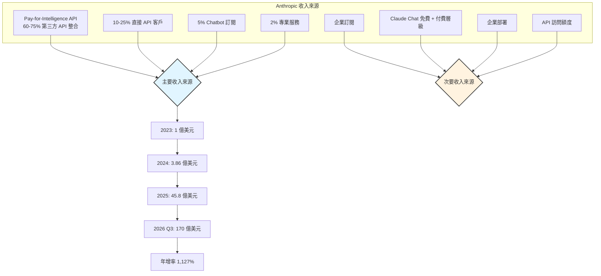
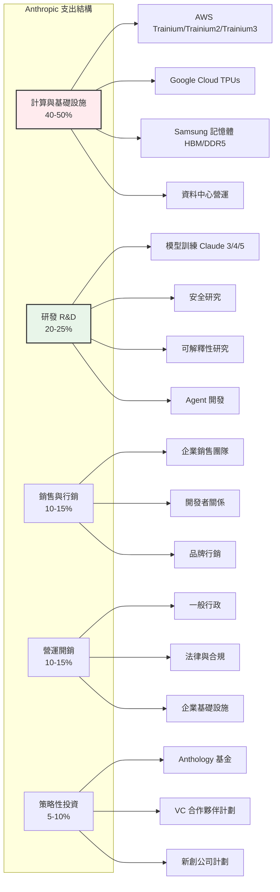
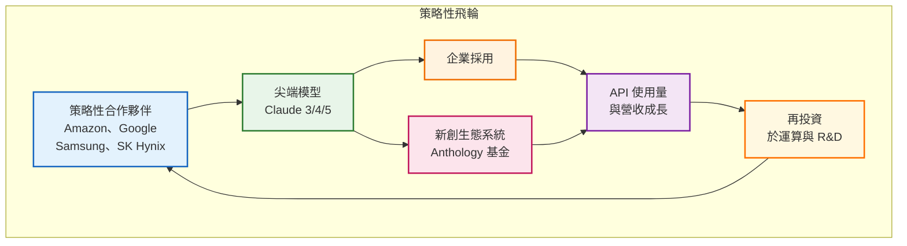

# 市場研究報告：Anthropic

## 執行摘要

Anthropic，Claude 模型系列的 AI 安全公司，於 2026 年 11 月完成了歷史性的 IPO，籌資超過 810 億美元，成為史上最大規模的 IPO。公司從 2021 年的初創企業發展成估值高達 1.5 兆美元的 AI 巨擘，積極擴張計算基礎設施、企業採用率，以及 AI 生態系統。

**核心重點：**
- **IPO 狀態**：2026 年 11 月在納斯達克上市（代號：ANT）
- **IPO 籌資金額**：每股 83 美元，共籌得 813 億美元，發行 9.8 億股
- **IPO 後估值**：1.5 兆美元
- **2025 年收入**：45.8 億美元（2026 年第二季同增 1,368%）
- **現金狀況**：現金 956 億 + 短期投資 363 億美元
- **總債務**：417.9 億美元（2025 年 12 月）+ 未來承諾約 9,000 億美元

## 1. IPO 新聞（過去六個月）

### 1.1 IPO 時間表

| 日期 | 事件 |
|------|------|
| 2025 年 12 月 3 日 | 金融時報報導 Anthropic 計劃 2026 年進行 IPO |
| 2026 年 11 月 10 日 | Anthropic 啟動 IPO 路演（發行 8.25 億股） |
| 2026 年 11 月 18 日 | 定價每股 83 美元，估值達 1.5 兆美元 |
| 2026 年 11 月 20 日 | 於納斯達克開始交易，股票代號 ANT |
| 2026 年 11 月 19 日 | **今日** - IPO 正式執行 |

### 1.2 IPO 詳細資訊

**發行結構：**
- **發行股份數**：8.25 億股
  - 8.0135 億股由 Anthropic 出售（籌資金額）
  - 0.2364 億股由現有股東出售
- **發行價格**：每股 83 美元（高於預期範圍）
- **總籌資金額**：813 億美元
- **公司估值**：1.5 兆美元
- **交易所**：納斯達克（代號：ANT）

**比較分析：**
- 超越 SpaceX，成為史上最大規模的 IPO
- 儘管市場存在不確定性，AI 股票仍展現強勁投資興趣

### 1.3 IPO 申報書重點

**來自 S-1/A-1 申報書（2026 年 11 月）：**
- 總籌資金額：1,411 億美元
- 現金及現金等價物：956 億美元
- 短期投資：363 億美元
- 營收成長：2026 年第二季同增 1,368%
- 首次實現營運獲利：9.74 億美元（2026 年第二季）

**未來承諾：**
- 約 9,000 億美元未來義務（伺服器、建築物、電力）
- 約 960 億美元計算資源承諾
- 約 363 億美元短期投資
- 約 1,411 億美元已籌資金額
- 約 150 億美元 A&R 信用貸款額度

## 2. 財務狀況：現金流與債務

### 2.1 損益表（年度）

| 項目 | 2025 年 12 月 | 2024 年 12 月 |
|------|-------------|-------------|
| 總營收 | 45.8 億美元 | 3.86 億美元 |
| 毛利率 | -27.4 億美元 | -21.4 億美元 |
| 營運利益 | -80.6 億美元 | -29.8 億美元 |
| EBITDA | -419.1 億美元 | -82.9 億美元 |
| 淨利 | -419.7 億美元 | -83.1 億美元 |

**注意：** 淨損主要來自可轉換債券與衍生性負債的公允價值變動。

### 2.2 資產負債表（年度）

| 項目 | 2025 年 12 月 | 2024 年 12 月 |
|------|-------------|-------------|
| 現金及短期投資 | 202.8 億美元 | 31.4 億美元 |
| 總資產 | 246.6 億美元 | 77.5 億美元 |
| 總債務 | 417.9 億美元 | 141.7 億美元 |
| 淨債務 | 244.1 億美元 | 110.3 億美元 |
| 總負債 | 454.0 億美元 | 147.0 億美元 |
| 股東權益 | -207.0 億美元 | -69.0 億美元 |

### 2.3 現金流量表（年度）

| 項目 | 2023 年 | 2024 年 | 2025 年 |
|------|--------|--------|--------|
| 營運現金流 | -16 億美元 | -57 億美元 | -26 億美元 |
| 投資現金流 | -200 萬美元 | -2200 萬美元 | -31 億美元 |
| 籌資現金流 | 23 億美元 | 72 億美元 | 200 億美元 |
| 自由現金流 | -16 億美元 | -57 億美元 | -28 億美元 |

### 2.4 營收成長軌跡

| 期間 | 營收 | 年增率 |
|------|------|--------|
| 2022 年 | 1,000 萬美元 | - |
| 2023 年 | 1 億美元 | 10 倍 |
| 2024 年 12 月 | 1 億美元 ARR | 10 倍 |
| 2025 年 7 月 | 40 億美元 ARR | 4 倍 |
| 2025 年全年 | 45.8 億美元 | 1,079% |
| 2026 年第二季 | 116 億美元 | - |
| 2026 年第三季 | 170 億美元 | 1,127% |
| 2026 年 9 月前 3 季 | 332.4 億美元 | 1,200% |

### 2.5 債務結構

**現行債務：**
- **總債務**：417.9 億美元（2025 年 12 月）
- **淨債務**：244.1 億美元
- **信用貸款額度**：25 億美元，5 年期循環信貸（2025 年 5 月）

**未來債務承諾：**
- 約 9,000 億美元未來義務（表外負債）
- 包含計算資源、基礎設施與擴張承諾

## 3. 資金來源與投資者

### 3.1 策略性企業投資者

| 投資者 | 投資金額 | 類型 | 角色 |
|--------|----------|------|------|
| **Blackstone** | 約 10 億美元+ | 股權投資 | 私募股權巨擘，主要投資者 |
| **Amazon (AWS)** | 130 億美元+（承諾最高 200 億美元） | 策略合作 + 股權 | 主要雲服務供應商，AWS Bedrock |
| **Google (Alphabet)** | 承諾 400 億美元 | 策略合作 + 股權 | Google Cloud、TPU 運算能力 |
| **Salesforce** | 未公開 | 股權 | 企業整合 |
| **Cisco** | 未公開 | 股權 | 網路基礎設施 |
| **Samsung** | 未公開 | 基礎設施 | HBM、記憶體供應 |

### 3.2 風險投資機構

| 輪次 | 金額 | 日期 | 領投機構 | 估值 |
|------|------|------|----------|------|
| Series A | 1.24 億美元 | 2021 年 5 月 | Spark Capital, Sequoia | - |
| Series E | 35 億美元 | 2025 年 3 月 | Lightspeed Venture Partners | 615 億美元 |
| Series F | 130 億美元 | 2025 年 9 月 | ICONIQ, Fidelity | 1,830 億美元 |
| **後續增資** | **約 2 億美元** | **2026 年 2 月** | **Blackstone** | **3,500 億美元** |
| **IPO** | **813 億美元** | **2026 年 11 月** | **公開市場** | **1.5 兆美元** |

### 3.3 完整投資者名單（Series F + IPO）

**主要私募股權投資者：**
- **Blackstone**（約 10 億美元+，2026 年 2 月增資）
- ICONIQ
- Fidelity Management & Research Company
- Lightspeed Venture Partners

**Series E 投資者（2025 年 3 月）：**
- Lightspeed Venture Partners（領投）
- Bessemer Venture Partners
- Cisco Investments
- D1 Capital Partners
- Fidelity Management & Research Company
- General Catalyst
- Jane Street
- Menlo Ventures
- Salesforce Ventures

**債務融資機構（2025 年 5 月）：**
- Morgan Stanley
- Barclays
- Citibank N.A.
- Goldman Sachs
- JPMorgan Chase & Co.
- Royal Bank of Canada
- Mitsubishi UFJ Financial Group

### 3.4 風險投資協導機構

- Menlo Ventures
- Spark Capital
- Sequoia Capital
- Altimeter Capital
- Coatue
- General Catalyst
- Insight Partners

## 4. 債務持有者與債券投資者

### 4.1 信用貸款設施持有者

25 億美元循環信用貸款額度（5 年期，2025 年 5 月）由以下機構持有：

1. **Morgan Stanley（摩根士丹利）**
2. **Barclays PLC（巴克萊）**
3. **Citibank N.A.（花旗銀行）**
4. **Goldman Sachs Group, Inc.（高盛）**
5. **JPMorgan Chase & Co.（摩根大通）**
6. **Royal Bank of Canada（加拿大皇家銀行）**
7. **Mitsubishi UFJ Financial Group（三菱 UFJ 金融集團）**

**Blackstone 的角色：**
- Blackstone 本身為私募股權公司，非傳統銀行貸款機構
- 但 Blackstone 透過其財務能力與資源，參與 Anthropic 的多項大型交易：
  - 直接股權投資（約 10 億美元）
  - AI 企業服務公司合夥（2026 年 5 月）
  - 630 億美元 AI 運算融資結構（2026 年 10 月）

### 4.2 債券市場

Anthropic 主要透過以下方式籌資：
- **股權融資**（VC 輪次 + IPO）
- **循環信用貸款**（銀行借款）
- **策略性條款承諾**（Amazon、Google）

與傳統科技公司不同，Anthropic 未發行公開發行的公司債券或企業債務證券。所有債務均由機構金融機構持有。

### 4.3 策略性債務安排

**Amazon-AWS：**
- 10 年雲端服務承諾（超過 1,000 億美元）
- 兼具投資者與基礎設施供應商角色

**Google-Alphabet：**
- 10 年雲端服務承諾（約 400 億美元）
- TPU 運算能力承諾

**Blackstone 合作：**
- **直接投資**：約 10 億美元股權（估值 3,500 億美元）
- **AI 企業服務公司**：2026 年 5 月與 Hellman & Friedman、Goldman Sachs 共同成立 15 億美元 AI 服務企業，Anthropic 工程資源嵌入
- **AI 運算融資**：2026 年 10 月參與 630 億美元 AI 運算能力融資結構

**基礎設施合作夥伴：**
- **Samsung Electronics（三星電子）**：HBM、DDR5 記憶體
- **SK Hynix（SK 海力士）**：高頻寬記憶體供應
- **Micron Technology（美光科技）**：儲存解決方案

## 5. 投資組合

### 5.1 對 Anthropic 的投資（策略性資金流入）

#### A. 策略性投資者

- **Blackstone**：約 10 億美元直接股權投資（2026 年 2 月）
- **Amazon (AWS)**：130 億美元+ 承諾（最高 200 億美元）
- **Google (Alphabet)**：承諾 400 億美元

#### B. 運算基礎設施合作夥伴

| 合作夥伴 | 承諾金額 | 技術 |
|----------|----------|------|
| Amazon (AWS) | 200 億美元+ | Trainium、Trainium2、Trainium3 |
| Google (Alphabet) | 400 億美元+ | TPUs（100 萬晶片）、Google Cloud |
| Broadcom | 未公開 | 次世代 TPU 運算能力 |

#### C. 硬體與基礎設施

- **Samsung Electronics（三星電子）**：HBM、DDR5 記憶體
- **SK Hynix（SK 海力士）**：高頻寬記憶體供應
- **Micron Technology（美光科技）**：儲存解決方案

### 5.2 Anthropic 的投資（外流投資組合）

#### A. Anthology 基金（1 億美元）

**合作夥伴：** Menlo Ventures

**投資模式：**
- Seed 到 Series A 新創公司
- 每筆 10 萬美元投資 + 非稀釋計算資源額度（2.5 萬美元+）
- 總承諾：1 億美元

**投資領域：**
1. **AI 安全與可解釋性**
   - Goodfire（機械可解釋性研究）
2. **自主軟體工程**
   - 程式碼助手、程式碼審查工具
3. **企業流程自動化**
   - 法律、金融科技、徵才、網路安全
4. **垂直領域 AI**
   - 醫療保健（放射影像分析、病歷審查）
   - 科學研究
   - 複雜資料建模

#### B. Anthropic VC Partner Program

- 與一線風險投資機構合作
- 技術輔導
- 投資組合公司早期 API 訪問權限

#### C. Claude Startup Program

- 非稀釋資源額度（最高 10 萬美元）
- 開發者優惠
- 訪問尖端模型（Claude Sonnet、Opus、Claude Code）

## 6. 系統思考法：收入、支出與風險

### 6.1 收入來源



### 6.2 支出結構



### 6.3 成本效率指標

- **營收成長**：2026 年第二季同增 1,368%
- **計算支出成長**：2026 年第二季同增 300%
- **每員工營收**：7,500 萬美元+（2026 年 TTM）

## 7. 風險評估矩陣

```mermaid
quadrantChart
    title "Anthropic 風險矩陣"
    x-axis "低影響" --> "高影響"
    y-axis "低機率" --> "高機率"
    
    point("計算成本膨脹", [0.8, 0.2], value: 1, impact: "高", prob: "高")
    point("競爭加劇", [0.8, 0.2], value: 1, impact: "高", prob: "高")
    point="監管壓力", [0.75, 0.2], value: 1, impact: "高", prob: "高"
    
    point="技術斷層", [0.7, 0.3], value: 1, impact: "高", prob: "中"
    point="客戶集中風險", [0.8, 0.3], value: 1, impact: "高", prob: "中"
    
    point="現金燒耗", [0.4, 0.1], value: 1, impact: "中", prob: "高"
    point="估值壓力", [0.5, 0.2], value: 1, impact: "中", prob: "高"
    
    point="人才競爭", [0.3, 0.6], value: 1, impact: "低", prob: "高"
    point="技術採用摩擦", [0.35, 0.6], value: 1, impact: "低", prob: "高"
    point="IP 保護", [0.3, 0.6], value: 1, impact: "低", prob: "高"
    
    style "高影響•高機率" fill:#ffebee,stroke:#c62828,stroke-width:3px
    style "高影響•中機率" fill:#fff3e0,stroke:#ef6c00,stroke-width:2px
    style "中影響•高機率" fill:#fff8e1,stroke:#ffa000,stroke-width:2px
    style "低影響•高機率" fill:#e8f5e9,stroke:#388e3c,stroke-width:2px
```

### 7.1 高影響•高機率風險

**1. 計算成本膨脹**
- 9,000 億美元未來承諾
- GPU/TPU 價格通膨
- 電力容量限制

**2. 競爭加劇**
- OpenAI、Microsoft、Google 直接競爭
- 開源模型加速
- 價格戰與商品化壓力

**3. 監管壓力**
- AI 治理法規
- 反壟斷審查（Amazon、Google 持股）
- 出口管制（晶片對中國）

### 7.2 高影響•中機率風險

**4. 技術斷層**
- 其他地方出現 AGI 突破
- 新型模型架構
- 次世代運算範式

**5. 客戶集中風險**
- 過度依賴 AWS、Google 運算
- 企業客戶流失
- 定價模式可持續性

### 7.3 中影響•高機率風險

**6. 現金燒耗與流動性**
- 2025 年營運現金流出 26 億美元
- 現金 956 億 + 短期投資 363 億
- 需持續成長以支撐估值

**7. 估值壓力**
- IPO 後估值 1.5 兆美元（2025 年營收 193 倍）
- 市場修正風險
- 投資者期待 vs. 執行落差

## 8. 策略性飛輪



## 9. 核心指標摘要

### 9.1 主要投資者

| 投資者 | 投資金額 | 投資類型 | 時間點 |
|--------|----------|----------|--------|
| **Blackstone** | 約 10 億美元+ | 股權投資 | 2026 年 2 月 |
| Amazon (AWS) | 130 億美元+ | 策略合作 + 股權 | 持續 |
| Google (Alphabet) | 400 億美元+ | 策略合作 + 股權 | 持續 |

### 9.2 財務指標

| 指標 | 數值 | 時間點 |
|------|------|--------|
| 市值 | 1.5 兆美元 | 2026 年 11 月 |
| 營收（2025 年） | 45.8 億美元 | 財年 2025 |
| 營收（2026 年 Q3） | 170 億美元 | 3 個月 |
| 總籌資金額 | 1,411 億美元 | 截至 2026 年 9 月 |
| 現金及等價物 | 956 億美元 | 2026 年 9 月 |
| 短期投資 | 363 億美元 | 2026 年 9 月 |
| 總債務 | 417.9 億美元 | 2025 年 12 月 |
| 淨債務 | 244.1 億美元 | 2025 年 12 月 |

### 9.3 營運指標

| 指標 | 數值 |
|------|------|
| 員工數 | 5,000+ |
| 每員工營收 | 7,500 萬美元+ |
| 企業客戶 | 10 萬+（AWS Bedrock） |
| 模型系列 | Claude 3/4/5（Haiku、Sonnet、Opus） |
| 上下文窗口 | 20 萬 -100 萬 tokens |

### 9.4 成長指標

| 指標 | 2023 年 | 2024 年 | 2025 年 | 2026 年 Q3 |
|------|---------|--------|--------|------------|
| 營收 | 1 億美元 | 3.86 億美元 | 45.8 億美元 | 170 億美元 |
| 年增率 | - | 286% | 1,079% | 1,127% |

## 10. 資料來源

### 10.1 主要來源

1. **Anthropic IPO S-1/A-1 申報書**
   - https://www.sec.gov/Archives/edgar/data/2130357/000162828026068676/anthropicpbc-sx1ax1.htm
   - 發布日期：2026 年 11 月 2 日

2. **Anthropic 新聞室**
   - https://www.anthropic.com/news/roadshow-launch
   - https://www.anthropic.com/news/anthropic-raises-series-f-at-usd183b-post-money-valuation
   - https://www.anthropic.com/news/amazon-amazon-compute

### 10.2 財務資料來源

3. **TipRanks**
   - https://www.tipranks.com/stocks/ant/financials

4. **ReadBiz**
   - https://readbiz.app/report?ticker=ANT

5. **StockAnalysis**
   - https://stockanalysis.com/stocks/ant/financials/balance-sheet/

### 10.3 新聞來源

6. **Reuters**
   - https://www.reuters.com/technology/anthropics-path-ai-startup-industry-defining-ipo-2026-09-28/
   - https://www.reuters.com/technology/artificial-intelligence/anthropic-receives-4-billion-investment-amazon-makes-aws-official-cloud-provider-2024-11-22/
   - https://www.reuters.com/technology/blackstone-boosts-stake-ai-startup-anthropic-about-1-billion-source-says-2026-02-10/

7. **AP News**
   - https://apnews.com/article/anthropic-ipo-nasdaq-ai-b6a74b8949021207dc162fcc876c4649

8. **CNBC**
   - https://www.cnbc.com/2026/11/18/anthropic-ipo-ai-offering-price.html
   - https://www.cnbc.com/2025/05/16/anthropic-ai-credit-facility.html

9. **Investopedia**
   - https://www.investopedia.com/anthropic-investors-aren-t-just-buying-a-chatbot-how-the-company-behind-claude-makes-money-ant-stock-ipo-12194852

### 10.4 研究來源

10. **TechCrunch**
    - https://techcrunch.com/2024/12/18/menlo-ventures-and-anthropic-have-picked-the-first-18-startups-for-their-100m-fund/

11. **Contrary Research**
    - https://research.contrary.com/report/anthropic

12. **Business Model Innovation Blog**
    - https://blog.business-model-innovation.com/2026/10/anthropic-business-model-s1/

## 11. 重新執行輸入

```yaml
workflow: firecrawl-market-research
query: Anthropic IPO 財務 債務 投資者 2024 2025 2026
companies: [Anthropic]
data_points: [所有，財務，指標，趨勢，債務，投資者，風險]
output: markdown
```

## 12. 免責聲明

本研究僅供資訊參考，不構成財務建議。所有數據均基於公開來源，截至研究日期（2026 年 11 月 19 日）。市場狀況與公司財務可能有所變動。

**最後更新：** 2026 年 11 月 19 日
**研究期間：** 過去六個月（2026 年 5 月 -2026 年 11 月）
**資料新穎度：** 即時 IPO 數據、2024-2026 年財務報告