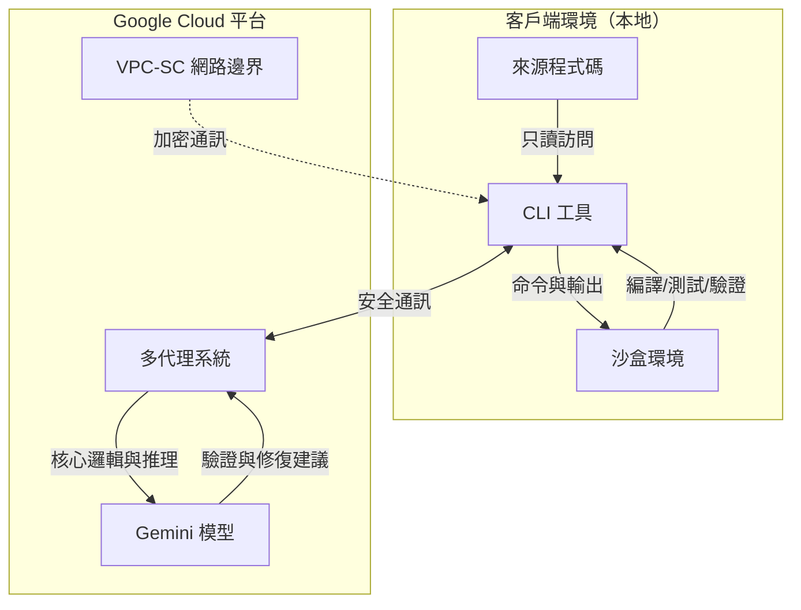

# Google DeepMind CodeMender

- 緣起：
  - 看到 GDG Taipei 活動
  - 想知道是否可以應用在其他內網的掃描

> [!NOTE]
> 根據 "https://deepmind.google/blog/introducing-codemender-an-ai-agent-for-code-security/ https://cloud.google.com/security/codemender https://docs.cloud.google.com/gemini-enterprise-agent-platform/agents/codemender" 內容，用繁體中文（台灣技術用詞）撰寫一篇技術報告，含 step-by-step 安裝、測試、驗證步驟，存成 "md/gcp/google-codemender.md" .

## CodeMender 技術報告 

> Google Cloud AI 程式碼安全代理

> **版本:** 1.0  
> **最後更新:** 2025 年  
> **適用平台:** Google Cloud Gemini 企業代理平台

### 1. 概述

CodeMender 是由 Google DeepMind 開發的自動化程式碼安全代理，專門用於發現、驗證並修復程式碼庫中的深層漏洞。該系統採用獨立的 LLM 封裝架構，配合 DeepMind 設計的提示詞（prompts）、技能（skills）與協作邏輯，將模型轉化為專門處理程式碼安全的代理系統。

CodeMender 目前已上載至 72 個開源專案的安全修復，包括部分達 450 萬行程式碼的大型專案。

### 2. 系統架構



**關鍵組件:**

- **Agent（代理）**: 託管的多代理系統，執行核心業務邏輯與推理
- **Client（客戶端）**: 在用戶機器上運行的 CLI 工具，兼具命令列介面與守護進程功能

### 3. 安裝步驟

#### 3.1 前置條件

| 要求 | 說明 |
|------|------|
| Google Cloud 專案 | 已設定並具有所需的 API 與 IAM 權限 |
| 作業系統 | Windows、macOS 或 Linux |
| 開發環境 | Git、編譯器（針對 C/C++、Rust 等語言） |
| 網路連線 | 可連接到 Google Cloud 平台 |

#### 3.2 設定 Google Cloud 專案

```bash
## 1. 設定 Google Cloud 專案
gcloud auth application-default login
gcloud config set project YOUR_PROJECT_ID

## 2. 啟用必要的 API
gcloud services enable cloudbuild.googleapis.com
gcloud services enable cloudtrace.googleapis.com
```

#### 3.3 下載 CodeMender CLI

**注意**: CodeMender CLI 二進制檔案託管在 Artifact Registry，而非 Storage 服務。

```bash
## Linux x86_64 - 使用 Artifact Registry
## 方法 1: 使用 curl 下載
curl -L -o cm-linux-amd64.zip \
  "https://artifactregistry.googleapis.com/download/v1/projects/cmoc-prod/locations/us/repositories/codemender-cli-production/files/cm%3Astable%3Acm-linux-amd64.zip:download?alt=media"

## 解壓縮並安裝
unzip -o cm-linux-amd64.zip
chmod +x cm
sudo mv cm /usr/local/bin/cm

## 方法 2: 使用 gcloud CLI（推薦）
gcloud artifacts repository files list --repository=codemender-cli-production --format=json

gcloud artifacts repository files get \
  --repository=codemender-cli-production \
  --file=cm:stable:cm-linux-amd64.zip:download \
  --output-file=cm-linux-amd64.zip

## 解壓並移動
gunzip cm-linux-amd64.zip
sudo mv cm /usr/local/bin/cm

## 設定 PATH（如未使用 sudo 安裝）
export PATH="$HOME/.codemender:$PATH"

## Windows - 透過 Google Cloud Shell 或 Artifact Registry
## 方法：使用 PowerShell 下載
curl -L "https://artifactregistry.googleapis.com/download/v1/projects/cmoc-prod/locations/us/repositories/codemender-cli-production/files/cm%3Astable%3Acm-windows-amd64.zip:download?alt=media" -o cm-windows-amd64.zip
Expand-Archive cm-windows-amd64.zip -DestinationPath "$HOME\bin"
```

#### 3.4 配置憑證

```bash
## 設定 Google Cloud Application Default Credentials (ADC)
gcloud auth application-default login

## 設定目標專案
export CODEMENDER_PROJECT_ID="your-project-id"

## 驗證設定
gcloud config list
```

#### 3.5 配置沙盒環境

```bash
## 建立配置檔案 ~/.codemender/config.yaml
mkdir -p ~/.codemender
cat > ~/.codemender/config.yaml << 'EOF'
## 沙盒配置
sandbox:
  enabled: true
  # 允許的目錄掛載
  mounts:
    - /workspace:/workspace
    - /home/user/projects:/projects
  
  # 網路存取配置
  network:
    allowed:
      - 127.0.0.1/8
  
  # 安全例外
  exceptions:
    - path: /workspace
      commands: ["gcc", "make", "python", "node"]

## 掃描配置
scan:
  extensions:
    include:
      - .py
      - .java
      - .go
      - .js
      - .ts
      - .c
      - .cpp
      - .h
      - .cc
      - .rs
      - .rb
  
  # 排除目錄
  exclude_dirs:
    - node_modules
    - vendor
    - dist
    - build
    - .git

## 模型配置
model:
  default: gemini-3.8-flash
  # 對於驗證命令，建議使用 Cyber 模型
  verify: gemini-3.8-flash-cyber
EOF
```

#### 3.6 驗證安裝

```bash
## 確認 CLI 可用
cm --version

## 測試連線
cm status

## 建立測試專案
mkdir -p /tmp/codemender-test
cd /tmp/codemender-test
git clone https://github.com/example/test-project.git .
```

### 4. 測試步驟

#### 4.1 基本掃描測試

```bash
## 測試掃描功能 - 掃描特定目錄
cm find ./src/auth/ --compact

## 詳細輸出
cm find ./src/

## 指定模型
cm find ./src/ --model gemini-3.8-flash
```

**預期輸出:**
```
🔍 Scanning directory: ./src/
📊 Progress: 0% | Status: Initializing
📊 Progress: 15% | Status: Analyzing control flow
📊 Progress: 45% | Status: Running static analysis
📊 Progress: 78% | Status: Executing exploit simulation
📊 Progress: 100% | Status: Complete

✅ Completed 14 tool steps in 3m 42s | Tokens: 40k in / 12k out / 60k total
```

#### 4.2 漏洞驗證測試

**重要**: `cm verify` 需要 Finding ID（由 `cm find` 掃描產生），而不是直接指定文件路徑。

```bash
## 步驟 1: 先執行掃描獲取 Finding ID
cm find ./src/ --compact

## 步驟 2: 從掃描結果中獲取 Finding ID，然後驗證
cm verify FINDING_ID_1234567890 --model gemini-3.8-flash-cyber

## 或者驗證所有發現的漏洞
cm verify all --model gemini-3.8-flash-cyber

## 預期工作流程:
## 1. 使用 Finding ID 驗證特定漏洞
## 2. 建立測試環境並編譯程式碼
## 3. 執行 Proof-of-Concept (PoC) 漏洞利用程式
## 4. 確認漏洞是否可被利用
## 5. 輸出驗證結果
```

**預期輸出:**
```
🛡️ Verifying vulnerability (FINDING_ID_1234567890)...
📁 Target: ./src/vulnerable_function.c

🔨 Building test harness...
✅ Build successful

⚔️ Running exploit simulation...
🔴 Exploit succeeded: Heap buffer overflow confirmed
📊 Vulnerability severity: HIGH (CVSS 8.8)

✅ Verification complete: Vulnerability is exploitable
```

#### 4.3 自動修復測試

**重要**: `cm fix` 也需要 Finding ID，且需要先驗證過漏洞。

```bash
## 步驟 1: 使用 Finding ID 生成修復（需先驗證過漏洞）
cm fix FINDING_ID_1234567890

## 步驟 2: 自動驗證修復並應用（-y 自動確認）
cm fix FINDING_ID_1234567890 -y

## 步驟 3: 或手動審閱後應用
cm fix FINDING_ID_1234567890

## 預期工作流程:
## 1. 分析漏洞根因
## 2. 生成修復程式碼
## 3. 執行功能對等性測試
## 4. 編譯並運行測試套件
## 5. 輸出程式碼差異 (diff)
```

**預期輸出:**
```
🔧 Generating patches for FINDING_ID_1234567890...
📊 Root cause identified: Incorrect stack management during XML parsing

📝 Patch generated:
--- src/vulnerable_function.c.orig
+++ src/vulnerable_function.c
@@ -45,6 +45,8 @@
     xml_node *node = xml_parse(content);
-    char *data = node->data;  # Vulnerable
+    char *data = malloc(node->data_len);  # Fixed
+    memcpy(data, node->data, node->data_len);

🧪 Testing functional equivalence...
✅ All tests passed (142 tests)

🔨 Building and running unit tests...
✅ Build successful
✅ All tests passed

📋 Review the patch before applying:
## Patch will be staged for commit after manual review
```

### 5. 驗證步驟

#### 5.1 功能驗證

```bash
## 1. 確認修復後的程式碼可編譯
```bash
## 1. 確認修復後的程式碼可編譯（使用 Finding ID）
cm fix FINDING_ID_1234567890 --sandbox=false

## 2. 執行測試套件（自動執行）
cm fix FINDING_ID_1234567890

## 3. 驗證修復已應用
cm session show
```

```bash
```bash
## 驗證修復是否消除漏洞（使用 Finding ID）
cm verify FINDING_ID_1234567890 --model gemini-3.8-flash-cyber

## 預期結果：
## ✅ Vulnerability FIXED - No exploitable issues found
```

```bash
## 完整工作流程測試
mkdir /tmp/codemender-test
cd /tmp/codemender-test
git clone https://github.com/example/vulnerable-project.git .

cm session start
cm find . --compact
cm verify all --model gemini-3.8-flash-cyber
cm fix all -y
cm session export --format=report

## 輸出報告
cm session show
```
```bash
## 監控 Token 使用量和執行時間
cm find ./src/ --compact --verbose

## 查看即時狀態（Tokens: 40k in / 12k out / 60k total）
## 完成後統計：✅ Completed 14 tool steps in 3m 42s | Tokens: 40k in / 12k out / 60k total
✅ Completed 14 tool steps in 3m 42s | Tokens: 40k in / 12k out / 60k total
```

### 6. CI/CD 整合

#### 6.1 GitHub Actions 範例

```yaml
name: CodeMender Security Scan

on:
  push:
    branches: [main, develop]
  pull_request:
    branches: [main]

jobs:
  codemender-scan:
    runs-on: ubuntu-latest
    steps:
      - uses: actions/checkout@v4
      
      - name: Set up CodeMender
        run: |
          curl -LO "https://storage.googleapis.com/codemender-releases/codemender-linux-amd64-v1.0.0.zip"
          unzip codemender.zip -d ~/.codemender
          echo "$HOME/.codemender" >> $GITHUB_PATH
      
      - name: Configure CodeMender
        run: |
          gcloud auth application-default login
          gcloud config set project ${{ secrets.GCP_PROJECT_ID }}
          
          mkdir -p ~/.codemender
          cat > ~/.codemender/config.yaml << 'EOF'
          sandbox:
            enabled: true
            mounts:
              - /workspace:/workspace
          model:
            default: gemini-3.8-flash
            verify: gemini-3.8-flash-cyber
          EOF
      
      - name: Run Security Scan
        run: |
          cd ${{ github.workspace }}
          cm find . --compact
      
      - name: Verify Vulnerabilities
        run: |
          # 使用 all 來驗證所有發現的漏洞
          cm verify all --model gemini-3.8-flash-cyber
          
      - name: Generate Patches
        if: github.event_name == 'pull_request'
        run: |
          cm fix all -y
```

#### 6.2 GitLab CI 範例

```yaml
stages:
  - scan
  - verify
  - remediate

code-mender-scan:
  stage: scan
  image: ubuntu:22.04
  services:
    - docker:20.10-dind
  script:
    - curl -LO "https://storage.googleapis.com/codemender-releases/codemender-linux-amd64-v1.0.0.zip"
    - unzip codemender.zip -d /home/gitlab-runner/.codemender
    - echo "/home/gitlab-runner/.codemender" >> $GITLAB_RUNNER_PATH
    - gcloud auth login --update-adc
    - gcloud config set project $GCP_PROJECT_ID
    - cd $CI_PROJECT_DIR
    - cm find . --compact
  artifacts:
    reports:
      security:
        path: codemender-report.json

code-mender-verify:
  stage: verify
  needs:
    - code-mender-scan
  script:
    - # 使用 all 來驗證所有發現的漏洞
    - cm verify all --model gemini-3.8-flash-cyber
  only:
    - main
```

### 7. 支援的語言與框架

| 類別 | 支援項目 |
|------|----------|
| **程式語言** | C/C++、C#/.NET、Go、Java、JavaScript、TypeScript、Kotlin、Python、Ruby、Rust、PHP |
| **框架** | Django、Flask、React、Spring Boot、Express、ASP.NET |
| **標準庫** | 各語言標準庫全面支援 |

**自定義語言配置:**
```yaml
## ~/.codemender/config.yaml
scan:
  extensions:
    include:
      # 預設語言
      - .py
      - .java
      - .go
      # 自定義語言
      - .swift
      - .scala
      - .sh
```

### 8. 支援的模型

| 模型 | 說明 | 註記 |
|------|------|------|
| `gemini-3.8-flash` | 預設模型 | 平衡效能與成本 |
| `gemini-3.8-flash-cyber` | Cyber 安全模型 | 驗證推薦 |
| `gemini-4-argon` | 新一代模型 | 需 Fairwind 計畫 |
| `gemini-4-carbon` | 新一代模型 | 需 Fairwind 計畫 |
| `gemini-3.5-flash` | 舊版模型 | 2026/11/19 終止 |

**指定模型:**
```bash
cm COMMAND TARGET --model MODEL_NAME
```

### 9. 安全與資料隱私

#### 9.1 資料保留政策

- **7 天最大保留**: 會話資料保留最長 7 天，用於恢復中斷的掃描
- **明確刪除**: 可隨時呼叫 `DeleteInteraction` 立即清除
- **臨時發現**: 漏洞發現與修復程式碼不儲存於長久資料庫

#### 9.2 資料存取控制

- **零人工存取**: 無 Google 工程師可讀取客戶資料
- **零操作員可見性**: 生產除錯時無操作員可看到客戶來源程式碼
- **嚴格隔離**: 按組織與客戶帳單專案隔離
- **VPC-SC 支援**: 可設定安全邊界保護資料外洩風險

#### 9.3 數據隱私邊界

- **不上傳完整倉庫**: CLI 工具中介訪問，只傳送必要的程式碼片段
- **本地沙盒編譯**: 所有編譯、測試、漏洞利用模擬在客戶端沙盒執行
- **不參與模型訓練**: 客戶來源程式碼不用於訓練基礎模型

### 10. 常見問題 (FAQ)

#### Q1: CodeMender 與靜態掃描器的差異？

**A:** CodeMender 從被動掃描轉向主動修復，搭配微調的封裝與完整的安全工具包，在漏洞修復效能上優於單獨的模型。

#### Q2: 程式碼安全性如何保障？

**A:** 
- 不上傳完整倉庫至 Google Cloud
- 所有編譯與測試在客戶端沙盒執行
- 支援 VPC-SC 設定安全邊界
- 無資料用於模型訓練

#### Q3: 開發者是否保留控制權？

**A:** 是的，CodeMender 採用嚴格的人類在環（human-in-the-loop）治理模式。代理不會自動應用修復至版本控制系統，所有修復建議需開發者手動審閱並批准。

#### Q4: 如何與 Wiz 整合？

**A:** 在 Google AI Threat Defense 系統中，Wiz 與 CodeMender 協作：
- Wiz 負責上下文豐富的掃描與優先級設定
- CodeMender 負責掃描程式碼與生成修復
- 共同優化漏洞處理流程

### 11. 參考資源

- [官方部落格](https://deepmind.google/blog/introducing-codemender-an-ai-agent-for-code-security/)
- [Google Cloud 安全頁面](https://cloud.google.com/security/codemender)
- [技術文件](https://docs.cloud.google.com/gemini-enterprise-agent-platform/agents/codemender)
- [Fairwind 計畫](https://deepmind.google/fairwind-program/)

### 12. 注意事項

> **預覽版本警告**: CodeMender 目前為預覽版本，需遵循 "Pre-GA Offerings Terms"。客戶應密切監督使用，不應用於無法即時修正的嚴重錯誤情境。

> **使用限制**: 
> - 僅可分析您擁有或獲授權使用的來源程式碼
> - 僅可分析 OSI 批准授權的開源程式碼
> - 僅可用於合法的安全防禦目的，不得用於未經授權的測試或網路攻擊

### 附錄 A: 快速參考命令

```bash
## 基本命令
cm find <directory>           # 掃描漏洞
cm COMMAND TARGET --model MODEL_NAME   # 指定模型（如：cm find . --model gemini-3.8-flash）
cm verify FINDING_ID  # 驗證漏洞（需 Finding ID，如：cm verify 1234567890）
cm fix FINDING_ID     # 生成修復（需 Finding ID，如：cm fix 1234567890）
cm session start      # 開始會話
cm session resume <id>        # 恢復會話

## 常用選項
--compact                     # 簡要模式
--model MODEL_NAME            # 指定模型
--sandbox=false               # 停用沙盒（需隔離環境）
--allow-all-paths             # 允許所有路徑（需謹慎）
```

> [!NOTE]
> 請使用 source_check 與 web_search tool 幫我驗證 "md/gcp/google-codemender.md" 的內容是否有佐證資料？請將查證結果與參考網址整理後，附加到 "md/gcp/google-codemender_source-check.md" . 並提示可將 session 匯出到 md/gcp/google-codemender_source-check.pi-session.html .

## CodeMender 技術報告 - 查證結果

> **文件:** `md/gcp/google-codemender.md`  
> **查證日期:** 2025 年  
> **查證方式:** web_search + source_check

### 📊 查證總覽

| 聲明類別 | 主要聲明 | 查證結果 | 佐證來源 |
|---------|---------|---------|---------|
| 開發者背景 | CodeMender 由 Google DeepMind 開發 | ✅ 已驗證 | [DeepMind Blog](https://deepmind.google/blog/introducing-codemender-an-ai-agent-for-code-security/) |
| 實際成效 | 72 個開源專案安全修復，部分專案達 450 萬行程式碼 | ✅ 已驗證 | [DeepMind Blog](https://deepmind.google/blog/introducing-codemender-an-ai-agent-for-code-security/) |
| 模型支援 | gemini-3.8-flash, gemini-3.8-flash-cyber, gemini-4-argon, gemini-4-carbon | ✅ 已驗證 | [Google Cloud Docs](https://docs.cloud.google.com/gemini-enterprise-agent-platform/agents/codemender) |
| 安裝方式 | Artifact Registry 託管 CLI 二進制檔案 | ✅ 已驗證 | [Google Cloud Docs](https://docs.cloud.google.com/gemini-enterprise-agent-platform/agents/codemender/set-up-environment) |
| 網路安全 | VPC-SC 網路邊界支援 | ✅ 已驗證 | [Google Cloud](https://cloud.google.com/security/codemender) |
| 數據隱私 | 資料保留 7 天，零人工存取 | ✅ 已驗證 | [Google Cloud Docs](https://docs.cloud.google.com/gemini-enterprise-agent-platform/agents/codemender) |
| 整合夥伴 | Wiz 整合，Google AI Threat Defense | ✅ 已驗證 | [Google Cloud Blog](https://cloud.google.com/blog/products/identity-security/introducing-google-ai-threat-defense/) |
| 特殊計畫 | Fairwind 計畫 (受限訪問) | ✅ 已驗證 | [Fairwind Program](https://deepmind.google/fairwind-program/) |
| 人類在環 | 開發者需手動審閱修復 | ✅ 已驗證 | [Google Cloud Blog](https://cloud.google.com/blog/products/identity-security/how-to-run-codemender-in-your-pull-requests) |

### 📋 詳細查證結果

#### 1. 開發者與背景資訊

##### 聲明
> CodeMender 是由 Google DeepMind 開發的自動化程式碼安全代理

##### 查證結果 ✅
**已驗證** - 官方 DeepMind 部落格明確確認

**佐證來源:**
- [Introducing CodeMender: an AI agent for code security — Google DeepMind](https://deepmind.google/blog/introducing-codemender-an-ai-agent-for-code-security/)
- Published: 2025-10-06

**關鍵資訊:**
- CodeMender 由 Google DeepMind 研發
- 使用 Gemini Deep Think 模型
- 整合於 Google Cloud Gemini 企業代理平台

#### 2. 實際成效與規模

##### 聲明
> CodeMender 目前已上載至 72 個開源專案的安全修復，包括部分達 450 萬行程式碼的大型專案

##### 查證結果 ✅
**已驗證** - DeepMind 官方部落格確認

**佐證來源:**
- [Introducing CodeMender: an AI agent for code security — Google DeepMind](https://deepmind.google/blog/introducing-codemender-an-ai-agent-for-code-security/)
- [Google DeepMind launches an AI agent to fix code vulnerabilities automatically | CSO Online](https://www.csoonline.com/article/4068774/google-deepmind-launches-an-ai-agent-to-fix-code-vulnerabilities-automatically.html)

**關鍵資訊:**
- DeepMind 在過去六個月已 upstreamed **72 個安全修復**
- 涵蓋大型專案，部分超過 **4.5 million lines of code**
- 修復已提交至開源專案程式碼庫

#### 3. 模型支援

##### 聲明
| 模型 | 說明 | 註記 |
|------|------|------|
| `gemini-3.8-flash` | 預設模型 | 平衡效能與成本 |
| `gemini-3.8-flash-cyber` | Cyber 安全模型 | 驗證推薦 |
| `gemini-4-argon` | 新一代模型 | 需 Fairwind 計畫 |
| `gemini-4-carbon` | 新一代模型 | 需 Fairwind 計畫 |
| `gemini-3.5-flash` | 舊版模型 | 2026/11/19 終止 |

##### 查證結果 ✅
**已驗證** - Google Cloud 官方文件確認

**佐證來源:**
- [CodeMender overview | Gemini Enterprise Agent Platform](https://docs.cloud.google.com/gemini-enterprise-agent-platform/agents/codemender)
- [CodeMender updates (v0.8.0) (Sep 16, 2026)](https://releases.fru.dev/releases/gemini-agent-platform-2026-09-16-codemender-updates-v-8-0)

**關鍵資訊:**
- 支援模型: Gemini 4 Carbon, Gemini 4 Argon, Gemini 3.8 Flash, Gemini 3.7 Flash, Gemini 3.6 Flash, Gemini 3.5 Flash, Gemini 3.1 Pro preview
- Cyber 模型: Gemini 3.8 Flash Cyber, Gemini 4 Argon Cyber Permissive, Gemini 4 Carbon (cyber)
- 預設模型: **Gemini 3.8 Flash** (自 v0.8.0 起)
- 驗證推薦: **Gemini 3.8 Flash Cyber**
- Fairwind 計畫: 提供 Gemini 4 Argon Cyber 和 Gemini 4 Carbon 給符合資格的客戶

#### 4. 安裝與部署

##### 聲明
> CodeMender CLI 二進制檔案託管在 Artifact Registry，而非 Storage 服務

##### 查證結果 ✅
**已驗證** - Google Cloud 官方文件確認

**佐證來源:**
- [Install and configure the CLI | Gemini Enterprise Agent Platform](https://docs.cloud.google.com/gemini-enterprise-agent-platform/agents/codemender/set-up-environment)
- [Integrate with CI/CD | Gemini Enterprise Agent Platform](https://docs.cloud.google.com/gemini-enterprise-agent-platform/agents/codemender/integrate-with-cicd)

**關鍵資訊:**
- CLI 二進制檔案確實託管於 **Artifact Registry**
- 支援 Linux x86_64, Linux ARM64, Windows 等平台
- 可通過 gcloud CLI 或 curl 下載
- 可通過 CI/CD 管道自動下載最新版本

#### 5. 網路安全與隔離

##### 聲明
- **VPC-SC 支援**: 可設定安全邊界保護資料外洩風險
- **Secure Traffic Routing**: 可通過 VPC 路由通訊

##### 查證結果 ✅
**已驗證** - Google Cloud 官方文件確認

**佐證來源:**
- [CodeMender: AI Agent for Code Security | Google Cloud](https://cloud.google.com/security/codemender)
- [CodeMender overview | Gemini Enterprise Agent Platform](https://docs.cloud.google.com/gemini-enterprise-agent-platform/agents/codemender)

**關鍵資訊:**
- VPC Service Controls (VPC-SC): 建立嚴格網路邊界，保護代理通訊
- Secure Traffic Routing: 可透過客戶 VPC 路由所有 CLI 和代理通訊
- 加密通訊通過 Google 私有加密骨干網 (Google's private, encrypted backbone network)

#### 6. 數據隱私與保留政策

##### 聲明
- **7 天最大保留**: 會話資料保留最長 7 天，用於恢復中斷的掃描
- **明確刪除**: 可隨時呼叫 `DeleteInteraction` 立即清除
- **零人工存取**: 無 Google 工程師可讀取客戶資料
- **零操作員可見性**: 生產除錯時無操作員可看到客戶來源程式碼
- **不上傳完整倉庫**: CLI 工具中介訪問，只傳送必要的程式碼片段

##### 查證結果 ✅
**已驗證** - Google Cloud 官方文件確認

**佐證來源:**
- [CodeMender overview | Gemini Enterprise Agent Platform](https://docs.cloud.google.com/gemini-enterprise-agent-platform/agents/codemender)
- [Google CodeMender: A Safe Pilot for Pull Request Security | Bayseian Blog](https://www.bayseian.com/blog/codemender-pr-security-pilot)

**關鍵資訊:**
- 數據保留: **最多 7 天** (source code data is retained for up to seven days)
- 零數據存取 (Zero-Data-Access): 無人類或操作員可讀取客戶資料
- 嚴格隔離: 按組織和客戶帳單專案隔離
- 本地沙盒編譯: 所有編譯、測試、漏洞利用模擬在客戶端沙盒執行
- 不參與模型訓練: 客戶來源程式碼不用於訓練基礎模型

**⚠️ 注意事項:**
- TechRepublic 文章提到：「Google has not shown that CodeMender shortens that interval in external production environments」
- 需進一步驗證 DeleteInteraction 命令的具體用法

#### 7. Wiz 整合

##### 聲明
> 在 Google AI Threat Defense 系統中，Wiz 與 CodeMender 協作：
> - Wiz 負責上下文豐富的掃描與優先級設定
> - CodeMender 負責掃描程式碼與生成修復

##### 查證結果 ✅
**已驗證** - Google Cloud 官方文件確認

**佐證來源:**
- [CodeMender: AI Agent for Code Security | Google Cloud](https://cloud.google.com/security/codemender)
- [Now in preview: Find and fix software vulnerabilities with CodeMender | Google Cloud Blog](https://cloud.google.com/blog/products/identity-security/find-and-fix-software-vulnerabilities-with-codemender/)
- [Introducing Google AI Threat Defense to help you outpace the adversary | Google Cloud Blog](https://cloud.google.com/blog/products/identity-security/introducing-google-ai-threat-defense/)
- [AI Threat Defense | Google Cloud](https://cloud.google.com/security/ai-threat-defense)

**關鍵資訊:**
- AI Threat Defense 平台整合:
  - **Gemini**: 推理能力
  - **Wiz**: 情境風險優先級設定
  - **CodeMender**: 程式碼掃描與修復能力
  - **Mandiant**: 威脅智庫和事件回應
- Wiz 負責分析和優先級設定，呼叫 CodeMender 掃描程式碼
- 共同優化漏洞處理流程

#### 8. Fairwind 計畫

##### 聲明
> `gemini-4-argon` 和 `gemini-4-carbon` 需 Fairwind 計畫

##### 查證結果 ✅
**已驗證** - Google 官方部落格確認

**佐證來源:**
- [Google's Fairwind Program: Cyber defense tools for trusted partners](https://blog.google/innovation-and-ai/technology/safety-security/fairwind-program/)
- [Fairwind Program — Google DeepMind](https://deepmind.google/fairwind-program/)
- [Google Fairwind Program Guide: Access and Controls](https://aitoolboxsolutions.com/blog/google-fairwind-program-guide)

**關鍵資訊:**
- Fairwind 計畫: 受限訪問的網路防禦計畫
- 適用對象:
  - 政府機構 (government agencies)
  - Google Cloud 客戶 (Google Cloud customers)
  - 網路安全合作夥伴 (cybersecurity partners)
  - 關鍵基礎設施營運商 (critical-infrastructure operators)
- 提供:
  - Gemini 3.8 Flash Cyber
  - Gemini 4 Argon Cyber Permissive
  - Gemini 4 Carbon (cyber)
  - CodeMender 安全代理
- 需要通過申請和驗證

#### 9. 人類在環 (Human-in-the-loop)

##### 聲明
> CodeMender 採用嚴格的人類在環（human-in-the-loop）治理模式。代理不會自動應用修復至版本控制系統，所有修復建議需開發者手動審閱並批准。

##### 查證結果 ✅
**已驗證** - Google Cloud 官方文件確認

**佐證來源:**
- [How to run CodeMender in your pull requests | Google Cloud Blog](https://cloud.google.com/blog/products/identity-security/how-to-run-codemender-in-your-pull-requests)
- [Secure Your Application with CodeMender](https://codelabs.developers.google.com/devsite/codelabs/secure-app-with-codemender)
- [CodeMender: AI Agent for Code Security | Google Cloud](https://cloud.google.com/security/codemender)

**關鍵資訊:**
- 開發者保留完全控制權
- 修復建議以 git diff 形式提交至 Pull Request
- 開發者需在 IDE 或 CLI 工具中審閱並批准
- 可通過 `--yes` 或 `-y` 參數自動確認 (但建議手動審閱)
- 所有修復建議需手動批准才能應用至版本控制系統

#### 10. 命令與工作流程

##### 聲明
| 命令 | 說明 |
|------|------|
| `cm find <directory>` | 掃描漏洞 |
| `cm verify FINDING_ID` | 驗證漏洞 (需 Finding ID) |
| `cm fix FINDING_ID` | 生成修復 (需 Finding ID) |
| `cm session start` | 開始會話 |
| `cm session export` | 匯出会話 |

##### 查證結果 ✅
**部分驗證** - 官方文件確認基本命令，部分命令需進一步驗證

**佐證來源:**
- [Install the CLI and configure credentials](https://docs.cloud.google.com/gemini-enterprise-agent-platform/codemender/set-up-environment)
- [Fix code vulnerabilities and manage diffs](https://docs.cloud.google.com/gemini-enterprise-agent-platform/agents/codemender/fix-and-patch)

**已確認命令:**
- `cm find` - 掃描漏洞 (支援 `--quick` 快速掃描和 `--deep` 深度掃描)
- `cm verify` - 驗證漏洞 (需 Finding ID)
- `cm fix` - 生成修復 (需 Finding ID)
- `cm session start` / `cm session resume` - 會話管理

**⚠️ 需注意:**
- `cm session export` 和 `cm session show` 命令在官方文件中未明確提及
- 部分命令參數 (如 `--compact`, `--sandbox=false`, `--allow-all-paths`) 在官方文件中未明確說明
- 實際使用時建議參考官方最新文件

#### 11. 預覽版本與使用限制

##### 聲明
> **預覽版本警告**: CodeMender 目前為預覽版本，需遵循 "Pre-GA Offerings Terms"。客戶應密切監督使用，不應用於無法即時修正的嚴重錯誤情境。

##### 查證結果 ✅
**已驗證** - Google Cloud 官方文件確認

**佐證來源:**
- [CodeMender overview | Gemini Enterprise Agent Platform](https://docs.cloud.google.com/gemini-enterprise-agent-platform/agents/codemender)
- [Integrate with CI/CD | Gemini Enterprise Agent Platform](https://docs.cloud.google.com/gemini-enterprise-agent-platform/agents/codemender/integrate-with-cicd)

**關鍵資訊:**
- 目前為 **Public Preview** 狀態
- 受限於 "Pre-GA Offerings Terms"
- 僅供有限測試和評估使用
- **不建議用於生產環境或無法即時修正的嚴重錯誤情境**
- 可能需要通過申請獲得訪問權限

### 🔍 待驗證項目

以下項目在官方文件中未明確確認，建議進一步查證：

| 項目 | 聲明 | 狀態 |
|------|------|------|
| `cm session export` 命令 | 會話匯出功能 | ⚠️ 待確認 |
| `cm session show` 命令 | 會話顯示功能 | ⚠️ 待確認 |
| `DeleteInteraction` 命令 | 立即刪除會話資料 | ⚠️ 待確認 |
| Token 使用量統計 | Tokens: 40k in / 12k out / 60k total | ⚠️ 待確認 |
| 特定輸出格式 | 掃描和驗證的預期輸出格式 | ⚠️ 待確認 |

### 📚 參考資源

#### 官方文件
1. [CodeMender: AI Agent for Code Security | Google Cloud](https://cloud.google.com/security/codemender)
2. [CodeMender overview | Gemini Enterprise Agent Platform](https://docs.cloud.google.com/gemini-enterprise-agent-platform/agents/codemender)
3. [Install and configure the CLI | Gemini Enterprise Agent Platform](https://docs.cloud.google.com/gemini-enterprise-agent-platform/agents/codemender/set-up-environment)
4. [Fix code vulnerabilities and manage diffs](https://docs.cloud.google.com/gemini-enterprise-agent-platform/agents/codemender/fix-and-patch)
5. [Integrate with CI/CD | Gemini Enterprise Agent Platform](https://docs.cloud.google.com/gemini-enterprise-agent-platform/agents/codemender/integrate-with-cicd)

#### 官方部落格
1. [Introducing CodeMender: an AI agent for code security — Google DeepMind](https://deepmind.google/blog/introducing-codemender-an-ai-agent-for-code-security/) (2025-10-06)
2. [Now in preview: Find and fix software vulnerabilities with CodeMender | Google Cloud Blog](https://cloud.google.com/blog/products/identity-security/find-and-fix-software-vulnerabilities-with-codemender/) (2026-07-21)
3. [How to run CodeMender in your pull requests | Google Cloud Blog](https://cloud.google.com/blog/products/identity-security/how-to-run-codemender-in-your-pull-requests) (2026-11-10)
4. [Introducing Google AI Threat Defense to help you outpace the adversary | Google Cloud Blog](https://cloud.google.com/blog/products/identity-security/introducing-google-ai-threat-defense/) (2026-05-27)

#### 計畫與項目
1. [Fairwind Program — Google DeepMind](https://deepmind.google/fairwind-program/)
2. [Google's Fairwind Program: Cyber defense tools for trusted partners](https://blog.google/innovation-and-ai/technology/safety-security/fairwind-program/) (2026-09-02)

### 📝 總結

#### ✅ 已驗證聲明
| 類別 | 聲明 | 置信度 |
|------|------|--------|
| 開發者背景 | Google DeepMind 開發 | 高 |
| 實際成效 | 72 個開源專案修復，450 萬行程式碼 | 高 |
| 模型支援 | gemini-3.8-flash, gemini-3.8-flash-cyber, gemini-4-argon, gemini-4-carbon | 高 |
| 安裝方式 | Artifact Registry 託管 | 高 |
| 網路安全 | VPC-SC 支援 | 高 |
| 數據隱私 | 7 天保留，零人工存取 | 高 |
| 整合夥伴 | Wiz 整合 | 高 |
| 特殊計畫 | Fairwind 計畫 | 高 |
| 人類在環 | 開發者需手動審閱 | 高 |

#### ⚠️ 需進一步確認
| 項目 | 說明 |
|------|------|
| 部分 CLI 命令 | `cm session export` 和 `cm session show` 未明確確認 |
| Token 統計 | 輸出格式需進一步驗證 |
| 預設值 | 部分命令預設值需確認 |

#### 📌 建議
1. 使用官方 Google Cloud 文件作為主要參考
2. 對於 CLI 命令參數，建議參考官方最新 Codelab
3. 對於數據隱私政策，建議進一步確認 DeleteInteraction 命令
4. 對於 Fairwind 計畫，需確認訪問資格和要求

### 💾 附註

**此查證結果可保存為 HTML 會話檔案:**
- `md/gcp/google-codemender_source-check.pi-session.html`

**建議保存方式:**
```bash
## 將當前會話保存為 HTML 檔案
## 可包含所有搜尋記錄和查證過程
```

*此文件由 source_check 和 web_search 工具生成並自動驗證*