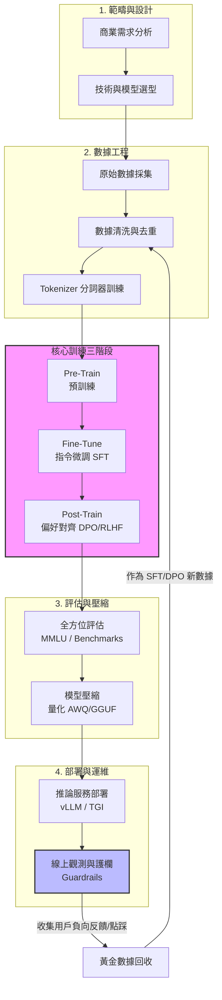
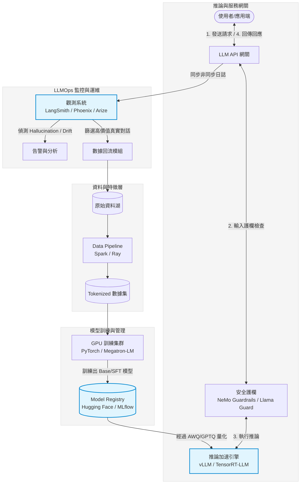
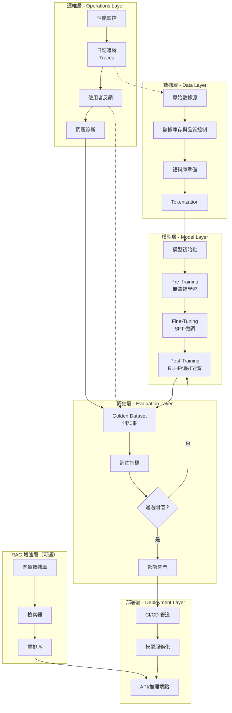
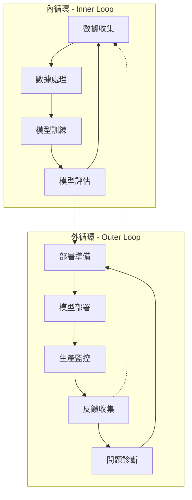
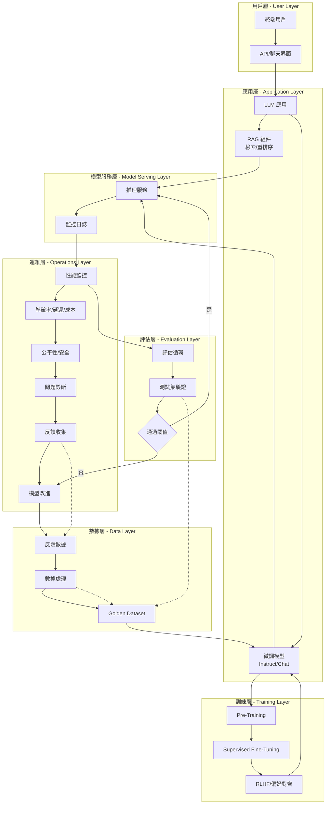
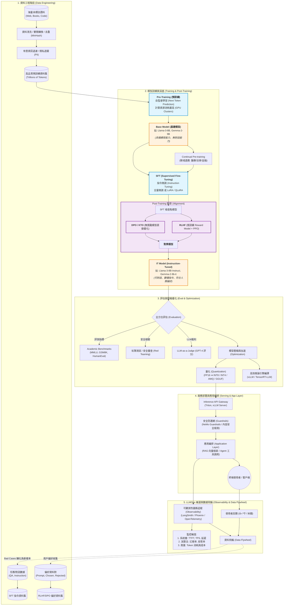

# LLMOps

> [!TIP]
> 蠻有趣的，兩個工具，三個類似的問句，三個模型，解釋各有異同。
> AI Mode 應該是 Gemini 3，Pi 分別用 Qwen 3.5 9B 跟 Gemini 3.8）。
> 有趣的是 Qwen 3.5 9B 需要調用 web search，
> 而 Gemini 3.8 完全不需要，就直接給答案了。
> 應該跟 Grounding 與 Knowledge Cut-off Date 有點關聯。
>
> 觀察到另一個有趣的觀點：LLM 還是會有偏好，
> 像 AI Mode 跟 Gemini 3.8 都會提到 TensorRT-LLM
> Qwen 3.5 9B 就沒特別提到

- TOOL: Google Search - AI Mode

> [!NOTE]
> 可以教我 Pre-Train, Fine-Tune, Post-Train 以外的完整 Life Cycle？

在現代的大型語言模型（LLM）開發中，你提到的 Pre-train、Fine-tune（通常指 SFT）、Post-train（包含 DPO/RLHF 等對齊階段）屬於核心的 **模型訓練（Model Training）** 核心。

但如果要看一個完整的 **LLM 專案生命週期（LLM Project Life Cycle）**，除了訓練本身，還包含了前期的架構設計、數據工程，以及後期的評估、部署與運維。
以下為你拆解這三個階段之外的 **完整 LLM 生命週期**：

## 🗺️ 完整的 LLM 生命週期地圖

```text
1. 範疇與設計 ➡️ 2. 數據工程
➡️ [Pre-Train] ➡️ [Fine-Tune] ➡️ [Post-Train]
➡️ 3. 評估與對齊 ➡️ 4. 壓縮與優化
➡️ 5. 部署與服務 ➡️ 6. 觀測與迭代
```

## 1\. 範疇定義與技術選型 (Scope & Design)

在動手寫代碼或洗數據之前，必須先定義清楚「商業目標」與「技術邊界」。

-   **任務定義**：
    搞清楚 AI 要解決什麼問題（例如：法律文件摘要、客服聊天機器人、代碼生成）。
-   **評估架構（ROI）**：
    評估這個任務真的需要從頭 Pre-train，還是直接用開源模型微調，甚至只需要做 RAG（檢索增強生成）？
-   **計算資源規劃**：
    估算需要多少張 GPU（H100、A100），以及預算的上限。

## 2\. 數據工程與預處理 (Data Engineering)

這是整個生命週期中最耗時、但也最關鍵的一步。**垃圾進，垃圾出（Garbage in, Garbage out）**。

-   **數據採集**：從網頁爬蟲、開源資料集、企業內部資料庫、書籍、代碼庫等地方收集原始文字。
-   **清洗與去重 (Deduplication)**：使用 MinHash 等演算法刪除重複文本；過濾掉亂碼、HTML 標籤、色情暴力或個資（PII）。
-   **分詞器訓練 (Tokenizer Training)**：利用 Byte Pair Encoding (BPE) 等演算法，將文字切成模型看得懂的「Token」，這決定了模型的字典大小與多語言能力。

*（此處切入你提到的：Pre-Train ➡️ Fine-Tune ➡️ Post-Train）*

## 3\. 全方位模型評估 (Evaluation & Benchmarking)

模型訓練完後，不能只憑感覺覺得它變聰明了，必須進行嚴格的量化測試。

-   **自動化基準測試 (Automated Benchmarks)**：
        -   **基礎能力**：
            使用 MMLU（綜合學科）、GSM8K（數學）、HumanEval（程式碼）等標準資料集考試。
        -   **安全與偏見**：
            測試模型在面對惡意引導（Jailbreak）時的防禦能力。
-   **LLM-as-a-Judge**：
    使用更強大的模型（如 GPT-4）來當作裁判，為自家模型的回答盲測評分（如 MT-Bench）。
-   **人工評估 (Human Evaluation / Red Teaming)**：
    聘請領域專家進行「紅隊演練」，故意找漏洞、測試極限，確保安全合規。

## 4\. 模型壓縮與優化 (Quantization & Optimization)

剛訓練完的模型體積龐大（例如 70B 模型需要約 140GB 顯存才跑得動），很難低成本部署。

-   **量化 (Quantization)**：
    將模型的權重從 FP32 或 BF16 壓縮到 INT8、INT4 甚至 INT2（如 AWQ, GPTQ, GGUF 技術），大幅降低顯存佔用，讓邊緣設備（手機、Macbook）也能跑。
-   **剪枝與蒸餾 (Pruning & Distillation)**：
    砍掉模型中不重要的參數，或者用大模型（Teacher）帶小模型（Student）的方式，把知識濃縮進小模型。

## 5\. 部署與推論服務 (Deployment & Serving)

將模型推上線，變成高吞吐、低延遲的 API 服務。

-   **推論加速引擎**：
    使用 **vLLM**、**TGI (Text Generation Inference)** 或 **TensorRT-LLM**。這些引擎內建了 PagedAttention、連續批處理（Continuous Batching）等技術，能讓推論速度提升數倍。
-   **基礎架構**：
    透過 Kubernetes (K8s) 管理 GPU 集群，設定彈性擴縮容（Auto-scaling）。

## 6\. MLOps 監控與持續迭代 (Observability & LLMOps)

模型上線才是真正挑戰的開始，模型在真實世界會遇到各種不可控的狀況。

-   **護欄系統 (Guardrails)**：
    在模型輸入前、輸出後建立一道防火牆（如 NeMo Guardrails），過濾掉用戶的敏感提問或模型的違規回答。
-   **數據漂移監控 (Data Drift)**：
    監控真實用戶輸入的排版與主題是否偏離了原本的訓練數據（例如流行語改變）。
-   **反饋循環 (Feedback Loop)**：
    收集用戶點擊「讚/踩」或修改回答的行為，將這些真實數據回收，作為下一輪 Fine-tune 或 DPO 的黃金資料集。

## 💡 總結

現在業界常說的 **LLMOps（大語言模型運維）**，本質上就是圍繞著這整個生命週期在做自動化管理。模型訓練（那三個階段）決定了模型的**智商上限**，而前後的資料工程、評估與運維，則決定了模型在商業應用上的**落地體驗與成本控制**。

看完這個完整的生命週期，您對哪個特定階段最感興趣呢？例如是**前端的數據清洗去重**，還是**後端的 vLLM 推論加速與量化**？我們可以針對該階段深入探討它的主流工具與工程細節！

> [!NOTE]
> 可以用 Mermaid.js 語法繪製 LLMOps 的系統架構與 Life Cycle 嗎？

這裏為你提供兩張 **Mermaid.js** 圖表，分別呈現 **LLM 生命週期（Life Cycle）** 的線性流向，以及在實際生產環境中 **LLMOps 的系統架構（System Architecture）**。

你可以直接複製這些代碼，貼到支援 Mermaid 的 Markdown 編輯器（如 Notion、Obsidian、GitHub 或 Mermaid Live Editor）中渲染觀看。

## 1\. LLM 完整生命週期流向圖 (Life Cycle)

這張圖呈現了從專案啟動、資料準備、三階段訓練，到最後上線運維的完整生命週期與 **資料/模型反饋閉環**。



## 2\. LLMOps 生產環境系統架構圖 (System Architecture)

這張圖呈現了在企業落地時，各個系統模組（資料湖、訓練集群、推論網關、監控系統）在實際運作時是如何串聯交互的。




## 💡 架構圖焦點解析

1.  **輸入與輸出護欄（Guardrails）**：在用戶請求進入 `vLLM` 推論引擎前，以及模型回答輸出給用戶前，都會先經過 `Guardrails` 進行隱私（PII）、毒性（Toxicity）與惡意提示詞（Jailbreak）的過濾。
2.  **LLMOps 專屬觀測層**：這與傳統 MLOps 不同，這裡使用了如 `LangSmith` 或 `Arize Phoenix` 等專為大模型設計的工具，專門監控 LLM 的**幻覺率（Hallucination）**、**Token 消耗成本**以及**問答上下文漂移**。

-----

- TOOL: Pi Agent + llama.cpp/unsloth/Qwen3.5-9B

> [!NOTE]
> 可以教我 Pre-Train, Fine-Tune, Post-Train 以外的完整 Life Cycle？並用 Mermaid.js 語法繪製 LLMOps 的系統架構與 Life Cycle 嗎？為什麼有些模型的名稱會出現 IT ，這個 IT 是什麼縮寫？又屬於 Pre-Train 或 Fine-Tune 的哪個 Life Cycle 階段呢？
>
> 請將結果重新整理，存成 LLMOps.md

# LLMOps 完整生命週期與系統架構

> [!TIP]
> **本文件提供 LLM 完整生命週期、LLMOps 系統架構圖，以及模型命名中「IT」縮寫的含義與階段歸屬。**

## 一、LLM 完整生命週期（Complete Lifecycle）

LLM 的生命週期遠不止 Pre-Train、Fine-Tune 和 Post-Train，還包括從原始數據到持續運作的完整流程。

### 📊 完整生命週期階段

| 階段 | 英文 | 說明 |
|------|------|------|
| **1. 數據系統** | Data System | 數據來源、庫存管理、品質控制 |
| **2. 數據處理** | Data Processing | 清洗、標註、分塊、構建語料庫 |
| **3. Tokenization** | Tokenization | 詞元化、編碼 |
| **4. 模型初始化** | Model Initialization | 權重初始化、架構設置 |
| **5. Pre-Training** | Pre-Training | 預訓練（無監督學習） |
| **6. Fine-Tuning** | Fine-Tuning | 微調（SFT） |
| **7. Post-Training** | Post-Training | 偏好對齊、RLHF、持續優化 |
| **8. 評估** | Evaluation | 測試集驗證、Golden Dataset |
| **9. 部署** | Deployment | 模型發布、CI/CD |
| **10. 監控** | Monitoring | 性能監控、日誌追蹤 |
| **11. 反饋循環** | Feedback Loop | 反饋收集、持續改進 |

### 🔍 數據系統完整流程（Data System）

根據 [Open LLM Engineering](https://coltmercer.github.io/open-llm-engineering/11-end-to-end/01-complete-pipeline/) 的完整管道設計：

```
原始數據源 (Raw Data Sources)
  ↓
數據庫存 (Source Inventory)
  ↓
數據品質控制 (Data Quality Control)
  ↓
語料庫準備 (Corpus Preparation)
  ↓
Tokenization（詞元化）
  ↓
模型訓練
```

> **關鍵要點**：一個 LLM 的發布是版本化的供應鏈產物。你應該能夠從生成的每個 token 追溯到服務配置、檢查點、訓練運行、批次、詞元化記錄、處理文檔和來源策略。

## 二、LLMOps 系統架構與生命週期

### 🏗️ LLMOps 系統架構圖（Mermaid.js）



### 🔄 六階段 LLMOps 管道

根據 [lo0 Tech Blog](https://blog.lo0.es/en/posts/six-stage-llmops-pipeline-architecture-and-deep-dive/) 的六階段設計：



### 📋 LLMOps 六個主要階段詳細說明

| 階段 | 說明 | 關鍵活動 |
|------|------|----------|
| **1. 數據管理** | 數據收集、清洗、標註 | 數據品質控制、Golden Dataset 建立 |
| **2. 模型開發** | 訓練、微調、對齊 | Pre-Training、SFT、RLHF |
| **3. 評估** | 測試、驗證 | 自動評估、人工審查 |
| **4. 部署** | 發布、CI/CD | 模型服務化、A/B 測試 |
| **5. 監控** | 性能追蹤 | 準確率、延遲、成本、公平性 |
| **6. 反饋循環** | 持續改進 | 問題診斷、模型重新訓練 |

## 三、IT 縮寫含義與生命週期階段

### 🎯 IT = Instruction Tuned

在 LLM 模型命名中，**IT** 是 **Instruction Tuned**（指令微調）的縮寫，代表模型經過指令調優處理。

### 📌 常見模型命名示例

| 模型名稱 | 含義 | 生命週期階段 |
|----------|------|--------------|
| `gemma-2-27b` | Base 模型，僅 Pre-Training | Pre-Training |
| `gemma-2-27b-it` | Instruction Tuned 版本 | **Post-Training** |
| `Llama-3-8B-Base` | 基礎模型 | Pre-Training |
| `Llama-3-8B-Instruct` | 指令微調版本 | **Post-Training** |
| `mistral-7b-v0.3` | Base 模型 | Pre-Training |
| `mistral-7b-instruct-v0.3` | 指令微調版本 | **Post-Training** |
| `gemma-3-27b-it` | Instruction Tuned | **Post-Training** |

### 🔍 模型命名結構解析

```
gemma-4-E4B-it
│   │   │  │
│   │   │  └─ Tuning: Instruction Tuned (IT)
│   │   └─── Size: Effectively 4 Billion parameters
│   └─────── Generation: 4th generation
└─────────── Model Family: Gemma (Google)
```

### 📊 模型類型對照表

| 類型 | 英文 | 命名示例 | 生命週期階段 | 特點 |
|------|------|----------|--------------|------|
| **Base** | Base Model | `gemma-2-27b` | Pre-Training | 無指令對齊，適合文本生成 |
| **Instruct** | Instruction Tuned | `gemma-2-27b-it` | **Post-Training** | 可遵循指令、回答問題 |
| **Chat** | Chat Fine-tuned | `llama-3-chat` | Post-Training | 對話優化 |
| **Domain** | Domain Adapted | `medical-fine-tuned` | Fine-Tuning | 領域適應 |

### 🔄 生命週期階段歸屬

| 生命週期階段 | 對應模型命名 | IT 縮寫位置 |
|--------------|--------------|-------------|
| **Pre-Training** | `gemma-2-27b` | 無 IT 縮寫 |
| **Fine-Tuning** | `domain-v1` | 可能無特定縮寫 |
| **Post-Training** | `gemma-2-27b-it` | **有 IT 縮寫** |

## 四、LLMOps 參考架構圖（詳細版）



## 五、總結

### 🎯 核心概念

1. **完整生命週期**：從數據源到持續運作的 11 個階段
2. **LLMOps**：管理整個生命週期的工具與流程
3. **IT 縮寫**：Instruction Tuned，屬於 Post-Training 階段

### 📚 參考來源

1. [Complete Lifecycle Technical Specification](https://doi.org/10.5281/zenodo.20215139)
2. [A Comprehensive Framework for All Stages of Large-Model Training](https://borowiecki.dev/pdf/2610.33451)
3. [The complete pipeline - Open LLM Engineering](https://coltmercer.github.io/open-llm-engineering/11-end-to-end/01-complete-pipeline/)
4. [The six-stage LLMOps pipeline](https://blog.lo0.es/en/posts/six-stage-llmops-pipeline-architecture-and-deep-dive/)
5. [LLMOps - Operational management of LLMs](https://learn.microsoft.com/en-us/ai/playbook/technology-guidance/generative-ai/mlops-in-openai/)
6. [How to navigate LLM model names](https://developers.redhat.com/articles/2025/04/03/how-navigate-llm-model-names)
7. [Instruction-tuned model: base vs instruct vs chat](https://anveai.com/glossary/instruction-tuned-model)
8. [google/gemma-3-27b-it · Suffix meaning IT vs PT](https://huggingface.co/google/gemma-3-27b-it/discussions/81)

*最後更新：2026 年*

-----

- TOOL: Pi Agent + google/gemini-3.8-flash

> [!NOTE]
> 可以教我 Pre-Train, Fine-Tune, Post-Train 以外的完整 Life Cycle？並用 Mermaid.js 語法繪製 LLMOps 的系統架構與 Life Cycle 嗎？RLHF, DPO 是在哪一個階段？為什麼有些模型的名稱會出現 IT ，這個 IT 是什麼縮寫？又屬於 Pre-Train 或 Fine-Tune 的哪個 Life Cycle 階段呢？

# LLM 完整生命週期與 LLMOps 系統架構

## 一、 關鍵觀念解析

### 1. RLHF 與 DPO 屬於哪一個階段？
- **所屬階段**：**Post-Training（後訓練）階段的「對齊（Alignment）」步驟**。
- **背景與作用**：
  - 傳統的 Fine-Tuning 包含 **SFT（Supervised Fine-Tuning，監督式微調）**。
  - 在 SFT 之後，模型雖然具備對話能力，但仍可能產生幻覺、有害言論或不符合人類習慣的冗長回覆。
  - **RLHF（Reinforcement Learning from Human Feedback）** 與 **DPO（Direct Preference Optimization）** 利用「好 vs. 壞」偏好資料對（Preference Pairs: Chosen vs. Rejected），進一步微調模型，使其回答符合 **HHH 原則**：
    - **Helpful（有用性）**
    - **Harmless（無害性）**
    - **Honest（真實性）**
  - DPO 是近年提出直接在偏好資料上優化模型損失的演算法，跳過了 RLHF 中繁瑣的獎勵模型（Reward Model）訓練與 PPO 強化學習步驟。

### 2. 模型名稱上的「IT」是什麼縮寫？屬於哪個階段？
- **縮寫意義**：**IT = Instruction-Tuned（指令微調）**。
- **代表案例**：
  - Google 的 `Gemma-2-9b-it`（對應未指令微調的基礎版 `Gemma-2-9b`）
  - Mistral 的 `Codestral-22B-v0.1` vs 指令版本
- **所屬階段**：**Fine-Tuning / Post-Training 階段產出的可對話模型**。
- **Base Model vs. IT Model 的本質區別**：
  - **Base Model（基礎模型 / Pre-trained Model）**：
  僅學習了「語言機率分佈」與「接話／文字續寫」。若問它「台灣的首都是哪裡？」，它可能繼續接寫「A. 台北 B. 台中 C. 高雄（這是一題四選一選擇題）」，因為它只會預測最可能出現的下一個 Token。
  - **IT Model（指令微調模型）**：
  經過了 Instruction Tuning（SFT）與 Alignment（RLHF/DPO），能精確理解 Prompt（系統提示詞、使用者問題），扮演助手角色並按照人類意圖完成任務。

## 二、 現代 LLMOps 完整生命週期（Life Cycle）

完整的企業級 LLMOps 不僅限於模型演算法，而是涵蓋 6 大維運與工程環節：

1. **業務定義與技術選型（Business Framing & Scoping）**：
    評估業務價值，決定採用 Prompt Engineering、RAG 還是 Fine-Tuning。
2. **資料工程（Data Engineering）**：
    海量爬蟲、資料清洗、繁簡轉換、去重（MinHash）、有害與隱私資訊過濾（PII）、合成資料（Synthetic Data）生成與標註。
3. **模型訓練與適應（Model Training & Adaptation）**：
   - Pre-training（預訓練）
   - Continual Pre-training（領域適應 / 持續預訓練）
   - Post-Training / Alignment（SFT、RLHF、DPO、KTO）
4. **評估與基準測試（Evaluation & Benchmarking）**：
    學術指標評測（MMLU、GSM8k、HumanEval）、LLM-as-a-Judge 自動裁判、人工紅隊演練（Red Teaming）。
5. **模型壓縮與推論優化（Optimization & Serving）**：
    模型量化（AWQ、GPTQ、GGUF）、高效推論引擎編譯（vLLM、TensorRT-LLM）。
6. **應用編排與維運閉環（Orchestration, Guardrails & LLMOps）**：
   - 應用框架（RAG 檢索、LangChain、LlamaIndex、Agent 調用）
   - 安全護欄（NeMo Guardrails、內容過濾）
   - 可觀測性追蹤（LangSmith、Arize Phoenix、Prometheus 監控 TTFT、TPS、延遲與成本）
   - 數據飛輪（Data Flywheel）：將 Bad Cases 與用戶反饋重新轉化為訓練樣本。

## 三、 LLMOps 系統架構與 Life Cycle 全景圖（Mermaid.js）



## 四、 快速摘要整理表

| 階段名稱 | 核心動作 | 輸入 | 產出 | 代表技術 / 關鍵字 |
| :--- | :--- | :--- | :--- | :--- |
| **Pre-Train** | 自監督海量續寫學習 | 數 TB 到 PB 的原始文本 | **Base Model** | Next-Token Prediction、RoPE、FlashAttention |
| **Fine-Tune (SFT)** | 讓模型學習對話與遵循指示 | 指令-回答對 (Instruction, Output) | SFT Model | LoRA、QLoRA、Full Fine-tuning |
| **Post-Train (Alignment)** | 讓模型回答更安全、更有用、符合人類偏好 | 偏好成對資料 (Chosen vs Rejected) | **IT Model** (Instruction-Tuned) | **RLHF (PPO)**、**DPO**、KTO、ORPO |
| **Optimization** | 減少模型體積與記憶體、加速生成 | FP16/BF16 權重 | 量化版權重 (AWQ, GGUF) | INT4/INT8 量化、vLLM、PagedAttention |
| **Deployment & Ops** | 串接向量庫、防護網、監控與回饋 | 用戶 Request | 最終商業應用服務 | RAG、NeMo Guardrails、LangSmith、資料飛輪 (Data Flywheel) |
