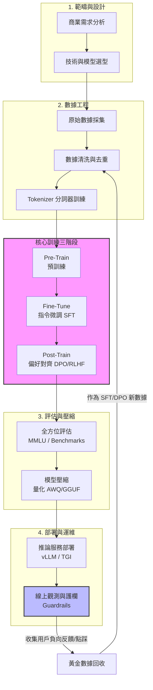

# LLMOps

- TOOL: Google Search - AI Mode

> [!NOTE]
> 可以教我 Pre-Train, Fine-Tune, Post-Train 以外的完整 Life Cycle？

在現代的大型語言模型（LLM）開發中，你提到的 Pre-train、Fine-tune（通常指 SFT）、Post-train（包含 DPO/RLHF 等對齊階段）屬於核心的 **模型訓練（Model Training）** 核心。

但如果要看一個完整的 **LLM 專案生命週期（LLM Project Life Cycle）**，除了訓練本身，還包含了前期的架構設計、數據工程，以及後期的評估、部署與運維。
以下為你拆解這三個階段之外的 **完整 LLM 生命週期**：

## 🗺️ 完整的 LLM 生命週期地圖

```text
1. 範疇與設計 ➡️ 2. 數據工程
➡️ [Pre-Train] ➡️ [Fine-Tune] ➡️ [Post-Train]
➡️ 3. 評估與對齊 ➡️ 4. 壓縮與優化
➡️ 5. 部署與服務 ➡️ 6. 觀測與迭代
```

## 1\. 範疇定義與技術選型 (Scope & Design)

在動手寫代碼或洗數據之前，必須先定義清楚「商業目標」與「技術邊界」。

-   **任務定義**：
    搞清楚 AI 要解決什麼問題（例如：法律文件摘要、客服聊天機器人、代碼生成）。
-   **評估架構（ROI）**：
    評估這個任務真的需要從頭 Pre-train，還是直接用開源模型微調，甚至只需要做 RAG（檢索增強生成）？
-   **計算資源規劃**：
    估算需要多少張 GPU（H100、A100），以及預算的上限。

## 2\. 數據工程與預處理 (Data Engineering)

這是整個生命週期中最耗時、但也最關鍵的一步。**垃圾進，垃圾出（Garbage in, Garbage out）**。

-   **數據採集**：從網頁爬蟲、開源資料集、企業內部資料庫、書籍、代碼庫等地方收集原始文字。
-   **清洗與去重 (Deduplication)**：使用 MinHash 等演算法刪除重複文本；過濾掉亂碼、HTML 標籤、色情暴力或個資（PII）。
-   **分詞器訓練 (Tokenizer Training)**：利用 Byte Pair Encoding (BPE) 等演算法，將文字切成模型看得懂的「Token」，這決定了模型的字典大小與多語言能力。

*（此處切入你提到的：Pre-Train ➡️ Fine-Tune ➡️ Post-Train）*

## 3\. 全方位模型評估 (Evaluation & Benchmarking)

模型訓練完後，不能只憑感覺覺得它變聰明了，必須進行嚴格的量化測試。

-   **自動化基準測試 (Automated Benchmarks)**：
        -   **基礎能力**：
            使用 MMLU（綜合學科）、GSM8K（數學）、HumanEval（程式碼）等標準資料集考試。
        -   **安全與偏見**：
            測試模型在面對惡意引導（Jailbreak）時的防禦能力。
-   **LLM-as-a-Judge**：
    使用更強大的模型（如 GPT-4）來當作裁判，為自家模型的回答盲測評分（如 MT-Bench）。
-   **人工評估 (Human Evaluation / Red Teaming)**：
    聘請領域專家進行「紅隊演練」，故意找漏洞、測試極限，確保安全合規。

## 4\. 模型壓縮與優化 (Quantization & Optimization)

剛訓練完的模型體積龐大（例如 70B 模型需要約 140GB 顯存才跑得動），很難低成本部署。

-   **量化 (Quantization)**：
    將模型的權重從 FP32 或 BF16 壓縮到 INT8、INT4 甚至 INT2（如 AWQ, GPTQ, GGUF 技術），大幅降低顯存佔用，讓邊緣設備（手機、Macbook）也能跑。
-   **剪枝與蒸餾 (Pruning & Distillation)**：
    砍掉模型中不重要的參數，或者用大模型（Teacher）帶小模型（Student）的方式，把知識濃縮進小模型。

## 5\. 部署與推論服務 (Deployment & Serving)

將模型推上線，變成高吞吐、低延遲的 API 服務。

-   **推論加速引擎**：
    使用 **vLLM**、**TGI (Text Generation Inference)** 或 **TensorRT-LLM**。這些引擎內建了 PagedAttention、連續批處理（Continuous Batching）等技術，能讓推論速度提升數倍。
-   **基礎架構**：
    透過 Kubernetes (K8s) 管理 GPU 集群，設定彈性擴縮容（Auto-scaling）。

## 6\. MLOps 監控與持續迭代 (Observability & LLMOps)

模型上線才是真正挑戰的開始，模型在真實世界會遇到各種不可控的狀況。

-   **護欄系統 (Guardrails)**：
    在模型輸入前、輸出後建立一道防火牆（如 NeMo Guardrails），過濾掉用戶的敏感提問或模型的違規回答。
-   **數據漂移監控 (Data Drift)**：
    監控真實用戶輸入的排版與主題是否偏離了原本的訓練數據（例如流行語改變）。
-   **反饋循環 (Feedback Loop)**：
    收集用戶點擊「讚/踩」或修改回答的行為，將這些真實數據回收，作為下一輪 Fine-tune 或 DPO 的黃金資料集。

## 💡 總結

現在業界常說的 **LLMOps（大語言模型運維）**，本質上就是圍繞著這整個生命週期在做自動化管理。模型訓練（那三個階段）決定了模型的**智商上限**，而前後的資料工程、評估與運維，則決定了模型在商業應用上的**落地體驗與成本控制**。

看完這個完整的生命週期，您對哪個特定階段最感興趣呢？例如是**前端的數據清洗去重**，還是**後端的 vLLM 推論加速與量化**？我們可以針對該階段深入探討它的主流工具與工程細節！

> [!NOTE]
> 可以用 Mermaid.js 語法繪製 LLMOps 的系統架構與 Life Cycle 嗎？

這裏為你提供兩張 **Mermaid.js** 圖表，分別呈現 **LLM 生命週期（Life Cycle）** 的線性流向，以及在實際生產環境中 **LLMOps 的系統架構（System Architecture）**。

你可以直接複製這些代碼，貼到支援 Mermaid 的 Markdown 編輯器（如 Notion、Obsidian、GitHub 或 Mermaid Live Editor）中渲染觀看。

## 1\. LLM 完整生命週期流向圖 (Life Cycle)

這張圖呈現了從專案啟動、資料準備、三階段訓練，到最後上線運維的完整生命週期與 **資料/模型反饋閉環**。



## 2\. LLMOps 生產環境系統架構圖 (System Architecture)

這張圖呈現了在企業落地時，各個系統模組（資料湖、訓練集群、推論網關、監控系統）在實際運作時是如何串聯交互的。


## 💡 架構圖焦點解析

1.  **輸入與輸出護欄（Guardrails）**：在用戶請求進入 `vLLM` 推論引擎前，以及模型回答輸出給用戶前，都會先經過 `Guardrails` 進行隱私（PII）、毒性（Toxicity）與惡意提示詞（Jailbreak）的過濾。
2.  **LLMOps 專屬觀測層**：這與傳統 MLOps 不同，這裡使用了如 `LangSmith` 或 `Arize Phoenix` 等專為大模型設計的工具，專門監控 LLM 的**幻覺率（Hallucination）**、**Token 消耗成本**以及**問答上下文漂移**。
