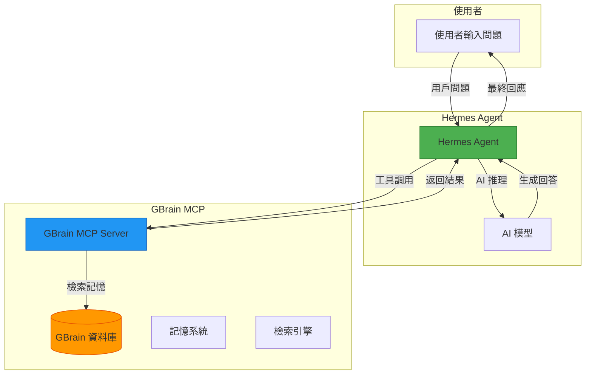
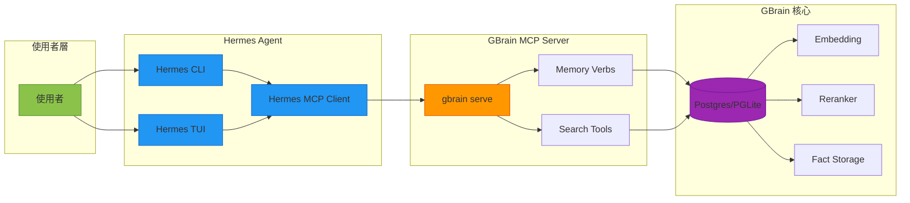

# Hermes Agent 與 GBrain 搭配使用指南

## 總覽

本文件示範如何將 GBrain 記憶系統整合到 Hermes Agent，讓 AI 代理具備共享記憶與知識檢索能力。



## 前置需求

### 系統需求

| 項目 | 版本要求 |
|------|----------|
| 作業系統 | Linux, macOS, Windows (WSL2) |
| Bun | 1.4.4 或更高版本 |
| 記憶體 | 至少 2GB 可用 |
| 硬碟空間 | 至少 3GB |

### 安裝 Bun（如尚未安裝）

```bash
# Linux / macOS
curl -fsSL https://bun.sh/install | bash

# Windows PowerShell
iex (irm https://bun.sh/install.ps1)

# 驗證安裝
bun --version
```

---

## 步驟一：安裝 GBrain

### 1.1 安裝 GBrain CLI

```bash
# 使用 Bun 全球安裝
bun install -g github:garrytan/gbrain#stable

# 驗證安裝成功
gbrain --version
```

### 1.2 初始化 GBrain（使用 PGLite 引擎）

```bash
# 初始化 GBrain（嵌入模式，無需外部資料庫）
gbrain init --pglite --no-embedding

# 或使用 Postgres 引擎（需要外部資料庫）
gbrain init --prefer-postgres --allow-docker
```

### 1.3 建立個人記憶空間

```bash
# 建立個人記憶空間
gbrain init --pglite --no-embedding

# 設定記憶模式（根據需求選擇）
# conservative - 保守模式（4K 上下文，適合成本敏感）
gbrain config set search.mode conservative

# balanced - 平衡模式（12K 上下文，預設推薦）
gbrain config set search.mode balanced

# tokenmax - 最大化模式（無上下文限制）
gbrain config set search.mode tokenmax
```

### 1.4 驗證 GBrain 狀態

```bash
# 檢查 GBrain 健康狀態
gbrain doctor --json

# 查看記憶引擎狀態
gbrain engine status --json
```

---

## 步驟二：安裝 Hermes Agent

### 2.1 一行命令安裝

```bash
# Linux / macOS / WSL2
curl -fsSL https://hermes-agent.nousresearch.com/install.sh | bash
source ~/.bashrc  # 或 source ~/.zshrc

# Windows PowerShell
iex (irm https://hermes-agent.nousresearch.com/install.ps1)
```

### 2.2 驗證 Hermes 安裝

```bash
# 查看版本
hermes --version

# 啟動 TUI 介面測試
hermes --tui
```

---

## 步驟三：整合 GBrain 到 Hermes

### 3.1 註冊 GBrain MCP Server

```bash
# 使用互動式安裝（推薦）
printf 'Y\n' | hermes mcp add gbrain --env GBRAIN_HOME=$HOME --connect-timeout 60 --command $(which gbrain) --args serve --surface starter --advertise verbs

# 或使用手動配置
cat > ~/.hermes/config.yaml << 'EOF'
mcp_servers:
  gbrain:
    command: gbrain
    args:
      - serve
      - --surface
      - full
      - --advertise
      - verbs
    env:
      GBRAIN_HOME: /home/your-username
    connect_timeout: 60.0
    enabled: true
EOF
```

### 3.2 設定 API 金鑰（如需要）

```bash
# 編輯環境變數
nano ~/.hermes/.env

# 加入 AI 模型提供者金鑰
export ANTHROPIC_API_KEY=sk-ant-...
# 或
export OPENAI_API_KEY=sk-...
```

### 3.3 設定預設模型

```bash
# 設定預設模型（非互動式）
hermes config set model.default anthropic/claude-haiku-4.5

# 驗證設定
hermes config get model.default
```

---

## 步驟四：配置 Brain-First 行為

### 4.1 安裝 Brain-First 指令

```bash
# 將 GBrain 檢索規則注入到 Hermes 系統提示
gbrain setup hermes --instructions-only

# 預覽變更（不實際寫入）
gbrain setup hermes --instructions-only --dry-run

# 移除設定（如需要）
gbrain setup hermes --remove
```

### 4.2 編譯核心記憶上下文

```bash
# 將 GBrain 核心記憶編譯為 .hermes.md
gbrain compile-context --target hermes --include-core

# 驗證編譯結果
cat ~/.hermes/.hermes.md
```

---

## 步驟五：驗證整合

### 5.1 檢查 MCP Server 狀態

```bash
# 列出所有已註冊的 MCP Server
hermes mcp list

# 應該看到 gbrain 已啟用
# 檢查項目：gbrain ... ✓ enabled
```

### 5.2 測試 MCP 連接

```bash
# 測試 GBrain MCP 連接
hermes mcp test gbrain

# 應該輸出發現的工具列表
# 例如：recall, remember, entity, search, query 等
```

### 5.3 執行真實 Round-Trip 測試

```bash
# 使用非互動式模式測試
hermes -z "ask my gbrain brain: what did I import most recently?"

# 或直接在 TUI 中測試
hermes
# 輸入：what topics have I researched recently?
```

### 5.4 檢查 Hooks 設定

```bash
# 檢查 shell hooks 是否正確設定
hermes hooks doctor

# 應該看到 pre_llm_call hook 已啟用
```

---

## 步驟六：建立與測試記憶

### 6.1 建立測試記憶

```bash
# 在 GBrain CLI 中建立記憶
gbrain remember "Hermes Agent 是一個開源 AI 代理系統" --entity "AI-Tools"

# 查詢剛剛建立的記憶
gbrain recall "Hermes Agent" --json
```

### 6.2 測試 Hermes 檢索記憶

```bash
# 使用 Hermes 查詢 GBrain
hermes -z "what is Hermes Agent?"

# 應該能從 GBrain 檢索到相關記憶並回答
```

### 6.3 測試複雜查詢

```bash
# 測試多步驟查詢
hermes -z "summarize the GBrain integration process in Chinese"

# 測試實體查詢
hermes -z "what are the key features of GBrain?"
```

---

## 步驟七：進階設定

### 7.1 設定 Cron 任務

```bash
# 建立 GBrain 同步 cron（每 4 小時執行一次）
hermes cron create --name gbrain-sync '0 */4 * * *' 'Run gbrain sync; report only a non-zero exit'

# 建立健康檢查 cron（每天執行）
hermes cron create --name gbrain-alert '17 * * * *' 'Run gbrain doctor --alert --json 2>>~/.gbrain/alert-stderr.log'

# 查看 cron 列表
hermes cron list
```

### 7.2 導入 Markdown 文件

```bash
# 導入個人 Markdown 文件
gbrain import ~/docs/ --no-embed

# 建立索引（啟用語意檢索）
gbrain embed --stale

# 查看導入統計
gbrain stats
```

### 7.3 設定知識圖譜

```bash
# 提取知識圖譜連結
gbrain extract links --source db --dry-run

# 提交連結提取
gbrain extract links --source db

# 提取時間軸
gbrain extract timeline --source db
```

---

## 步驟八：常見問題排解

### 8.1 MCP 連接失敗

```bash
# 檢查 GBrain 是否正在運行
ps aux | grep gbrain

# 手動啟動 GBrain serve
gbrain serve --surface full

# 再次測試 Hermes
hermes mcp test gbrain
```

### 8.2 找不到 GBrain 命令

```bash
# 檢查 Bun 是否在 PATH 中
which bun

# 重新載入 shell 設定
source ~/.bashrc

# 再次檢查 GBrain
which gbrain
```

### 8.3 模型提供者未配置

```bash
# 檢查 .env 檔案
cat ~/.hermes/.env

# 設定 API 金鑰
echo "ANTHROPIC_API_KEY=sk-ant-..." >> ~/.hermes/.env

# 設定預設模型
hermes config set model.default anthropic/claude-haiku-4.5
```

---

## 架構圖



---

## 效能考量

| 設定 | 建議值 | 說明 |
|------|--------|------|
| 搜尋模式 | balanced | 平衡檢索品質與成本 |
| 上下文大小 | 12K tokens | 適合大多數場景 |
| 嵌入模型 | voyage-4 | 高品質語意檢索 |
| 重排序 | rerank-3-lite | 提升檢索準確度 |

---

## 最佳實踐

1. **定期維護**：使用 `gbrain doctor` 檢查系統健康
2. **記憶管理**：使用 `gbrain remember` 管理重要事實
3. **知識庫更新**：定期執行 `gbrain sync` 更新索引
4. **權限設定**：謹慎授予 MCP 工具權限
5. **備份策略**：定期備份 GBrain 資料庫

---

## 參考文檔

- [Hermes Agent 官方文件](https://hermes-agent.nousresearch.com/)
- [GBrain 官方文件](https://gbrain.io/)
- [GBrain MCP 整合](https://github.com/garrytan/gbrain/blob/master/docs/mcp/HERMES.md)
- [GBrain 安裝指南](https://github.com/garrytan/gbrain/blob/master/INSTALL_FOR_AGENTS.md)

---

## 授權

本文件遵循 MIT 授權，與 GBrain 專案相同。
