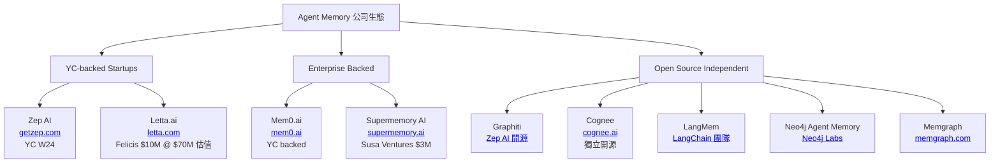
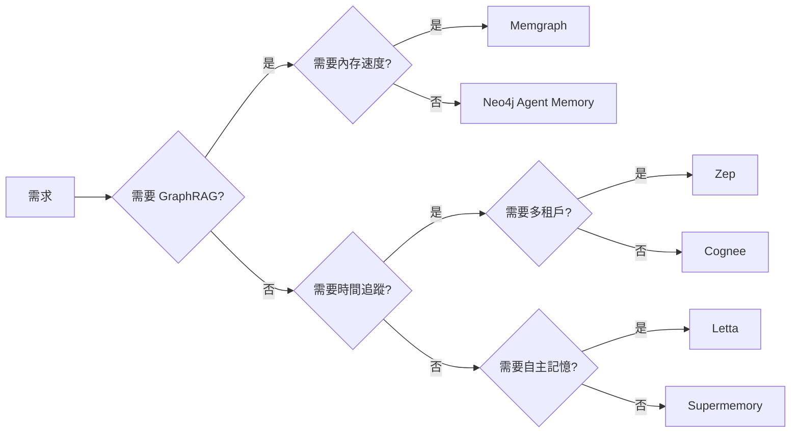

# Mem0 替代方案比較 (2026)

> 最後更新：2026-11-24  
> 討論 Agent Memory 技術與儲存格式，除了 Mem0 以外有哪些選擇，以及 GraphRAG 支援度

---

## 📌 目錄

- [執行摘要](#-執行摘要)
- [主流 Agent Memory 技術總覽](#主流-agent-memory-技術總覽)
- [Side-by-Side 比較表](#side-by-side-比較表)
- [公司與商業背景](#公司與商業背景)
- [技術堆疊詳細分析](#技術堆疊詳細分析)
- [GraphRAG 支援度分析](#graphrag-支援度分析)
- [推薦選擇指南](#推薦選擇指南)

---

## 📌 執行摘要

本文整理了目前聲量最高的 Agent Memory 技術與儲存格式，除了 **Mem0** 以外的主流替代方案。主要發現如下：

1. **Zep** 與 **Letta** 是目前 Mem0 之外最熱門的開源選擇
2. **Neo4j Agent Memory** 與 **Memgraph** 是 GraphRAG 的最佳支援者
3. **Zep** 的雙時態追蹤讓它在時間線推理場景中表現突出
4. **Letta** 適合需要 Agent 自主學習的長期任務
5. **Supermemory** 與 **Cognee** 提供完整的開源圖庫 + 向量混合解決方案

---

## 主流 Agent Memory 技術總覽

### 1. Zep ⭐ 最熱門替代方案

**Zep** 是目前 Mem0 之外最受歡迎的替代方案，提供統一的上下文層給企業 AI 應用。

- **架構**: 時序知識圖譜 (Temporal Knowledge Graph)
- **儲存格式**: 圖庫 (Neo4j/FalkorDB/Neptune) + 向量嵌入
- **特色**:
  - 支援 `valid_at` / `invalid_at` 每個事實的時間有效性追蹤
  - 雙時態 (bi-temporal) 追蹤 - 知道事實何時成立、何時失效
  - 純圖遍歷 + RRF (Reciprocal Rank Fusion) 檢索，無需額外 LLM 呼叫
- **適合**: 需要追蹤事實變化、時間線推理的場景
- **授權**: MIT

### 2. Letta (MemGPT) 🏆 最完整狀態管理

**Letta** 由前 MemGPT 團隊創立，專注於讓 Agent 自主管理記憶。

- **架構**: Agent 自主管理記憶，支援編輯與重組
- **儲存格式**: SQLite + 向量存儲
- **特色**:
  - Agent 有自己記憶編輯權限
  - 低讀取成本 (Tool calls, no LLM in core)
  - 原生 LangGraph 整合 (LangMem)
- **適合**: 需要 Agent 自主學習、長期任務執行的場景
- **授權**: Apache 2.0

### 3. Graphiti 📊 圖庫導向

**Graphiti** 由 Zep AI 開發，專注於時序知識圖譜。

- **架構**: 時序知識圖譜 (基於 Neo4j)
- **儲存格式**: Neo4j 圖庫
- **特色**:
  - 實驗性 MCP Server
  - 純圖庫遍歷檢索
  - 支援時間軸追蹤
- **適合**: 複雜關係追蹤、企業知識圖譜整合
- **授權**: MIT
- **注意**: 圖記憶功能從開源 SDK 移除，僅在 Platform 的 Custom 計劃提供

### 4. Supermemory ⚡ 快速記憶引擎

**Supermemory** 提供高速的記憶與上下文引擎。

- **架構**: 記憶 + 上下文引擎
- **儲存格式**: 時序向量圖 (Temporal Vector-Graph)
- **特色**:
  - 高語義召回 (XERJ 測試：94.7% 頂 5 命中率)
  - MIT 授權
  - 自動化事實處理
- **適合**: 需要快速檢索、高準確度召回
- **授權**: MIT

### 5. Cognee 📚 文件圖譜

**Cognee** 專注於文件圖譜與企業知識庫。

- **架構**: 文件圖譜引擎
- **儲存格式**: 圖庫 (Kùzu/Memgraph/Neo4j) + 向量 (LanceDB/Qdrant)
- **特色**:
  - 支援文件圖譜
  - 完整歷史追蹤
  - 內建 MCP Server
- **適合**: 文檔管理、企業知識庫
- **授權**: MIT

### 6. LangMem 🔄 原生 LangGraph 整合

**LangMem** 是 LangChain 團隊推出的記憶管理工具。

- **架構**: 記憶管理 SDK
- **儲存格式**: 可與任何儲存系統搭配
- **特色**:
  - 原生 LangGraph 整合
  - 提供核心 API 與儲存層
- **適合**: LangGraph 用戶
- **授權**: MIT

### 7. Neo4j Agent Memory 🌐 原生 GraphRAG

**Neo4j Agent Memory** 是 Neo4j Labs 的官方記憶解決方案。

- **架構**: 原生知識圖譜
- **儲存格式**: Neo4j 圖庫
- **特色**:
  - 原生支援 GraphRAG
  - 儲存對話、實體、推理過程
  - Python/TypeScript 客戶端
- **適合**: GraphRAG、複雜關係追蹤
- **授權**: Apache 2.0

### 8. Memgraph 🚀 內存圖庫

**Memgraph** 是專為 AI 記憶設計的內存圖庫。

- **架構**: 內存圖庫 + 向量搜尋
- **儲存格式**: Memgraph (內存) + usearch (向量)
- **特色**:
  - 內存架構，一致性與可預測的回應時間
  - 內建向量搜尋 (usearch)
  - 支援 GraphRAG 工作負載
- **適合**: 低延遲需求、GraphRAG
- **授權**: Apache 2.0

---

## Side-by-Side 比較表

| 特性 | **Mem0** | **Zep** | **Letta** | **Supermemory** | **Graphiti** | **Cognee** | **LangMem** | **Neo4j Agent Memory** | **Memgraph** |
|------|----------|---------|-----------|-----------------|--------------|------------|-------------|------------------------|--------------|
| 🔍 **背後公司** | Mem0.ai (YC-backed) | Zep AI (YC W24) | Letta.ai (Felicis $10M) | Supermemory AI (Susa Ventures $3M) | Zep AI (開源) | 獨立開源 (topoteretes) | LangChain 團隊 | Neo4j Labs | Memgraph Inc. |
| 🌐 **官網** | [mem0.ai](https://mem0.ai) | [getzep.com](https://getzep.com) | [letta.com](https://letta.com) | [supermemory.ai](https://supermemory.ai) | [github.com/getzep/graphiti](https://github.com/getzep/graphiti) | [cognee.ai](https://cognee.ai) | [langchain.ai/langmem](https://langchain.ai/langmem) | [neo4j.com/labs/agent-memory](https://neo4j.com/labs/agent-memory/) | [memgraph.com](https://memgraph.com) |
| 💰 **授權** | Apache 2.0 | MIT | Apache 2.0 | MIT | MIT | MIT | MIT | Apache 2.0 | Apache 2.0 |
| 🛠️ **主要語言** | Python / TypeScript | Python / Go | Python | Python / TypeScript | Python | Python | Python | Python | C++ / Python |
| 🗄️ **儲存格式** | PostgreSQL + pgvector<br>Neo4j (圖記憶已移除 OSS) | Neo4j/FalkorDB/Neptune<br>+ 向量 | SQLite + 向量存儲 | 自訂圖 + 向量引擎 | **Neo4j 圖庫** | Kùzu/Memgraph/Neo4j<br>+ LanceDB/Qdrant | 自訂圖 + 向量 | Neo4j + Vector | **內存圖庫**<br>+ usearch 向量 |
| 📂 **GraphRAG 支援** | ⚠️ 圖記憶從 OSS 移除<br>僅 Platform Custom 計劃 | ✅ 雙時態知識圖譜 | ✅ 內建圖支援 | ✅ 圖 + 向量混合 | ✅ **原生 Neo4j 圖庫** | ✅ 圖 + 向量混合 | ⚠️ 需自訂整合 | ✅ **原生 GraphRAG** | ✅ **GraphRAG 最佳** |
| ⚡ **檢索方式** | 向量搜尋 + 實體提升 | 圖遍歷 + RRF<br>(無 LLM) | 向量 + 圖 | 時序向量圖 | 圖 + 向量混合 | 圖 + 向量混合 | 向量搜尋 | 圖 + 向量 | **內存圖 + 向量** |
| 🕐 **時態追蹤** | ❌ 無 | ✅ **雙時態** (valid_at/invalid_at) | ❌ 單一時間軸 | ✅ 時序圖 | ✅ 時序圖 | ✅ 時序圖 | ❌ 需自訂 | ❌ 無 | ✅ 時序支援 |
| 🏢 **多租戶** | ✅ 完整支援<br>(org/project/user) | ✅ 支援 | ⚠️ 需自訂 | ✅ 企業級 | ⚠️ 需自訂 | ✅ 支援 | ⚠️ 需自訂 | ⚠️ 需自訂 | ✅ 支援 |
| 📦 **部署選項** | Self-hosted (Docker)<br>Cloud | Cloud<br>Self-hosted | Cloud<br>Self-hosted | Self-hosted<br>Cloud | Self-hosted<br>Cloud | Self-hosted<br>Cloud | Self-hosted | Self-hosted<br>Cloud | Self-hosted<br>Cloud |
| 🚀 **特色能力** | 自動事實提取<br>去重 | **事實失效追蹤**<br>點在時間查詢 | **Agent 自主記憶**<br>編輯權限 | 94.7% 召回率<br>自動化遺忘 | 時序知識圖譜 | 企業知識庫<br>MCP 整合 | LangGraph 原生 | 原生 GraphRAG | **內存圖庫**<br>usearch 向量 |

---

## 公司與商業背景

### 🏢 公司詳細資訊



### 💰 融資與投資情況

| 公司 | 融資階段 | 金額 | 主要投資者 |
|------|---------|------|-----------|
| **Zep AI** | Series A | - | YC W24 |
| **Letta.ai** | Seed | $10M | Felicis, Google Jeff Dean, HuggingFace Clem Delangue, Runway |
| **Supermemory AI** | Seed | ~$3M | Susa Ventures, Browder Capital, SF1.vc |
| **Mem0.ai** | - | - | YC backed |
| **Graphiti** | - | - | Zep AI 開源項目 |
| **Cognee** | - | - | 獨立開源 |
| **LangMem** | - | - | LangChain 團隊 |
| **Neo4j Agent Memory** | - | - | Neo4j Labs |
| **Memgraph** | - | - | Memgraph Inc. |

---

## 技術堆疊詳細分析

### 1. Zep AI 🇨🇦

```
┌─────────────────────────────────────────────────────────┐
│  底層程式語言：Python / Go / TypeScript                 │
│  後端框架：FastAPI / Microservices                       │
│  雲端架構：AWS / Kubernetes / PostgreSQL                 │
│  儲存格式：Neo4j/FalkorDB/Neptune + 向量嵌入             │
└─────────────────────────────────────────────────────────┘
```

**主要技術細節**:
- 使用 Go 寫微服務後端
- Python 提供 API 層與整合
- 支援 Neo4j、FalkorDB、Neptune 等圖庫
- 內建自訂向量搜尋
- 支援 SOC 2 Type II + HIPAA 合規

### 2. Letta (MemGPT) 🇺🇸

```
┌─────────────────────────────────────────────────────────┐
│  底層程式語言：Python                                    │
│  後端框架：FastAPI / LangChain                           │
│  儲存格式：SQLite + 向量存儲 (FAISS/Chroma 等)           │
│  架構：Agent 自主管理記憶                                │
└─────────────────────────────────────────────────────────┘
```

**主要技術細節**:
- 由前 MemGPT 團隊開發
- 支援 Agent 自主記憶管理
- 提供記憶編輯工具
- 內建 LangGraph 整合

### 3. Supermemory AI 🇺🇸

```
┌─────────────────────────────────────────────────────────┐
│  底層程式語言：Python / TypeScript                       │
│  自訂技術：自訂學習模型 + 自訂圖庫引擎                    │
│  儲存格式：時序向量圖 (Temporal Vector-Graph)            │
│  特色：內建公司大腦 (Company Brain)                     │
└─────────────────────────────────────────────────────────┘
```

**主要技術細節**:
- 自訂學習模型決定記憶內容
- 自訂時序圖庫引擎
- 支援 100k+ 組織、十億 monthly tokens
- 提供 REST API、MCP Server、SDK

### 4. Cognee 🌍

```
┌─────────────────────────────────────────────────────────┐
│  底層程式語言：Python 3.10-3.14                          │
│  後端框架：FastAPI (port 8000)                           │
│  前端框架：Next.js (TypeScript, port 3000)              │
│  圖庫：Kùzu/Memgraph/Neo4j/PostgreSQL                   │
│  向量庫：LanceDB/Qdrant/PGVector/Weaviate/Milvus        │
│  實體抽取：GLiNER (內建) / spaCy / HuggingFace          │
│  部署：Docker / Docker Compose                          │
└─────────────────────────────────────────────────────────┘
```

**主要技術細節**:
- 完整圖庫 + 向量混合架構
- 內建 GLiNER 實體抽取模型
- 支援 MCP Server
- 提供 Web Dashboard

### 5. Graphiti 🇨🇦

```
┌─────────────────────────────────────────────────────────┐
│  底層程式語言：Python                                    │
│  後端框架：FastAPI (REST) / MCP Server                  │
│  圖庫：**Neo4j** (原生) / FalkorDB                       │
│  特色：時序知識圖譜 (Bi-temporal)                        │
│  查詢：Cypher + 向量搜尋                                │
└─────────────────────────────────────────────────────────┘
```

**主要技術細節**:
- 原生 Neo4j 圖庫整合
- 時序知識圖譜 (Bi-temporal)
- 支援 Cypher 查詢語言
- 實驗性 MCP Server

### 6. Memgraph 🚀

```
┌─────────────────────────────────────────────────────────┐
│  底層程式語言：C++ (核心) / Python (客戶端)             │
│  架構：內存圖庫 + usearch 向量引擎                       │
│  查詢語言：Cypher (openCypher 相容)                      │
│  特色：內存圖庫，一致性與低延遲                          │
└─────────────────────────────────────────────────────────┘
```

**主要技術細節**:
- 內存架構，一致性與可預測的回應時間
- 內建 usearch 向量搜尋引擎
- 支援 GraphRAG 工作負載
- 完整的 Cypher 相容性

---

## GraphRAG 支援度分析

### ✅ 完全支援 GraphRAG 的記憶系統

1. **Neo4j Agent Memory** ⭐
   - 原生支援 GraphRAG
   - 儲存對話、實體、推理過程
   - Python/TypeScript 客戶端
   - 支援 Bolt 直接連線

2. **Memgraph** 🚀
   - Context Graph 作為 AI 記憶
   - 內建向量搜尋 (usearch)
   - 高速回應時間
   - 支援 GraphRAG 工作負載

3. **Zep + Graphiti** 🔄
   - 時序知識圖譜
   - 支援圖庫 + 向量混合
   - 可與 GraphRAG 框架整合

4. **recon-graphrag** 🔌
   - 支援 Neo4j 和 Memgraph 的插拔式圖存儲
   - 遵循 Microsoft GraphRAG 哲學
   - 可替換後端圖存儲

### ⚠️ Mem0 的 GraphRAG 支援

- **開源版**: v2→v3 遷導中移除了圖記憶支援
- **平台版**: 圖記憶僅在 Custom 計劃中提供
- **現狀**: 圖記憶功能從開源 SDK 移除了

### 📊 GraphRAG 記憶體使用建議

```
記憶體需求 = 索引節點數 × Embedding 維度

例如：
100 萬節點 × 768 維 = 768 MB 向量儲存
```

---

## 推薦選擇指南

### 根據需求選擇



### 最佳實踐搭配

| 場景 | 推薦組合 | 原因 |
|------|---------|------|
| **GraphRAG 企業級** | Neo4j Agent Memory + Memgraph | 原生 GraphRAG 支援 + 內存速度 |
| **時間線追蹤** | Zep (Neo4j) | 雙時態追蹤 + 圖庫 |
| **快速部署** | Cognee | 開源 + 完整圖庫 + 向量 + 前端 |
| **多租戶 SaaS** | Zep Cloud | 完整多租戶支援 |
| **Agent 自主學習** | Letta | Agent 自主記憶管理 |
| **低成本開源** | Supermemory | MIT 授權 + 自訂引擎 |

---

## 📋 完整技術規格比較表

| 技術 | 程式語言 | 主要框架 | 圖庫 | 向量庫 | 關聯 DB | 前端 | 容器化 |
|------|---------|---------|------|--------|--------|------|--------|
| **Mem0** | Python/TS | FastAPI | Neo4j | pgvector | PostgreSQL | - | ✅ Docker |
| **Zep** | Python/Go | FastAPI | Neo4j/FalkorDB | - | PostgreSQL | React/Vue | ✅ Docker |
| **Letta** | Python | LangChain | - | FAISS/Chroma | SQLite | - | ✅ Docker |
| **Supermemory** | Python/TS | - | 自訂引擎 | 自訂引擎 | PostgreSQL | React | ✅ Docker |
| **Graphiti** | Python | FastAPI | **Neo4j** | - | - | - | ✅ Docker |
| **Cognee** | Python | FastAPI | Kùzu/Memgraph | LanceDB | PostgreSQL | Next.js | ✅ Docker |
| **LangMem** | Python | - | - | - | LangGraph | - | - |
| **Neo4j AM** | Python/TS | - | **Neo4j** | - | - | - | ✅ Docker |
| **Memgraph** | Python | - | **Memgraph** | usearch | - | - | ✅ Docker |

---

## 🔥 關鍵洞察

1. **GraphRAG 最佳選擇**：**Neo4j Agent Memory** 和 **Memgraph** 是 GraphRAG 的原生支援者，內建圖庫 + 向量混合搜尋

2. **時間追蹤冠軍**：**Zep** 的雙時態 (bi-temporal) 追蹤是唯一提供 `valid_at` / `invalid_at` 的系統，適合追蹤事實變化

3. **開源友好**：**Supermemory** (MIT)、**Cognee** (MIT)、**Letta** (Apache 2.0) 都是開源選擇

4. **商業支援**：**Letta.ai** ($10M)、**Zep AI** (YC)、**Supermemory** ($3M) 有明確融資

5. **Graphiti 注意**：圖記憶功能從開源版移除，僅在 Platform 的 Custom 計劃提供

6. **Mem0 現況**：圖記憶功能從開源版移除，建議考慮其他 GraphRAG 支援方案

---

## 📚 參考資源

- [Agent Memory Techniques Comparison](https://github.com/NirDiamant/Agent_Memory_Techniques)
- [Agent Memory Systems Comparative Atlas](https://neoneye.github.io/agent-memory-atlas/)
- [Mem0 Alternatives 2026](https://xerj.org/compare/mem0-alternatives-2026)
- [AI Agent Memory Systems: 28 Compared](https://aimemorybenchmark.com/systems)

---

*本文內容基於 2026 年 11 月的最新資料整理，技術發展快速，建議定期檢視官方文件。*
